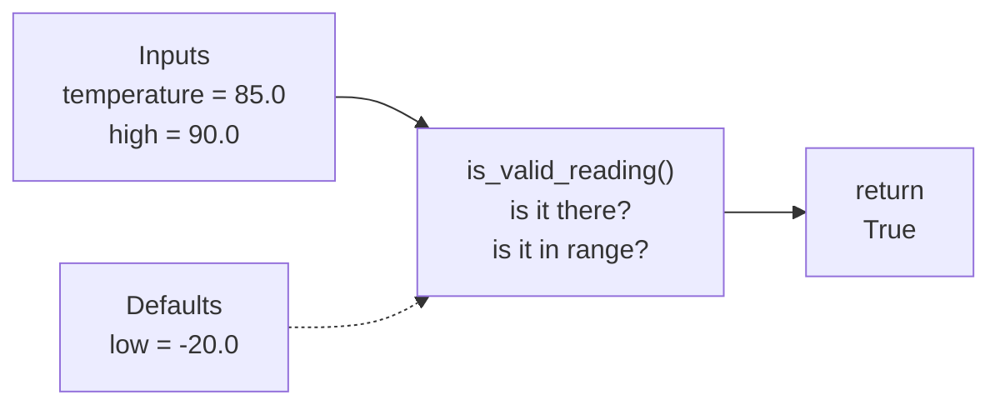

# Functions: Turn a Check into a Tool You Can Test and Reuse

A **function** is a piece of work with a name. You write it once with `def`, then use it anywhere by calling its name. Test code is full of them: a function that checks a reading, one that builds fake test data, one that writes a report line. Functions keep your tests short, and a function that returns a value can be tested on its own.

!!! note "Before you start"
    You need Python 3.13 and the lesson on [conditions and loops](conditions-and-loops.md). The example file is `examples/functions_demo.py`.

## Why testers need this

In the [last lesson](conditions-and-loops.md), the range check `-20 <= temperature <= 60` sat inside a loop. Now three tests need the same check: the device API test, the dashboard test and the CSV import test. If each test copies the line, and the rule changes to `-25`, you must find and fix every copy. If one is missed, a test checks the old rule and still passes.

A function fixes this. The rule lives in one place, every test calls it, and a change is one edit.

## How it works

Values go in through the **parameters**. The function does its work. One value comes out with `return`.



*You pass in what changes between calls. Parameters with a default (`low`) can be left out. The function hands back one result with `return`.*

## The code

```python title="examples/functions_demo.py"
--8<-- "modules/start_here/python_for_testers/examples/functions_demo.py"
```

From the `examples` folder, run:

```bash
python functions_demo.py
```

```text
True False False
True
{'id': 'SNS-0042', 'status': 'online', 'battery': 100}
{'id': 'SNS-0043', 'status': 'online', 'battery': 5}
PASS: SNS-0042 answered 200 in 0.45s
FAIL: SNS-0043 expected 200, got 503
FAIL: SNS-0044 took 2.4s (limit 1.0s)
[report] 3 devices checked
None
True False True
```

## Line by line

**The first function.**

- `def is_valid_reading(temperature, low=-20.0, high=60.0)` makes a function. `temperature`, `low` and `high` are its **parameters**: names for the values you pass in. `low` and `high` have **default values**, so callers can leave them out.
- `float | None` and `-> bool` are **type hints**. They say "a float or None goes in, a bool comes out". Python does not enforce them, but your editor uses them to warn you about mistakes, and readers see at once what the function expects.
- The text in triple quotes is the **docstring**. It says what the function does in one sentence. Editors show it when you hover over the name.
- `return False` ends the function at once and hands back `False`. The line after it does not run for a missing reading.

**Calling the functions.**

- `is_valid_reading(85.0)` uses the defaults, so 85.0 is out of range: `False`. `is_valid_reading(85.0, high=90.0)` changes one default by name, so the same reading is valid: `True` (line 2 of the output). Naming the value (`high=90.0`) makes the call easy to read.
- `make_device("SNS-0043", battery=5)` is a **test data builder**. It gives a full, valid device, and the test changes only the field it cares about. A low-battery test says `battery=5` and nothing else.
- `check_response(...)` has three parameters you must give, and two with defaults. It has two `return` lines for the two ways to fail, and one for the pass. Each return gives a ready-made line for the test report.

**`return` versus `print`.**

- `log_result()` prints a line, but has no `return`. A function without `return` gives back `None`. That is why `print(returned)` shows `None`.
- Use `print` to show something to a person. Use `return` to hand a value to the code that called you. A check that only prints can't be used in an `assert` or an `if`.

**Testing the function.**

- The last line tries the **edges** of the range: exactly 60.0 (valid), just above it (not valid), and exactly -20.0 (valid). Bugs hide at edges, so a good test always tries them. Because the function returns a value, checking it is one line.

## How it is used in a real QA project

- **Shared checks.** Rules like "valid reading", "valid email" or "price in range" live in one function. Every test uses it.
- **Test data builders.** Functions like `make_device()` or `make_user()` build fake data with safe defaults. See [test data factories](../automation-testing/data-driven/test-data-factories.md) for the bigger version.
- **Fixtures.** In pytest, [fixtures](../automation-testing/pytest/fixtures-and-conftest.md) are functions that prepare what a test needs, like a logged-in user or a clean database.
- **Tests are functions too.** Every pytest test is a function whose name starts with `test_`. In [tests and asserts](../automation-testing/pytest/tests-and-asserts.md), you call your helper and check its result with `assert`.
- **Page objects and API clients** are groups of functions, one per action, such as `login()` or `get_device()`. [Object-oriented programming](object-oriented-programming.md) shows how to group them.

## Your task

Open `exercises/ex04_functions.py`. Replace each `raise` line with your code:

1. `make_user(name, role="customer")`: return a dictionary with `name`, `role` and `email`. The email is the name plus `@example.com`.
2. `percent(part, whole)`: return the percentage, rounded to 1 decimal. Return `0.0` when `whole` is 0, so you never divide by zero.
3. `battery_ok(device, minimum=20)`: return `True` when the device's `"battery"` is at least `minimum`. A missing battery value is `False`.

From the `exercises` folder:

```bash
python -m pytest tests/test_ex04_functions.py
```

All 7 tests pass when your answers are right.

??? success "Solution"
    ```python
    --8<-- "modules/start_here/python_for_testers/solutions/ex04_functions.py"
    ```

    - `f"{name}@example.com"` builds the email. `example.com` is a domain kept for examples, so fake emails never reach a real person.
    - In `percent`, the check for 0 comes first and returns early. Then the division below it is always safe.
    - In `battery_ok`, `.get("battery")` gives `None` for a missing value, and the `if` handles it before the comparison.

## When it goes wrong

These are real messages from Python 3.13.

**You left out a value the function needs.**

```text
TypeError: check_response() missing 1 required positional argument: 'seconds'
```

The function has a parameter without a default, and the call did not give it. Read the name at the end of the message and pass that value.

**You misspelled a parameter name.**

```text
TypeError: make_device() got an unexpected keyword argument 'battry'
```

The function has no parameter with that name. Check the spelling against the `def` line.

**You forgot `return`.**

```text
TypeError: unsupported operand type(s) for +: 'NoneType' and 'int'
```

The function did its work but did not `return` the result, so it gave back `None`. Then `None + 1` failed. Add `return` in front of the result.

**You forgot the brackets when calling.** `if is_valid_reading:` is always true, and `print(is_valid_reading)` shows something like this:

```text
<function is_valid_reading at 0x1014d94e0>
```

(The number changes every run.) Without `()`, you get the function itself, not its result. Call it: `is_valid_reading(21.5)`.

## References

- [Python tutorial: defining functions](https://docs.python.org/3/tutorial/controlflow.html#defining-functions)
- [Python tutorial: default argument values and keyword arguments](https://docs.python.org/3/tutorial/controlflow.html#default-argument-values)
- [Python docs: type hints (typing)](https://docs.python.org/3/library/typing.html)
- [PEP 257: docstring conventions](https://peps.python.org/pep-0257/)

Written for Python 3.13. Links checked: November 2026.
