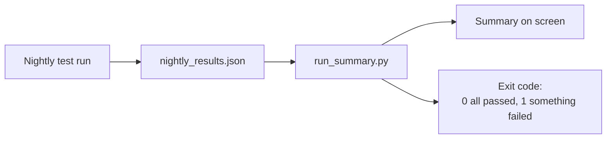

# Python for Testers: Just Enough Python to Write Real Tests and Tools

You don't need to be a software developer to write good tests, but you do need to read and write everyday Python. Tests are small programs. So are the helper scripts testers write all the time: summarise a test run, compare two API responses, check a CSV export. This topic teaches the Python that shows up in that work, and nothing that doesn't.

!!! info "In plain words"
    Learning Python for testing is like learning enough of a language to live in a new country. You don't need poetry. You need to read signs, ask for things, and understand the answer.
    Every lesson here is one of those everyday sentences.

!!! example "Your task"
    The nightly test run saves its results as a JSON file. Every morning someone opens it and counts the failures by hand. Your lead asks: "Can you write a small script that tells us what failed, and which tests are slow?"
    This page builds that script, and each lesson teaches one piece of it.

!!! note "Before you start"
    You need Python 3.11 or newer. If it isn't installed, see [Environment setup](../getting-started/environment-setup/index.md), or the official [Python downloads](https://www.python.org/downloads/) page.
    Run the examples from the `examples` folder of this topic.

## Jump to what you need

Work through them in order if Python is new to you. Each one takes 20 to 30 minutes, with an exercise.

1. [Variables and types](variables-and-data-types.md): text, numbers, True and False, and why `"30"` isn't `30`
2. [Strings, lists and dictionaries](lists-tuples-sets-and-dictionaries.md): the three shapes most test data comes in
3. [If and loops](conditions-and-loops.md): make decisions, and do the same check many times
4. [Functions](functions.md): name a piece of work, so you can test it and use it again
5. [Modules and imports](modules-and-imports.md): use dates, paths and JSON from the standard library
6. [Classes and objects](object-oriented-programming.md): the idea behind page objects and API clients
7. [Errors and exceptions](exception-handling.md): read a traceback, and handle what can go wrong
8. [Reading and writing files](file-handling.md): test data, CSV files and reports
9. [JSON](json.md): the format of almost every API response
10. [Virtual environments and pip](virtual-environments-and-pip.md): install tools for one project, without breaking another
11. [Reading other people's code](reading-other-peoples-code.md): find your way around a test suite you didn't write

## 1. Understand the ask

| You ask | Your lead answers |
| --- | --- |
| Where is the results file? | `nightly_results.json`, saved by the pipeline every night |
| What do you want to see? | How many passed and failed, what failed and why, the slowest tests |
| Who will run it? | The pipeline, and anyone on the team |
| Does it need to stop the pipeline? | Yes: if something failed, it should end with an error code |

## 2. Picture the system



## 3. Learn just enough

You need [dictionaries and lists](lists-tuples-sets-and-dictionaries.md) (the file is a list of tests), [loops](conditions-and-loops.md) (to count them), [JSON](json.md) (to read the file) and [functions](functions.md) (to keep it testable). Start with those four lessons if you're short of time.

## 4. Get something running

Look at the shape of the data first. Here's the start of the file:

```json
{
  "run": "nightly 2026-11-16",
  "tests": [
    {"name": "test_login_with_right_password", "outcome": "passed", "seconds": 0.41},
    {"name": "test_search_in_bengali", "outcome": "failed", "seconds": 0.47,
     "message": "assert 0 == 2 (no results for 'বই')"},
```

A dictionary with a `"tests"` list, and each test is a dictionary with a name, an outcome and a time. Once you see the shape, the code almost writes itself: load it, loop over the tests, count.

## 5. Decide what to put in

The lead asked for three things: counts, failures with their message, and the slowest tests. Skipped tests count too, so a skipped PayPal test isn't hidden. Keep the output short enough to read in ten seconds.

## 6. Write a one-page plan

For a small script, the plan is a few lines in the docstring at the top: what it does, how to run it, what the input looks like, and what the exit codes mean. The [run summary starter](#templates) shows that docstring.

## 7. Build in small steps

Build it one piece at a time, running it after each step: load the file and print the number of tests; then count outcomes; then list failures; then the slowest tests. When it's done:

```bash
python run_summary.py nightly_results.json
```

```text
Run: nightly 2026-11-16
12 tests: 2 failed, 9 passed, 1 skipped (75.0% passed)
Total time: 13.6 seconds

Failed:
- test_search_in_bengali: assert 0 == 2 (no results for 'বই')
- test_refund_day_31: assert None == 'Refunds are possible up to 30 days after delivery'

Slowest 3:
-  5.20 s  test_checkout_journey
-  3.85 s  test_invoice_pdf
-  2.10 s  test_admin_ships_order
```

It ends with exit code 1, because two tests failed. The pipeline sees that and marks the run red.

## 8. Report and get feedback

Share it with one line: "`python run_summary.py nightly_results.json` prints the summary, and fails the job if a test failed." Then watch what people ask for next ("can it post to the team channel?"). That's how small scripts grow into team tools.

## 9. Keep learning on your own

Next, go to the [pytest framework](../automation-testing/pytest/index.md) topic, where you'll write real tests with the Python from here. The official [Python tutorial](https://docs.python.org/3/tutorial/index.html) is excellent when you want more depth on any lesson.

!!! tip "How an experienced SDET thinks about this"
    - Look at the data before writing code. Print it, read its shape, then decide.
    - Run your code after every few lines. Small steps mean small mistakes.
    - Put the work in functions, so a test can check them without running the whole script.
    - Copy the error message into a search engine exactly. Someone has had it before.

!!! warning "Red flags"
    - Copying code you don't understand, and changing it until it seems to work.
    - Installing packages without a virtual environment.
    - Scripts that only print, and never return an exit code, so the pipeline can't tell if they failed.
    - Real passwords or tokens typed into a script.

!!! question "Stuck? Try this"
    - **You don't understand an error.** Read the last line of the traceback first: it says what went wrong. The line above it says where. See [Errors and exceptions](exception-handling.md).
    - **You don't know what a value is.** Print it, and its type: `print(repr(value), type(value))`. Most beginner bugs are a value that isn't what you thought.
    - **The code is too big to understand.** Copy the smallest part into a new file and run that alone.
    - **You've tried for 30 minutes.** Ask for help, with the code, the exact error, and what you've already tried. See [When to ask for help](../working-as-a-qa/learning-a-new-area/when-to-ask-for-help.md).

## Templates

**Every file is below, ready to copy.** The whole folder is also [on GitHub](https://github.com/myopensdet/myopensdet.github.io/tree/main/modules/start_here/python_for_testers/templates).

Copy these into your own project. Each file starts with a line that says where it came from.

=== "run_summary.py"

    ```python
    --8<-- "modules/start_here/python_for_testers/templates/run_summary.py"
    ```

=== "compare_json.py"

    ```python
    --8<-- "modules/start_here/python_for_testers/templates/compare_json.py"
    ```

=== "script_starter.py"

    ```python
    --8<-- "modules/start_here/python_for_testers/templates/script_starter.py"
    ```

=== "How to use them"

    1. **run_summary.py:** point it at your own results file. If your tool saves a different shape, change `load_tests()` only.
    2. **compare_json.py:** compare an expected API response with the real one. Use `--ignore` for values that change every time, like IDs and dates. The [JSON lesson](json.md) shows it in use.
    3. **script_starter.py:** copy it whenever you start a new helper script. It already has arguments, a clear error for a missing file, and exit codes.
    4. **The exercises:** in the `exercises` folder, fill in each function, then run `python -m pytest` there. The answers are in `solutions`, but try first.

## Official resources

- [The Python Tutorial](https://docs.python.org/3/tutorial/index.html): the official introduction, very good for going deeper
- [The Python Standard Library](https://docs.python.org/3/library/index.html): everything that comes with Python, like `json`, `csv`, `pathlib` and `datetime`
- [Python downloads](https://www.python.org/downloads/)
- [pytest: Get started](https://docs.pytest.org/en/stable/getting-started.html): for running the exercises

## All lessons in this category

<!-- BEGIN topics (generated by scripts/build_nav.py, do not edit by hand) -->

<div class="zts-topics zts-order" markdown>

1.  [**Variables and data types**](variables-and-data-types.md)

    Store an API check in variables, and pick the right type for each value.

    <span class="zts-chip">Beginner</span>

2.  [**Lists, tuples, sets and dictionaries**](lists-tuples-sets-and-dictionaries.md)

    Results in a list, fixed rules in a tuple, missing items with a set, API data in a dictionary.

    <span class="zts-chip">Beginner</span>

3.  [**Conditions and loops**](conditions-and-loops.md)

    Judge a result with if, check every reading with for, and retry with a limit.

    <span class="zts-chip">Beginner</span>

4.  [**Functions**](functions.md)

    Give a check a name, so you can test it and use it in every test.

    <span class="zts-chip">Beginner</span>

5.  [**Modules and imports**](modules-and-imports.md)

    Use dates, paths and JSON from the standard library, and your own files.

    <span class="zts-chip">Beginner</span>

6.  [**Object-oriented programming**](object-oriented-programming.md)

    Bundle data and actions together: the idea behind page objects and API clients.

    <span class="zts-chip">Beginner</span>

7.  [**Exception handling**](exception-handling.md)

    Read a traceback fast, and handle what can go wrong.

    <span class="zts-chip">Beginner</span>

8.  [**File handling**](file-handling.md)

    Read test data and CSV files, write reports, and keep Bengali text safe.

    <span class="zts-chip">Beginner</span>

9.  [**JSON**](json.md)

    Read and write JSON, and compare an expected API response with the real one.

    <span class="zts-chip">Beginner</span>

10.  [**Virtual environments and pip**](virtual-environments-and-pip.md)

    Give each project its own Python packages, and pin their versions.

    <span class="zts-chip">Beginner</span>

11.  [**Reading other people's code**](reading-other-peoples-code.md)

    Find your way around code you didn't write: predict, run, and check.

    <span class="zts-chip">Beginner</span>

</div>

<!-- END topics -->
