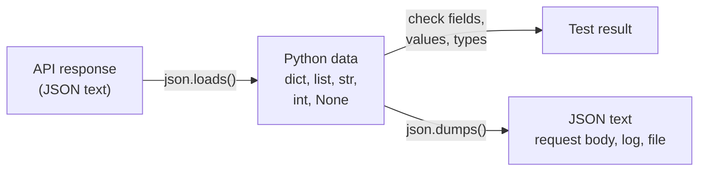

# JSON: Read API Responses, Check Their Types, and Compare Them

**JSON** is the text format almost every API uses to send data. It looks a lot like Python dictionaries and lists, and Python's `json` module turns one into the other in one line. For a tester, reading JSON is only half the job. The other half is checking it: the right fields, the right values, and the right **types**. A number sent as text is one of the most common API bugs.

!!! note "Before you start"
    You need Python 3.13 and the lessons on [lists, tuples, sets and dictionaries](lists-tuples-sets-and-dictionaries.md) and [file handling](file-handling.md). The example file is `examples/json_demo.py`.

## Why testers need this

The device API returns a device's status, its battery level and its latest readings. The API docs say `battery` is a number from 0 to 100. Your test must:

- turn the response text into Python data, and reach into nested parts like `readings[-1]["temperature"]`,
- notice when `battery` arrives as the text `"87"` instead of the number `87`,
- send a request body with a Bengali location, and keep it readable in logs,
- compare a whole response with the expected one, and list every difference.

## How it works

JSON text and Python data map one to one. `json.loads` goes from text to Python, and `json.dumps` goes back.

| JSON | Python | Example |
| --- | --- | --- |
| object `{...}` | `dict` | `{"id": "SNS-0042"}` |
| array `[...]` | `list` | `[21.5, 22.0]` |
| string `"..."` | `str` | `"SNS-0042"` |
| number | `int` or `float` | `87`, `21.5` |
| `true` / `false` | `True` / `False` | `"online": true` |
| `null` | `None` | `"firmware": null` |



*Text comes in, becomes Python data you can check, and goes out again as text when you send or save it.*

## The code

```python title="examples/json_demo.py"
--8<-- "modules/start_here/python_for_testers/examples/json_demo.py"
```

From the `examples` folder, run:

```bash
python json_demo.py
```

```text
<class 'dict'> True None
22.0 2
'87' False
{"device_id": "SNS-0042", "location": "\u09a2\u09be\u0995\u09be \u0985\u09ab\u09bf\u09b8", "alerts": true, "note": null}
{"device_id": "SNS-0042", "location": "ঢাকা অফিস", "alerts": true, "note": null}
{
  "device_id": "SNS-0042",
  "location": "ঢাকা অফিস",
  "alerts": true,
  "note": null
}
True
```

## Line by line

**Part 1: reading the response.**

- `body` is the response as text, written over several lines with triple quotes. A real test gets it from the API, for example `response.text`.
- `json.loads(body)` turns the text into a dictionary. JSON `true` became `True` and `null` became `None` (line 1 of the output).
- `data["device"]["online"]` reaches into a dictionary inside a dictionary. Read it left to right: the `device` part, then its `online` field.
- `data["readings"][-1]["temperature"]` is the temperature of the last reading: `22.0`. `readings` is a list, so `[-1]` picks the last item, which is a dictionary.

**Part 2: checking the type.**

- `repr(data["battery"])` shows `'87'` with quotes: it is text. `isinstance(data["battery"], int)` is `False`.
- A check like `data["battery"] >= 20` would crash on text, and `data["battery"] == 87` would fail. Worse, code that adds up text joins it: `"87" + "13"` is `"8713"`. Report it as a bug: the API does not match its docs.

**Part 3: writing JSON.**

- `json.dumps(request_body)` turns Python data into JSON text. `True` became `true` and `None` became `null`.
- By default, letters outside English are written as `\u` codes. That is valid JSON, but nobody can read `\u09a2\u09be...` in a log. `ensure_ascii=False` keeps `ঢাকা অফিস` as it is.
- `indent=2` puts each field on its own line. Use it for logs, reports and saved test data.

**Part 4: saving and reading back.**

- `saved.write_text(json.dumps(data, indent=2), ...)` saves the response, for example as the expected data for later runs.
- Reading it back with `json.loads(...)` gives data equal to the original: `True`.

## Comparing an expected response with the real one

Checking fields one by one gets long. The [compare_json.py](index.md#templates) starter walks through two JSON files and prints every difference, with the path to it. From the `examples` folder:

```bash
python ../templates/compare_json.py expected_product.json actual_product.json
```

```text
$.price: expected 4.25, got "4.25"
$.tags: expected 2 items, got 1
$.created_at: not expected, got "2026-11-16T09:30:00Z"
3 difference(s).
```

Three real findings: the price is text instead of a number, a tag is missing, and there is a new field. Values that change on every call, like dates and IDs, can be left out with `--ignore`:

```bash
python ../templates/compare_json.py expected_product.json actual_product.json --ignore created_at,tags
```

```text
$.price: expected 4.25, got "4.25"
1 difference(s).
```

The script exits with code 1 when it finds a difference, so a CI pipeline can fail on it.

## How it is used in a real QA project

- **API tests.** Every API test reads JSON: `response.json()` in the `requests` library does the same as `json.loads(response.text)`. See [headers and JSON](../api-testing/headers-and-json.md).
- **Schema checks.** Instead of checking each type by hand, teams describe the expected shape once and check every response against it. See [schema validation](../api-testing/schema-validation.md). The exercise below is a small version.
- **Request bodies.** POST and PUT requests send JSON made with `json.dumps`, or with the `json=` option of `requests`.
- **Test data and expected results** are kept in JSON files next to the tests. See [CSV, JSON and YAML test data](../automation-testing/data-driven/csv-json-yaml-data.md).
- **Device messages.** IoT devices often send JSON over MQTT. The same `json.loads` reads them, as in [exception handling](exception-handling.md).

## Your task

Open `exercises/ex09_json.py`. Replace each `raise` line:

1. `failed_tests(text)`: read a results JSON text, and return the names of the tests whose outcome is `"failed"`.
2. `to_json(data)`: turn data into JSON text with 2-space indents, keeping Bengali letters readable.
3. `wrong_types(data, expected)`: return the keys whose value does not have the expected type. A missing key counts as wrong. `expected` looks like `{"id": str, "online": bool, "battery": int}`.

From the `exercises` folder:

```bash
python -m pytest tests/test_ex09_json.py
```

All 5 tests pass when your answers are right.

??? success "Solution"
    ```python
    --8<-- "modules/start_here/python_for_testers/solutions/ex09_json.py"
    ```

    - `failed_tests` uses a list comprehension: each test's name, if its outcome is `"failed"`.
    - In `wrong_types`, `type(value) is expected_type` is stricter than `isinstance`. In Python, `True` counts as an `int` for `isinstance`, but an API that sends `true` for a battery level has a bug, and this check catches it.

## When it goes wrong

These are real messages from Python 3.13.

**Single quotes are not JSON.**

```text
json.decoder.JSONDecodeError: Expecting property name enclosed in double quotes: line 1 column 2 (char 1)
```

JSON needs double quotes: `{"id": "SNS-0042"}`. This often happens when someone pastes a printed Python dictionary into a test file. Use `json.dumps` to make real JSON.

**A comma after the last item.**

```text
json.decoder.JSONDecodeError: Illegal trailing comma before end of object: line 1 column 18 (char 17)
```

Python allows `{"id": "SNS-0042",}` but JSON does not. Remove the last comma. The message gives the column, so you can find it.

**The text is empty.**

```text
json.decoder.JSONDecodeError: Expecting value: line 1 column 1 (char 0)
```

The response had no body at all, or was HTML (an error page) instead of JSON. Print the status code and the first part of the text before parsing. An error page where JSON was promised is often the real bug.

**The field is one level deeper.**

```text
KeyError: 'id'
```

The `id` is inside `device`, so it is `data["device"]["id"]`. Print the data with `json.dumps(data, indent=2)` to see its shape.

**Python data that JSON can't hold.**

```text
TypeError: Object of type date is not JSON serializable
```

JSON has no date type. Turn dates into text first: `day.isoformat()` gives `"2026-11-22"`.

## References

- [Python docs: json](https://docs.python.org/3/library/json.html)
- [JSON format (json.org)](https://www.json.org/json-en.html)
- [RFC 8259: the JSON standard](https://www.rfc-editor.org/rfc/rfc8259)

Written for Python 3.13. Links checked: November 2026.
