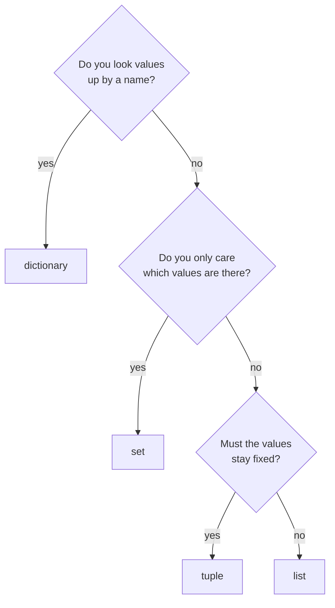

# Lists, Tuples, Sets and Dictionaries: Hold Many Test Values at Once

One variable holds one value. Real test data comes in groups: all the status codes from a run, the device IDs you expect, the fields in an API response. Python has four ways to hold a group of values. Each one is good at a different job, and picking the right one makes a check one line long instead of ten.

!!! note "Before you start"
    You need Python 3.13 and the lesson on [variables and data types](variables-and-data-types.md). The example file is `examples/collections_demo.py`.

## Why testers need this

A device dashboard shows the devices that sent data today. Your job is to check that every expected device is there, and that each device's API answer has all the fields it should. You need to:

- clean the text you read from the page before you compare it,
- keep the status codes from your requests in order,
- keep the codes that count as a pass, so nobody changes them by mistake,
- find which devices are missing, and which ones you did not expect,
- read single fields from the API answer, even when a field is missing.

Each of those needs a different collection.

## How it works

| Collection | Written like | Order | Duplicates | Can change | Use it for |
| --- | --- | --- | --- | --- | --- |
| list | `[200, 200, 503]` | kept | allowed | yes | results in the order they happened |
| tuple | `(200, 201, 204)` | kept | allowed | no | fixed rules and settings |
| set | `{"SNS-0041", "SNS-0042"}` | none | removed | yes | "what is missing?" and "what is extra?" |
| dictionary | `{"status": "online"}` | kept | keys are unique | yes | values looked up by name, like JSON |

When you are not sure which one to pick, follow the questions:



*Start at the top. A name to look up means a dictionary. Only "which values" means a set. Fixed values mean a tuple. Everything else is a list.*

## The code

The script works through the dashboard check, one collection at a time. It starts with text, because most values you read from a page or a file are strings that need cleaning first.

```python title="examples/collections_demo.py"
--8<-- "modules/start_here/python_for_testers/examples/collections_demo.py"
```

From the `examples` folder, run:

```bash
python collections_demo.py
```

```text
'device sns-0042 is online' True ['device', 'sns-0042', 'is', 'online']
5 200 201 [200, 503] 3
False True
4 3 ['SNS-0041']
['SNS-0099']
online None unknown
['last_seen']
{'id': 'SNS-0042', 'status': 'online', 'battery': 86, 'firmware': None}
```

## Line by line

**Part 1: clean the text first.**

- `banner.strip()` removes spaces and line breaks at both ends. `.lower()` makes every letter small. You can chain them: each one works on the result of the one before.
- `repr(clean)` prints the text with its quotes, so you can see if any spaces are left. Use it whenever two texts "look the same" but don't match.
- `"online" in clean` asks "is this text inside that text?". For long messages, this is a safer check than `==` on the whole message.
- `clean.split(" ")` cuts the text at each space and gives you a **list** of words.

**Part 2: a list of status codes.**

- Square brackets make a list. `statuses.append(201)` adds a value at the end, so the list grows to 5 items.
- `statuses[0]` is the first item, because positions start at 0. `statuses[-1]` is always the last item, however long the list is.
- `statuses[1:3]` is a **slice**: positions 1 and 2. The end number is not included, so you get `[200, 503]`.
- `statuses.count(200)` counts how many times `200` appears: 3.

**Part 3: a tuple of allowed codes.**

- Round brackets make a tuple. It works like a list, but it can't change: no `append`, no new values. That protects rules you don't want anyone to change during a run.
- `503 in allowed_statuses` is `False`, so a test would flag the 503.

**Part 4: sets find what is missing.**

- Curly braces with single values make a set. `set(reports)` turns a list into a set. The list has 4 reports because `SNS-0043` sent two, but a set keeps each value once, so it has 3 devices.
- `expected_devices - reported_devices` means "in the first set but not the second": the missing device, `SNS-0041`.
- `reported_devices - expected_devices` gives the extra one, `SNS-0099`. A device nobody expected can be a bug too.
- A set has no order, so the script wraps it in `sorted()`. Then the output is the same every run, and your test results stay stable.

**Part 5: a dictionary is an API response.**

- Curly braces with `key: value` pairs make a dictionary. JSON from an API becomes a dictionary in Python (see [JSON](json.md)).
- `response["status"]` gets one value by its key: `online`.
- `response.get("location")` gives `None` when the key is missing, instead of stopping your script. `.get("location", "unknown")` gives your own default.
- `required_fields - response.keys()` uses the set trick on the keys. It shows the field the API forgot: `last_seen`.
- `response["battery"] = 86` changes a value. The same line with a new key would add it.

## How it is used in a real QA project

- **Lists** hold rows of test data, the steps in a test case, and the results of a run. [Conditions and loops](conditions-and-loops.md) shows how to go through a list one item at a time.
- **Tuples** hold fixed settings, like allowed status codes or a screen size `(1280, 720)`. pytest's [parametrize](../automation-testing/pytest/parametrize.md) uses tuples for each set of test inputs.
- **Sets** compare two groups fast: expected and actual menu items, user roles, device IDs, or the columns of a database table.
- **Dictionaries** hold API responses, test users (`{"email": ..., "role": ...}`), and settings for each environment.
- A common API check is "the response has every required field". It is one line with a set: `required - response.keys()`.

## Your task

Open `exercises/ex02_collections.py`. Replace each `raise` line with code that returns the answer:

1. `clean_message(text)`: remove spaces at both ends, and make the text lower case.
2. `missing_devices(expected, reported)`: the expected IDs that were not reported, as a sorted list.
3. `missing_fields(response, required)`: the required keys the response does not have, as a sorted list.
4. `status_of(response)`: the response's `"status"`, or `"unknown"` when it is missing.

From the `exercises` folder:

```bash
python -m pytest tests/test_ex02_collections.py
```

All 5 tests pass when your answers are right.

??? success "Solution"
    ```python
    --8<-- "modules/start_here/python_for_testers/solutions/ex02_collections.py"
    ```

    - `set(expected) - set(reported)` turns both lists into sets, so duplicates and order don't matter. `sorted()` turns the result back into a list in A to Z order.
    - `response.keys()` acts like a set, so you can take it away from a set directly.
    - `.get()` with a second value gives that value when the key is missing.

## When it goes wrong

These are real messages from Python 3.13.

**You asked for a position the list does not have.**

```text
IndexError: list index out of range
```

The list is shorter than you thought. `statuses[5]` fails on a list with 5 items, because the last position is 4. Print `len(statuses)` first, or use `statuses[-1]` for the last item.

**The key is not in the dictionary.**

```text
KeyError: 'status'
```

The API response has no `status` field. If the field is required, this is a bug to report. If it is optional, use `response.get("status")`.

**You tried to change a tuple.**

```text
AttributeError: 'tuple' object has no attribute 'append'
```

Tuples can't change. If the values really need to change, use a list.

**You tried to get a set item by position.**

```text
TypeError: 'set' object is not subscriptable
```

A set has no order, so it has no first item. Use `in` to check for a value, or turn it into a sorted list: `sorted(devices)[0]`.

**Two texts look the same but `==` says `False`.** One of them has a space or a line break at the end. Print both with `repr()` to see it, then use `.strip()`.

## References

- [Python tutorial: data structures (lists, tuples, sets, dictionaries)](https://docs.python.org/3/tutorial/datastructures.html)
- [Python docs: string methods](https://docs.python.org/3/library/stdtypes.html#string-methods)
- [Python docs: set types](https://docs.python.org/3/library/stdtypes.html#set-types-set-frozenset)

Written for Python 3.13. Links checked: November 2026.
