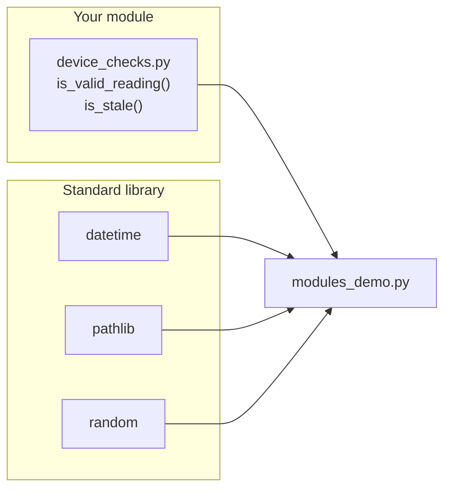

# Modules and Imports: Share Checks Between Files, and Use the Standard Library

A **module** is a Python file you can use from another file. You write a check once in `device_checks.py`, and every test file gets it with one `import` line. Python also comes with a big set of ready modules, the **standard library**. It handles dates, file paths, JSON and random test data, so you don't write those yourself.

!!! note "Before you start"
    You need Python 3.13 and the lesson on [functions](functions.md). The example files are `examples/device_checks.py` and `examples/modules_demo.py`. Keep them in the same folder.

## Why testers need this

A test project grows fast. After a month you have twenty test files, and many of them need the same checks: "is this reading valid?", "has this device gone quiet?". If each file has its own copy, the copies drift apart. With modules:

- shared checks live in one file, and tests import them,
- times from the API are compared with real date maths, not by hand,
- report files go to paths that work on Windows, macOS and Linux,
- random test data can be repeated exactly when a test fails.

## How it works

`modules_demo.py` gets code from two places: your own module, and Python's standard library. An `import` line runs the other file once and makes its names usable.



*Arrows show what `modules_demo.py` imports. Your own module and the standard library are imported the same way.*

## The code

The shared checks:

```python title="examples/device_checks.py"
--8<-- "modules/start_here/python_for_testers/examples/device_checks.py"
```

The file that uses them:

```python title="examples/modules_demo.py"
--8<-- "modules/start_here/python_for_testers/examples/modules_demo.py"
```

From the `examples` folder, run:

```bash
python modules_demo.py
```

```text
True False device_checks
0:18:00 True
reports/devices/2026-11-22.json 2026-11-22.json .json
[41, 19, 50]
__main__
```

## Line by line

**The imports at the top.**

- `import random` loads a whole module. You use its parts with a dot: `random.seed(7)`.
- `from datetime import UTC, datetime` loads only the names you list. Then you write `datetime(...)`, without `datetime.` in front.
- `import device_checks` and `from device_checks import is_stale, is_valid_reading` load **your own file**. Python finds `device_checks.py` because it sits in the same folder as the script you run.
- The imports are in three groups: standard library, then (later) installed packages, then your own files. That is the usual order, and tools like `ruff` keep it for you.

**Part 1: your own module.**

- `is_valid_reading(21.5)` works exactly as in the [functions lesson](functions.md), but the code now lives in `device_checks.py`.
- `device_checks.__name__` is `device_checks`. Every module knows its own name.

**Part 2: dates and times.**

- `datetime.fromisoformat("2026-11-22T09:12:00+00:00")` turns the text an API sends into a real date and time. The `+00:00` part is the time zone (UTC).
- `now - last_seen` gives a **timedelta**: a length of time. It prints as `0:18:00`, which means 18 minutes.
- `is_stale()` compares that with 10 minutes. The device has been quiet for 18, so it is stale: `True`.
- The script fixes `now` to one moment instead of asking the clock. Then the output is the same on every run, and so is a test that uses it. Real tests often do this.

**Part 3: file paths.**

- `Path("reports") / "devices" / "2026-11-22.json"` joins parts with `/`. pathlib puts the right separator for each computer: `/` on macOS and Linux, `\` on Windows.
- `.as_posix()` prints it with `/` everywhere, so this page shows the same output for everyone. `.name` is the file name and `.suffix` is the ending.

**Part 4: random test data.**

- `random.randint(0, 100)` picks a whole number from 0 to 100, like a battery level.
- `random.seed(7)` makes the "random" numbers the same on every run. When a test with random data fails, you can run it again and get the exact same data.
- `random` is fine for test data, but never for passwords or tokens. Use the `secrets` module for those. The `# noqa: S311` comment tells the linter this use is on purpose.

**`__name__` and `if __name__ == "__main__":`.**

- When you run a file directly, its `__name__` is `"__main__"`. That is the last line of the output.
- When the file is imported, its `__name__` is its own name, so the block under `if __name__ == "__main__":` in `device_checks.py` does not run. Run `python device_checks.py` and you see `device_checks.py was run directly`.
- Use this block for code that should run only when you start the file yourself, not when a test imports it.

## How it is used in a real QA project

- **A helpers or utils module.** Test projects keep shared checks, builders and API clients in their own files, for example `checks.py` or `clients/devices.py`. See [project layout](../automation-testing/pytest/project-layout.md).
- **conftest.py.** pytest imports `conftest.py` by itself, so its [fixtures](../automation-testing/pytest/fixtures-and-conftest.md) work in every test without an import line.
- **Installed packages.** `import requests` or `import pytest` work the same way, once the package is installed. [Virtual environments and pip](virtual-environments-and-pip.md) shows how to install them.
- **Time checks.** "Last seen within 10 minutes", "token expires in 1 hour", "report dated today" all use `datetime` and `timedelta`.
- **Reports and screenshots** are saved with `pathlib`, so the same test code runs on a Windows laptop and a Linux CI server.

## Your task

Open `exercises/ex05_modules.py`. The imports are already there. Replace each `raise` line:

1. `days_between(start, end)`: days between two dates written like `"2026-10-16"`. Use `date.fromisoformat()`.
2. `minutes_quiet(last_seen, now)`: whole minutes between two ISO times.
3. `is_stale(last_seen, now, max_minutes=10)`: `True` when the gap is longer than `max_minutes`.

From the `exercises` folder:

```bash
python -m pytest tests/test_ex05_modules.py
```

All 6 tests pass when your answers are right.

??? success "Solution"
    ```python
    --8<-- "modules/start_here/python_for_testers/solutions/ex05_modules.py"
    ```

    - Taking one `date` from another gives a timedelta. `.days` is its number of days.
    - `.total_seconds() // 60` turns the gap into whole minutes. `//` divides and drops the part after the decimal point.
    - Comparing two timedeltas with `>` works like comparing numbers. Exactly 10 minutes is not "longer than 10", so it is not stale.

## When it goes wrong

These are real messages from Python 3.13.

**Python can't find the module.**

```text
ModuleNotFoundError: No module named 'device_cheks'
```

Either the name is misspelled, or you ran the script from another folder. Python looks for your own modules next to the script you run. For packages like `requests`, the same message means the package is not installed in the environment you are using.

**The module has no such name.**

```text
ImportError: cannot import name 'is_old' from 'device_checks' (.../examples/device_checks.py)
```

The file was found, but it has no function called `is_old`. The path at the end (shortened here) shows which file Python used. Check the spelling, or check that it is the file you meant.

**The date text is in another format.**

```text
ValueError: Invalid isoformat string: '22/11/2026'
```

`fromisoformat()` wants `2026-11-22`. For other formats, use `datetime.strptime(text, "%d/%m/%Y")`. If an API sends dates in a format its docs don't promise, report it.

**One time has a time zone and the other does not.**

```text
TypeError: can't subtract offset-naive and offset-aware datetimes
```

`datetime.now(UTC)` has a time zone, `datetime(2026, 11, 22)` does not. Give both the same zone, for example `datetime(2026, 11, 22, tzinfo=UTC)`.

## References

- [Python tutorial: modules](https://docs.python.org/3/tutorial/modules.html)
- [Python docs: datetime](https://docs.python.org/3/library/datetime.html)
- [Python docs: pathlib](https://docs.python.org/3/library/pathlib.html)
- [Python docs: random](https://docs.python.org/3/library/random.html) and [secrets](https://docs.python.org/3/library/secrets.html)
- [Python docs: \_\_main\_\_](https://docs.python.org/3/library/__main__.html)

Written for Python 3.13. Links checked: November 2026.
