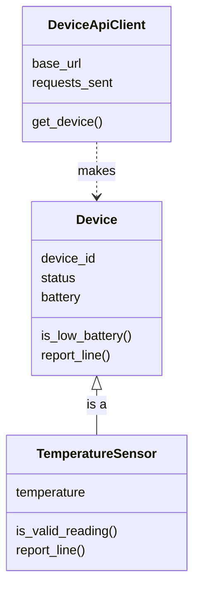

# Object-Oriented Programming: Classes for Devices, Page Objects and API Clients

So far, data sat in dictionaries and the checks sat in separate functions. A **class** puts them together. A `Device` class holds a device's ID, status and battery, plus the checks that belong to a device. Each device you make from it is an **object**. Almost every test framework is built this way: page objects, API clients and test data are classes.

!!! note "Before you start"
    You need Python 3.13 and the lessons on [functions](functions.md) and [lists, tuples, sets and dictionaries](lists-tuples-sets-and-dictionaries.md). The example file is `examples/classes_demo.py`.

## Why testers need this

Your test suite checks gateways and temperature sensors through a device API. With plain functions and dictionaries, every test must know the dictionary keys, and it is easy to pass the wrong dictionary to the wrong function. As the suite grows, you want:

- each device to carry its own data and its own checks (`sensor.is_low_battery()`),
- sensors to get everything a device has, plus their temperature check, without copying code,
- one place that knows how to talk to the API, so tests just say `client.get_device("SNS-0041")`.

Classes give you all three.

## How it works

A class is a plan. Objects are the things made from the plan. Each object has its own data (**attributes**) and shares the class's functions (**methods**).



*A `TemperatureSensor` is a `Device` with more: the hollow arrow means it gets everything a `Device` has. The dotted arrow shows that the API client makes `Device` objects from the server's data.*

## The code

```python title="examples/classes_demo.py"
--8<-- "modules/start_here/python_for_testers/examples/classes_demo.py"
```

From the `examples` folder, run:

```bash
python classes_demo.py
```

```text
GW-0001: online, battery 100%
SNS-0042: online, battery 12%, 85.0 degrees
False True False
True False
Device('SNS-0041', status='offline', battery=64) None
2 https://devices.example.test/api
```

## Line by line

**The `Device` class.**

- `class Device:` starts the plan. Class names use CapitalWords by custom.
- `def __init__(self, device_id, status="online", battery=100):` runs every time you make a device. Its job is to store the starting data.
- `self` is the object being made or used. `self.battery = battery` stores the value **on this object**, so each device keeps its own battery level.
- `is_low_battery(self, minimum=20)` and `report_line(self)` are **methods**: functions that belong to the class. They read the object's data through `self`.
- `__repr__` says how the object looks when printed in a list or by `print()`. Without it, you'd see something like `<__main__.Device object at 0x...>`, which tells you nothing in a test report.

**The `TemperatureSensor` class.**

- `class TemperatureSensor(Device):` means "a TemperatureSensor is a Device". This is **inheritance**. The sensor gets `device_id`, `status`, `battery`, `is_low_battery()` and all the rest without writing them again.
- `super().__init__(device_id, battery=battery)` runs the `Device` setup first, then the sensor adds its own `self.temperature`.
- `report_line()` is written again in the sensor. When you call it on a sensor, this version runs. It calls `super().report_line()` to reuse the device text, and adds the temperature.

**Using the objects.**

- `Device("GW-0001")` and `TemperatureSensor("SNS-0042", temperature=85.0, battery=12)` make two objects. Each one keeps its own data.
- Output line 3: the gateway's battery is fine (`False`), the sensor's is low (`True`), and 85.0 degrees is out of range (`False`).
- `isinstance(sensor, Device)` is `True`, because a sensor is a device. `isinstance(gateway, TemperatureSensor)` is `False`: a plain device is not a sensor.

**The API client.**

- `DeviceApiClient` keeps the `base_url` and a count of requests. A real client would keep a session and a login token here too.
- `get_device()` adds 1 to `self.requests_sent`, looks up the device, and returns a `Device` object, or `None` when the device does not exist. A test never touches the raw server data.
- After two calls, `client.requests_sent` is `2`. The object **remembers** things between calls. Functions can't do that on their own.
- `example.test` is a domain kept for tests, so the address can never reach a real server.

## How it is used in a real QA project

- **Page objects.** In UI tests, each page is a class: `LoginPage` has the page's locators and methods like `login(user, password)`. Tests call methods instead of repeating locators. See the [page object model](../automation-testing/playwright/page-object-model.md).
- **API clients.** A class like `DeviceApiClient` holds the base URL, the session and the token, and has one method per endpoint. See [an API client class](../api-testing/api-client-class.md).
- **Test data.** Classes (or `dataclasses`) describe users, devices and orders, with safe default values.
- **Base classes.** A `BasePage` holds what every page shares, such as "wait until loaded". Each page class inherits from it, as `TemperatureSensor` inherits from `Device`.
- **pytest test classes.** pytest can group tests in a class whose name starts with `Test`. That is why the exercise below tells pytest that `TestRun` is not a test class.

## Your task

Open `exercises/ex06_classes.py`. It has a `TestRun` class that collects the results of one test run. Fill in each method:

1. `__init__(self, name)`: store the name, and start `self.results` as an empty list.
2. `add(self, test_name, outcome)`: add one result to the list, as a dictionary.
3. `count(self, outcome)`: how many results have that outcome.
4. `failed_tests(self)`: the names of the failed tests, in order.
5. `summary(self)`: a line like `nightly: 4 tests, 2 failed`.

From the `exercises` folder:

```bash
python -m pytest tests/test_ex06_classes.py
```

All 5 tests pass when your answers are right.

??? success "Solution"
    ```python
    --8<-- "modules/start_here/python_for_testers/solutions/ex06_classes.py"
    ```

    - Each method reads `self.results`, the list that `__init__` made. That is the class keeping data and actions together.
    - `summary()` calls `self.count("failed")`: one method can use another through `self`.
    - The last test makes two runs and checks they don't share results. Each object has its own `self.results` list.

## When it goes wrong

These are real messages from Python 3.13.

**You forgot `self` in a method.**

```text
TypeError: Device.report_line() takes 0 positional arguments but 1 was given
```

Python passes the object as the first value to every method. Write `def report_line(self):`.

**You forgot `self.` when storing a value.**

```text
AttributeError: 'Device' object has no attribute 'device_id'
```

`device_id = device_id` inside `__init__` only makes a short-lived name. Write `self.device_id = device_id` to keep it on the object.

**You made an object without the values `__init__` needs.**

```text
TypeError: Device.__init__() missing 1 required positional argument: 'device_id'
```

`Device()` gave no ID. Pass it: `Device("SNS-0042")`.

**A child class forgot to call `super().__init__()`.**

```text
AttributeError: 'Sensor' object has no attribute 'device_id'
```

The child's own `__init__` replaced the parent's, so the parent's setup never ran. Call `super().__init__(...)` first, as `TemperatureSensor` does.

## References

- [Python tutorial: classes](https://docs.python.org/3/tutorial/classes.html)
- [Python tutorial: inheritance](https://docs.python.org/3/tutorial/classes.html#inheritance)
- [Python docs: dataclasses](https://docs.python.org/3/library/dataclasses.html)
- [pytest: conventions for test discovery](https://docs.pytest.org/en/stable/explanation/goodpractices.html#conventions-for-python-test-discovery)

Written for Python 3.13. Links checked: November 2026.
