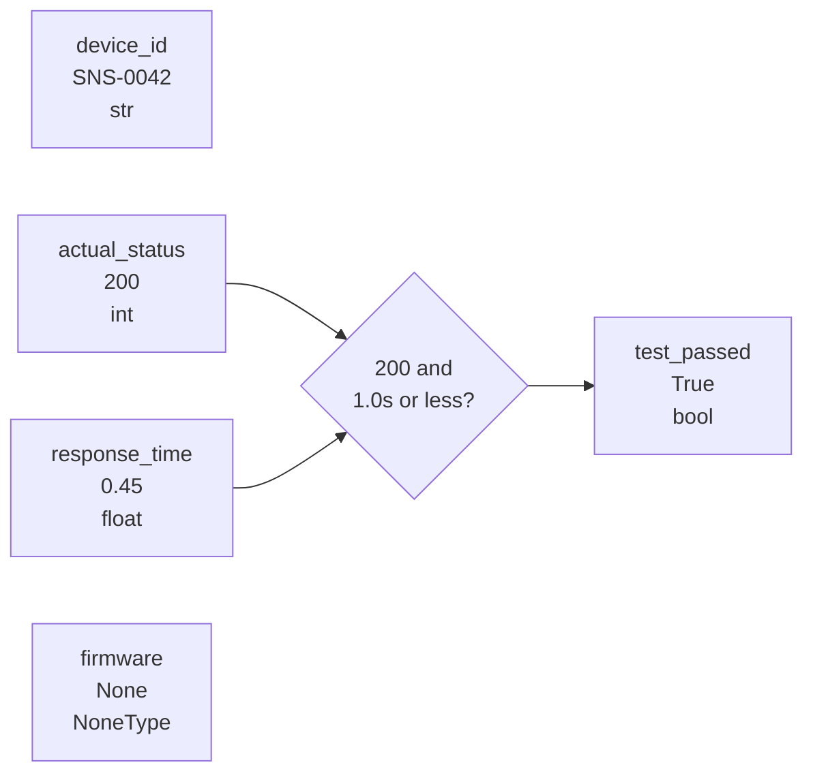

# Variables and Data Types: Store Test Data the Right Way

Every test works with values: an ID, a status code, a time, a yes or no. A **variable** is a name you give to one of those values, so you can use it again and print it in a clear message. Each value also has a **data type**. The type decides what you can do with the value, and it causes some of the most common test bugs.

!!! note "Before you start"
    You need Python 3.13. The example file is `examples/types_demo.py` in this topic's folder. See [Environment setup](../getting-started/environment-setup/index.md) if Python is not installed yet.

## Why testers need this

Say you check a device API. You send a request for device `SNS-0042`. You expect status `200`, and the answer must come within 1 second. To check this, you need to keep five things: the device ID, the expected status, the real status, the time it took, and the result. Each one has a different type, and picking the wrong type gives you a wrong result:

- A status code read from a CSV file is the text `"200"`, not the number `200`. Compare them and the test fails, even though the API is fine.
- A price total like `0.10 + 0.20` is not exactly `0.30` inside the computer. Compare it with `==` and a correct cart looks broken.

## How it works

A variable is a label. The value sits behind the label, and the value has a type. Python works out the type from how you write the value.



*Each box shows a variable name, its value and its type. The check uses two of the values and makes a new one: a `bool`.*

The five types you will use most:

| Type | What it holds | Written like | In a test |
| --- | --- | --- | --- |
| `str` | Text | `"SNS-0042"` | IDs, names, messages, anything read from a file or form |
| `int` | Whole numbers | `200` | Status codes, counts, retries |
| `float` | Numbers with a decimal point | `0.45` | Times in seconds, percentages |
| `bool` | `True` or `False` | `True` | The result of a check |
| `None` | "No value" | `None` | A field the API did not send |

## The code

This script keeps one API check in variables, then shows the three type traps.

```python title="examples/types_demo.py"
--8<-- "modules/start_here/python_for_testers/examples/types_demo.py"
```

From the `examples` folder, run:

```bash
python types_demo.py
```

```text
<class 'str'> <class 'int'> <class 'float'>
<class 'bool'> <class 'NoneType'>
PASS: SNS-0042 answered 200 in 0.45s
False True
0.30000000000000004 False
True True
True
```

## Line by line

**Part 1: one API check.**

- `device_id = "SNS-0042"`: the `=` sign gives the name `device_id` to the value. The quotes make it a `str`. An ID is text even when it has digits, because you never do maths with it.
- `expected_status = 200`: no quotes, no decimal point, so it is an `int`. Status codes are whole numbers.
- `response_time = 0.45`: the decimal point makes it a `float`.
- `firmware = None`: the API did not send a firmware version. `None` says "no value" on purpose. It is not `0` and not an empty text.
- `test_passed = actual_status == expected_status and response_time <= max_response_time`: `==` asks "are these equal?" and `<=` asks "is this less than or equal?". Each answer is `True` or `False`. `and` is `True` only when both are `True`. So `test_passed` is a `bool`.
- `print(type(device_id), ...)`: `type()` tells you a value's type. The first two lines of the output show `str`, `int`, `float`, `bool` and `NoneType`.
- `print(f"PASS: {device_id} answered {actual_status} in {response_time}s")`: the `f` before the quote makes an **f-string**. Python puts each value in `{ }` into the text. This is how you write clear test messages. The `if` and `else` lines pick which message to print; [Conditions and loops](conditions-and-loops.md) covers them.

**Part 2: text that looks like a number.**

- `status_from_csv = "200"`: values from CSV files, web forms and URLs always arrive as text.
- `status_from_csv == 200` is `False`, because text is never equal to a number. `int(status_from_csv) == 200` is `True`, because `int()` turns the text into a number first. That is output line 4: `False True`.

**Part 3: decimals are not exact.**

- `0.10 + 0.20` gives `0.30000000000000004`. A computer keeps a `float` in binary, and most decimals can't be stored exactly in binary. So `item_prices == 0.30` is `False` (output line 5).
- The fix for money: count in whole cents (`10 + 20 == 30`), or round both sides before you compare: `round(item_prices, 2) == 0.30`. Both are `True` (output line 6).

**Part 4: checking for no value.**

- `firmware is None` is `True`. Always check for `None` with `is None`, not `== None`. `is` asks "is this the very same thing?", and there is only one `None`.

## How it is used in a real QA project

- **Test data at the top of a test.** Testers put the expected values in named variables (`expected_status`, `max_response_time`) instead of typing `200` and `1.0` deep inside the code. When the rule changes, you change one line.
- **Clear failure messages.** An f-string message like `FAIL: SNS-0042 expected 200, got 503` tells the team what broke without opening the code.
- **Converting data from files.** In [data-driven tests](../automation-testing/data-driven/index.md), every value from a CSV file is text. You convert numbers with `int()` or `float()` before you compare.
- **Checking API fields.** A response field that is `None` (shown as `null` in JSON) when you expected a value is a real bug to report.
- **Money.** Shops and payment tests compare prices in cents, or round to 2 places, so the totals match exactly.

## Your task

Open `exercises/ex01_variables.py`. It has three small functions. Replace each `raise` line with one line of code that returns the answer:

1. `parse_status(text)`: turn a status code read from a file, like `"200"`, into the number `200`.
2. `is_fast_enough(response_time, limit)`: return `True` when the time is no more than the limit.
3. `to_cents(price)`: turn a price like `4.25` into whole cents: `425`.

Then check your work from the `exercises` folder:

```bash
python -m pytest tests/test_ex01_variables.py
```

All 5 tests pass when your answers are right.

??? success "Solution"
    ```python
    --8<-- "modules/start_here/python_for_testers/solutions/ex01_variables.py"
    ```

    - `int(text)` also removes spaces and the line break at the end, so `" 201\n"` becomes `201`.
    - `response_time <= limit` is already `True` or `False`, so you can return it as it is.
    - `round(price * 100)` matters: `19.99 * 100` comes out as `1998.9999999999998`. `round()` makes it `1999`. `int()` would cut off the decimals and give `1998`, one cent wrong.

## When it goes wrong

These are real messages from Python 3.13.

**You joined text and a number with `+`.**

```text
TypeError: can only concatenate str (not "int") to str
```

`"Checked " + device_id + ": " + status` fails when `status` is an `int`. Use an f-string: `f"Checked {device_id}: {status}"`.

**`int()` got text that is not a whole number.**

```text
ValueError: invalid literal for int() with base 10: '200 OK'
```

The text had more than digits in it, such as `"200 OK"` or `"200.0"`. Look at the real value first with `print(repr(value))`. Then take out the number part, or use `float()` for decimals. If the API sends `"200 OK"` where the docs say a number, that may be a bug to report.

**A test compares text with a number.**

```text
E       AssertionError: assert '200' == 200
```

This is pytest's message. The quotes around `'200'` show it is text. Convert it with `int()` before you compare, or fix the place the text comes from.

**A typo in a variable name.**

```text
NameError: name 'actual_stauts' is not defined. Did you mean: 'actual_status'?
```

Python does not know that name. Read the hint at the end, and fix the spelling.

**A price total is off by 0.01.** You compared `float` values. Compare whole cents, or round both sides to 2 places.

## References

- [Python tutorial: numbers, text and variables](https://docs.python.org/3/tutorial/introduction.html)
- [Python tutorial: floating-point problems](https://docs.python.org/3/tutorial/floatingpoint.html)
- [Python tutorial: f-strings](https://docs.python.org/3/tutorial/inputoutput.html#formatted-string-literals)
- [Python docs: built-in types](https://docs.python.org/3/library/stdtypes.html)

Written for Python 3.13. Links checked: November 2026.
