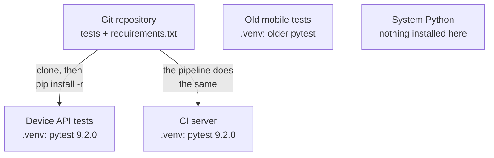

# Virtual Environments and pip: Give Every Test Project Its Own Tools

**pip** installs Python packages, like pytest or Playwright. A **virtual environment** is a folder with its own Python and its own packages, for one project only. Each test project gets one. A file called `requirements.txt` lists the exact versions, so your laptop, your teammate's laptop and the CI server all run the tests with the same tools.

!!! note "Before you start"
    You need Python 3.13. On macOS and Linux the command may be `python3`; on Windows it is often `py`. See [Environment setup](../getting-started/environment-setup/index.md) if Python is not installed yet.

## Why testers need this

You look after two test projects. The device API tests need the newest pytest. An older mobile test project still needs an older version, and nobody has time to update it this month. If both projects share one set of packages, updating pytest for one breaks the other.

It gets worse on a team. A test passes on your laptop and fails in the pipeline. After an hour you find that the pipeline installed a newer version of a library, which changed how it works. "Works on my machine" very often means "my machine has different package versions".

Virtual environments and pinned versions fix both problems.

## How it works

Each project folder has its own `.venv` folder with its own packages. The system Python is left alone. `requirements.txt` goes into Git; the `.venv` folder does not.



*Every place that runs the device API tests builds its `.venv` from the same `requirements.txt`, so the versions match. The old project keeps its own versions, and the system Python stays clean.*

## Step by step

These commands and outputs are from a real run on macOS with Python 3.13. Windows commands are in the tabs.

**1. Create the environment, inside your project folder.** The folder is usually called `.venv`:

```bash
python3 -m venv .venv
```

`-m venv` runs Python's built-in `venv` module. It makes the `.venv` folder with a fresh Python and pip inside.

**2. Activate it.** This makes `python` and `pip` mean the ones inside `.venv`:

=== "macOS and Linux"

    ```bash
    source .venv/bin/activate
    ```

=== "Windows (PowerShell)"

    ```powershell
    .venv\Scripts\Activate.ps1
    ```

Your prompt usually shows `(.venv)` at the start. Check that it really worked:

```bash
python --version
python -m pip list
```

```text
Python 3.13.18
Package Version
------- -------
pip     26.3
```

A new environment has only pip. That is the point: nothing comes in from other projects.

**3. Install what the project needs, with a version.**

```bash
python -m pip install "pytest==9.2.0"
python -m pytest --version
```

```text
pytest 9.2.0
```

- `python -m pip` runs the pip that belongs to the Python you are using. Plain `pip` can belong to a different Python.
- `==9.2.0` **pins** the version, so everyone gets exactly this one.

**4. Write the list down.** `pip freeze` lists everything installed, with exact versions. Save it as `requirements.txt`:

```bash
python -m pip freeze > requirements.txt
```

```text
iniconfig==2.3.1
packaging==26.3
pluggy==1.7.0
Pygments==2.21.0
pytest==9.2.0
```

You asked for one package and got five. pytest needs the other four, so pip installed them too. Those are called **dependencies**. They are pinned as well, so nothing changes under you.

**5. Rebuild it anywhere.** On another computer, or in the pipeline, after cloning the project:

```bash
python3 -m venv .venv
source .venv/bin/activate
python -m pip install -r requirements.txt
```

`-r` means "install everything in this file". The result is the same five packages, with the same versions.

**6. Keep `.venv` out of Git.** Add `.venv/` to `.gitignore`. Share `requirements.txt`, not the folder. The folder is big, and it only works on the computer that made it.

**7. Leave it when you are done.** `deactivate` goes back to the normal Python. Next time, activate it again before you work.

## How it is used in a real QA project

- **Every test project has a `.venv` and a `requirements.txt`** (or a `pyproject.toml`, which newer projects use for the same job). The README says how to build it, like the steps above.
- **The CI pipeline builds the environment from the file** on every run, then runs the tests. See [CI/CD for testers](../devops-for-qa/ci-cd/index.md).
- **Updates are planned.** A team updates a pinned version on purpose, runs the tests, and commits the new `requirements.txt`. Nothing changes by surprise.
- **Hashes for extra safety.** Some projects (this site is one) also store a hash for each package and install with `--require-hashes`. Then pip refuses any file that was changed, even with the same version number.
- **Browsers are separate.** Playwright's Python package goes in `.venv`, but its browsers are downloaded with `python -m playwright install`. See [Playwright](../automation-testing/playwright/index.md).

## Your task

In a new, empty folder:

1. Create a virtual environment and activate it.
2. Install `pytest==9.2.0`, and save `requirements.txt`.
3. Copy this topic's `exercises` folder in, and run `python -m pytest`. The tests fail with `NotImplementedError` until you solve them; that's fine. What matters is that pytest runs.
4. Leave the environment, delete the `.venv` folder, make a new one, and rebuild it from `requirements.txt`.

??? success "Solution"
    ```bash
    python3 -m venv .venv
    source .venv/bin/activate        # Windows: .venv\Scripts\Activate.ps1
    python -m pip install "pytest==9.2.0"
    python -m pip freeze > requirements.txt
    python -m pytest                 # inside the copied exercises folder
    deactivate
    rm -rf .venv                     # Windows: Remove-Item -Recurse .venv
    python3 -m venv .venv
    source .venv/bin/activate
    python -m pip install -r requirements.txt
    python -m pytest --version
    ```

    If the last line says `pytest 9.2.0`, the file did its job: you rebuilt the same environment from it.

## When it goes wrong

**The package is "missing", but you installed it.**

```text
ModuleNotFoundError: No module named 'pytest'
```

(This is a real message from a Python with no environment active.) You installed the package into one Python and ran another. Activate the environment, then use `python -m pytest`. To see which Python is running:

```bash
python -c "import sys; print(sys.executable)"
```

It should print a path that ends in `.venv/bin/python` (on Windows, `.venv\Scripts\python.exe`).

**The `python` command does not exist.**

```text
zsh:1: command not found: python
```

On many macOS and Linux systems, the command is `python3`. Use `python3 -m venv .venv`. After you activate the environment, `python` works too.

**pip says `error: externally-managed-environment`.** Your system protects its own Python from pip. That is the system telling you to use a virtual environment. Make one, activate it, and install there.

**PowerShell says running scripts is disabled.** Windows blocks the activate script by default. Run `Set-ExecutionPolicy -Scope CurrentUser RemoteSigned` once, or use `.venv\Scripts\activate.bat` in Command Prompt.

**Everything broke after you moved or renamed the project folder.** Virtual environments don't move well. Delete `.venv`, make a new one, and install from `requirements.txt`.

## References

- [Python docs: venv](https://docs.python.org/3/library/venv.html)
- [Python Packaging User Guide: install packages in a virtual environment](https://packaging.python.org/en/latest/guides/installing-using-pip-and-virtual-environments/)
- [pip: requirements file format](https://pip.pypa.io/en/stable/reference/requirements-file-format/)
- [pip: secure installs with hashes](https://pip.pypa.io/en/stable/topics/secure-installs/)

Written for Python 3.13 and pip 26. Links checked: November 2026.
