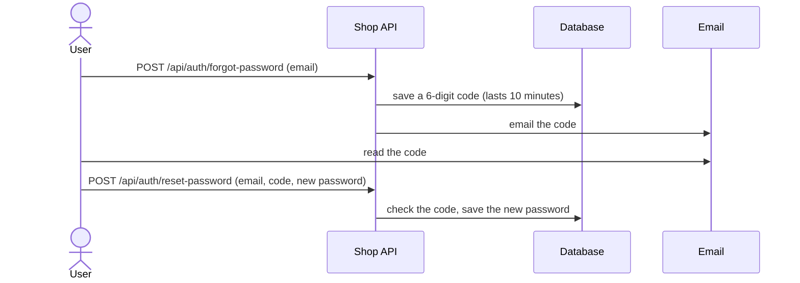

# Learning a New Testing Area: a 9-Step Playbook for Any Task

Sooner or later, your lead will give you a task you have never done. Maybe it is "test the payments", or "can you look at the database?", or "we need BDD". This page shows you how to handle that moment calmly, one step at a time. Every other topic on this site follows the same nine steps, so once you know them, you know how to start anything.

!!! info "In plain words"
    Imagine you move to a new city and need to find a doctor. You don't read every book about medicine first.
    You ask a neighbour where to go, look at a map, try the bus once, and ask again when you get lost.
    Learning a new testing area works the same way: ask, look, try something small, and learn as you go.

!!! example "Your task"
    You test an online shop. On Monday your lead says: "Next sprint we test password reset. You have never tested login features, but can you own it?"
    This page walks through that task, step by step, the way you would do it at work. The example shop runs at `http://127.0.0.1:8080`. On your team, the address will be your test environment.

## Jump to what you need

- [How to approach a task you have never done](how-to-approach-a-new-task.md): the first hour, without panic
- [The 9-step playbook](the-9-step-playbook.md): every step, and why it is in that order
- [Asking the right questions](asking-the-right-questions.md): day-one questions that save days of work
- [Reading official docs fast](reading-official-docs-fast.md): find the part you need in minutes
- [Learning from code and examples](learning-from-code-and-examples.md): read the code and tests that already exist
- [When to ask for help](when-to-ask-for-help.md): the 30-minute rule, and how to ask well

## 1. Understand the ask

The first thing to do is not testing. It is finding out what your lead actually wants. "Test password reset" sounds clear, but it hides a lot of questions. Is the web page included? Does "done" mean a plan, or finished tests? When is it due?

Copy the [day-one questions](#templates) and send your lead five of them in one message:

| You ask | Your lead answers |
| --- | --- |
| What exactly should I test? | Forgot password and reset password, in the API and the web page |
| Why now? | We are adding a "Forgot password?" link to the login page |
| What does "done" mean? | A plan I approve, tests for the main risks, and bug reports |
| When is it due? | End of next sprint |
| Where do I test? | The test copy of the shop on your own computer |

That took ten minutes. Now you know what to test, what not to test, and how to tell when you are finished. Without those answers, you could work hard for a week on the wrong thing. [Asking the right questions](asking-the-right-questions.md) has the full list.

## 2. Picture the system

Next, draw what you are testing and where the data goes. It doesn't need to be pretty. Boxes and arrows on paper are fine. From the API docs, the picture looks like this:



Look at the drawing and ask: where could this break? The code could be wrong. The email might not arrive. The 10-minute limit might not work. The new password might be too weak. Each of those is a test idea, and you found them just by drawing.

## 3. Learn just enough

Here is a trap many people fall into: they read for days before trying anything. Don't. Give yourself 30 to 60 minutes of reading, aimed only at this task. For this task, read in this order:

1. The shop's API docs at `/docs`: the two reset endpoints and their fields (10 minutes).
2. The [OWASP Forgot Password Cheat Sheet](https://cheatsheetseries.owasp.org/cheatsheets/Forgot_Password_Cheat_Sheet.html): a free guide from security experts on what a safe reset must do (20 minutes).
3. The team's existing tests for login, to see how they test (15 minutes).

Skip everything about encryption, other login methods, and passwords in general. Interesting, but not this task. [Reading official docs fast](reading-official-docs-fast.md) shows how to find the right part quickly.

## 4. Get something running

Within the first hour, try the feature once by hand. This is the step that turns a scary, vague task into something real. Ask the shop for a reset code:

```bash
curl -X POST http://127.0.0.1:8080/api/auth/forgot-password \
  -H "Content-Type: application/json" \
  -d '{"email": "arshad@example.com"}'
```

You should see:

```json
{"message": "If that email has an account, we sent a code to it."}
```

Notice something already: the answer doesn't say whether the email has an account. That is on purpose, so strangers can't use this page to find out who shops there. One small try, and you have learned a security rule.

In this example, test emails go to [Mailpit](https://mailpit.axllent.org/docs/), a tool that collects emails instead of sending them to real people. Open it and you find:

```text
Subject: Your Bookshelf password reset code
Hello Arshad, Your code is 894617. Use it to set a new password.
It works once and expires in 10 minutes.
```

Your code will be different: every code is new and random.

## 5. Decide what to test

Now list your test ideas, and sort them by risk. Risk means: if this breaks, how badly does it hurt the user or the business? You will never have time to test everything, so the riskiest things go first. The [test design techniques](../test-design-techniques/index.md) help you find ideas:

| Risk | Test idea | Technique |
| --- | --- | --- |
| High | A code older than 10 minutes must not work | Boundary values |
| High | A code must work only once | Error guessing |
| High | Someone else's code must not reset my password | Negative test |
| Medium | Many wrong codes in a row must be blocked | Error guessing |
| Medium | The answer must not show if an email has an account | Compare two answers |
| Low | A short new password is refused | Negative test |

Why is "a short password is refused" low? The shop checks new passwords the same way at sign-up, and the team already tests that, so it is less likely to break here. If it did break, the harm is small. The expiry is high, because if it fails, an old code found in someone's inbox months later could take over their account.

## 6. Write a one-page plan

Before you build anything, put the plan on one page and share it. This feels slow, but it is the step that saves the most time. Your lead can spot a wrong idea in five minutes. Without the plan, you might find out in week three. Fill in the [one-page test plan](#templates). There is a [finished example plan](#templates) below: copy its shape.

## 7. Build in small steps

Build your tests in this order, and run each one as soon as you write it:

1. **Smoke test:** can I ask for a code at all? The shop answers 202.
2. **Happy path:** the normal way works: ask, read the code, reset, log in with the new password.
3. **Negative cases:** a wrong code, a used code, an old code, a weak password.
4. **Edge cases:** exactly 10 minutes, the fifth wrong try, two codes in a row.

Why this order? If the smoke test fails, nothing else matters yet. Fix that first. A wrong code gives a clear error, which is what you want to see:

```json
{"error": {"code": "INVALID_CODE", "message": "That code is not right. Check the email again.", "request_id": "fba83a45..."}}
```

You will write these as automated tests in [API testing](../../core-automation/api-testing/index.md). For now, trying them by hand is enough.

## 8. Report and get feedback

Share three things with your lead: what you tested, what you found, and what is left. Keep it short. Nobody wants to read ten pages. Each bug you found gets a [bug report](../bug-reports/index.md). A risk you could not test goes into "Open questions" in your plan, so it doesn't get forgotten.

## 9. Keep learning on your own

Keep a [learning log](#templates): five minutes at the end of each day, one short entry. It feels small, but after a week you can see how far you came, and so can your lead. Next, read [Test design techniques](../test-design-techniques/index.md) to find better test ideas, and [Bug reports](../bug-reports/index.md) to report what you find.

!!! tip "How an experienced SDET thinks about this"
    - "I don't know this yet" is a normal part of the job. Experienced people get there faster because they follow the same steps every time, not because they know everything.
    - Ask questions early, when they are cheap. A question on day one costs ten minutes. The same question in week three can cost a rewrite.
    - Try the feature by hand before you automate it. You can't automate what you don't understand.
    - Write down what you decided not to test, and why. It protects you and your team later.

!!! warning "Red flags"
    - You have read for two days and still have not tried the feature once.
    - You can't say in one sentence what "done" means.
    - Your plan is longer than one page, or nobody has seen it.
    - You have been stuck on the same problem for more than an hour without asking anyone.
    - You are testing everything with the same care, instead of the risky parts first.

!!! question "Stuck? Try this"
    - **You don't understand the feature at all.** Draw it (step 2). If you can't draw it, ask someone to draw it with you for ten minutes.
    - **You can't get the feature to work even once.** Check you are in the right environment, with the right account. Then use the [30-minute rule](when-to-ask-for-help.md) and ask.
    - **There is too much to test.** Sort by risk (step 5) and agree the top five with your lead. The rest goes into "out of scope" for now.
    - **The docs and the app disagree.** That is a finding, not your mistake. Write it down and ask which one is right.

## Templates

**Every file is below, ready to copy.** The whole folder is also [on GitHub](https://github.com/arshaduzzaman-sm/myopensdet/tree/main/modules/think_like_a_tester/learning_a_new_testing_area/templates).

Copy these into your own project. Each one starts with a comment line that says where it came from.

=== "Day-one questions"

    ```markdown
    --8<-- "modules/think_like_a_tester/learning_a_new_testing_area/templates/day_one_questions.md"
    ```

=== "One-page test plan"

    ```markdown
    --8<-- "modules/think_like_a_tester/learning_a_new_testing_area/templates/one_page_test_plan.md"
    ```

=== "Learning log"

    ```markdown
    --8<-- "modules/think_like_a_tester/learning_a_new_testing_area/templates/learning_log.md"
    ```

=== "Example: a finished plan"

    ```markdown
    --8<-- "modules/think_like_a_tester/learning_a_new_testing_area/examples/password_reset_test_plan.md"
    ```

## Official resources

- [OWASP Forgot Password Cheat Sheet](https://cheatsheetseries.owasp.org/cheatsheets/Forgot_Password_Cheat_Sheet.html): what a safe password reset must do
- [ISTQB Glossary](https://glossary.istqb.org/): the official meaning of testing words
- [Mailpit documentation](https://mailpit.axllent.org/docs/): catch and read test emails by hand or with its API
