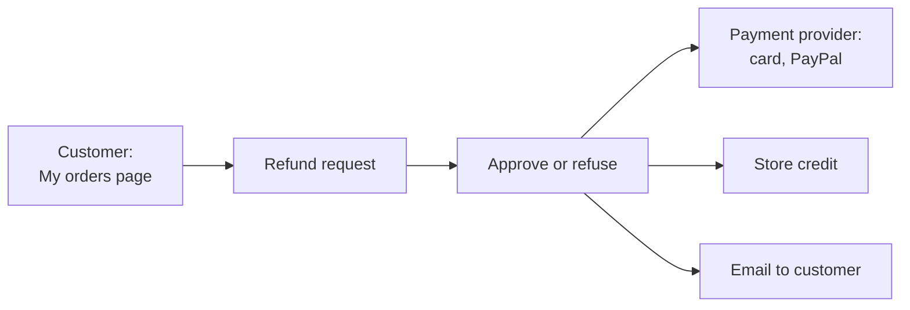

# Static Testing and Reviews: Find Bugs Before Any Code Runs

The cheapest bug is the one that never gets written. If a story says "refunds should be processed fast", one developer builds "within an hour" and another builds "within a week", and both are right by the story. Static testing is checking work *without running it*: reading stories, specs, test plans and code to find problems while they are still just words. It is the earliest testing you can do, and often the most valuable.

!!! info "In plain words"
    Think of building a house. Fixing a wrong wall on the drawing takes an eraser. Fixing it after the house is built takes a hammer, a week and a lot of money.
    A story or a spec is the drawing. Static testing is checking the drawing before anyone starts building.

!!! example "Your task"
    A new story arrives for the next sprint: customers can request refunds. Planning is tomorrow. Your lead asks: "Can you review the story before planning, so we don't find the gaps halfway through the sprint?"
    This page walks through that review, from the first read to a story the team can build and test.

## Jump to what you need

- [What static testing is](what-is-static-testing.md): what you can check without running anything, and why it saves so much time
- [Reviewing user stories](reviewing-user-stories.md): a worksheet that turns a vague story into a testable one
- [Finding ambiguity and missing cases](finding-ambiguity-and-missing-cases.md): vague words, and the questions nobody asked
- [Review types](review-types.md): from a quick look to a formal inspection, and how to give comments people act on
- [Static analysis tools](static-analysis-tools.md): tools that read code and find bugs in seconds

## 1. Understand the ask

"Review the story" can mean a quick read or a full meeting. Ask first:

| You ask | Your lead answers |
| --- | --- |
| How deep should the review be? | Deep enough that the team can plan it. One hour, not a day |
| Who should I talk to? | The product owner wrote it. A developer will build it |
| What do you want back? | A list of questions, and the story updated with the answers |
| Is it already decided, or can it change? | It can change. That's the point of reviewing now |

## 2. Picture the system

Before you look for gaps, see where the story fits. A refund touches more than one page:



Every arrow is a place where the story might be silent. What if the payment provider refuses? What does the refused email say? The picture makes the gaps easy to see.

## 3. Learn just enough

You don't need a course for this. Read:

1. This topic's [reviewing user stories](reviewing-user-stories.md) lesson (15 minutes): the worksheet you will use.
2. [INVEST](https://www.agilealliance.org/glossary/invest/) on the Agile Alliance site (5 minutes): six things a good story has, a name your team may already use.

## 4. Get something running

Static testing needs no running app, but it does need a tool or two. Run the [vague-word scanner](#templates) on the story:

```bash
python ambiguity_scan.py story_refund_request.md
```

```text
line 4: "quickly"  How quickly? Give a number and a unit, for example: within 5 working days.
line 8: "recent"  How recent? Give a number of days.
line 9: "should"  Must it, or is it optional? Write 'must' or 'can'.
line 9: "fast"  How fast? Give a number and a unit, for example: within 2 seconds.
line 11: "may"  Is it allowed, or not? Who decides, and how?
line 12: "etc"  What else is on the list? Write every item.
line 13: "properly"  What does 'properly' look like? What is the expected result?

7 vague words found. Ask about each one before testing.
```

Seven questions in one second, before you have even read the story properly. The [finding ambiguity](finding-ambiguity-and-missing-cases.md) lesson shows what to do with them.

## 5. Decide what to check

The scanner only finds vague words. It can't find what is *missing*. For that, go through the [user story review worksheet](#templates) section by section: who and why, acceptance criteria, missing cases, fit with the rest. The missing cases section is where most of the value is. For the refund story it finds three questions the story never asked: partial refunds, refunding twice, and orders not delivered yet.

## 6. Write a one-page plan

Here the "plan" is the list of questions, sent to the product owner before planning:

| # | Question | Answer |
| --- | --- | --- |
| 1 | "Recent orders": how many days after delivery? | 30 days after delivery |
| 2 | "Processed fast": by when must the money arrive? | Approved or refused within 2 working days |
| 7 | Missing: can a customer refund part of an order? | Yes, item by item |
| 8 | Missing: can an order be refunded twice? | No. Each item once |

The full list has nine questions. You can see it in the [example review](#templates).

## 7. Build in small steps

Update the story one answer at a time, and keep the old wording visible until the product owner agrees. The reviewed story has seven clear criteria instead of six vague ones. Run the scanner again:

```text
line 4: "support"  Support how? Which cases exactly?

1 vague words found. Ask about each one before testing.
```

One flag is left, and it is fine: the story says "without calling support", meaning the support team. A tool shows you where to stop and think. You still decide.

## 8. Report and get feedback

Bring the questions and answers to planning, not just the new story. The team sees *why* the story changed, and the developer who builds it sees the cases you will test. That usually prevents the most frustrating kind of bug report: "but the story didn't say that".

## 9. Keep learning on your own

Review one story per sprint with the worksheet, even when nobody asks. Next, read [Test cases](../test-cases/index.md) to turn the reviewed criteria into test cases, and [Test strategy and planning](../test-strategy-and-planning/index.md) to see where reviews fit in a test plan.

!!! tip "How an experienced SDET thinks about this"
    - Every vague word is two different features waiting to happen. Ask now, while it costs a message.
    - The best question in a review is "what happens when it goes wrong?" Most stories only describe success.
    - Review the work, not the person. "This criterion can't be tested" lands better than "you forgot".
    - Tools find vague words and code mistakes. People find missing rules. You need both.

!!! warning "Red flags"
    - Stories reach the sprint with words like "fast", "easy" or "etc" in the criteria.
    - Testers see a story for the first time when the code is ready.
    - Bug reports often end with "the story didn't say".
    - Reviews are a meeting where one person reads aloud and nobody prepared.
    - Static checks (Ruff, gitleaks) exist, but nobody runs them before a commit.

!!! question "Stuck? Try this"
    - **The product owner is too busy to answer.** Send the questions as a short numbered list, each with your best guess: "Recent: I'll assume 30 days unless you say otherwise." People answer "yes" or "no" to a guess much faster than to an open question.
    - **The team says reviewing slows them down.** Count the time later. One sprint where a story changes halfway costs more than many one-hour reviews. Offer a 30-minute version: scanner plus the missing cases section only.
    - **You don't know the business well enough to spot gaps.** You don't have to. Ask the worksheet's questions anyway: "What if it goes wrong? Who must not do this?" They work on any feature.
    - **Your comments get ignored.** Label them. "must:" for things that block testing, "question:" for things you don't understand. The [review types](review-types.md) lesson shows how.

## Templates

**Every file is below, ready to copy.** The whole folder is also [on GitHub](https://github.com/arshaduzzaman-sm/myopensdet/tree/main/modules/think_like_a_tester/static_testing_and_reviews/templates).

Copy these into your own notes or project. Each file starts with a line that says where it came from.

=== "User story review"

    ```markdown
    --8<-- "modules/think_like_a_tester/static_testing_and_reviews/templates/user_story_review_worksheet.md"
    ```

=== "Requirements checklist"

    ```markdown
    --8<-- "modules/think_like_a_tester/static_testing_and_reviews/templates/requirements_review_checklist.md"
    ```

=== "ambiguity_scan.py"

    ```python
    --8<-- "modules/think_like_a_tester/static_testing_and_reviews/templates/ambiguity_scan.py"
    ```

=== "Review comments guide"

    ```markdown
    --8<-- "modules/think_like_a_tester/static_testing_and_reviews/templates/review_comments_guide.md"
    ```

=== ".pre-commit-config.yaml"

    ```yaml
    --8<-- "modules/think_like_a_tester/static_testing_and_reviews/templates/pre-commit-config.yaml"
    ```

=== "ruff.toml"

    ```toml
    --8<-- "modules/think_like_a_tester/static_testing_and_reviews/templates/ruff_settings.toml"
    ```

=== "Example review"

    ```markdown
    --8<-- "modules/think_like_a_tester/static_testing_and_reviews/examples/story_review_refund.md"
    ```

=== "How to use them"

    1. Run `python ambiguity_scan.py story.md` on every new story. Turn each flag into a question, or decide it is fine.
    2. Fill the user story review worksheet for stories, and the requirements checklist for longer specs.
    3. Send the questions as a numbered list, each with your best guess.
    4. Use the comment labels from the review comments guide in every review, for stories and code.
    5. For code: save the pre-commit file as `.pre-commit-config.yaml` and the Ruff file as `ruff.toml` in your project's main folder, then run `pre-commit install`.

## Official resources

- [ISTQB Certified Tester Foundation Level](https://istqb.org/certifications/certified-tester-foundation-level-ctfl-v4-0/): chapter 3 covers static testing and reviews
- [Agile Alliance: INVEST](https://www.agilealliance.org/glossary/invest/): what makes a good user story
- [Google: How to do a code review](https://google.github.io/eng-practices/review/): a public guide many teams follow
- [Ruff rules](https://docs.astral.sh/ruff/rules/): every check Ruff can run, with examples
