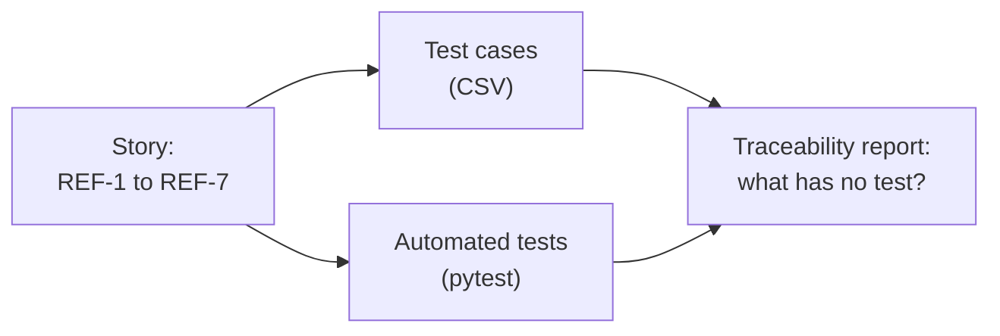

# Test Cases: Write Clear Checks Anyone Can Run, and Link Them to the Rules

A test idea is "check refunds after 30 days". A test case is that idea written so clearly that anyone on the team can run it and get the same result: what state to start in, what to do, and exactly what should happen. Good test cases make testing repeatable, make automation easy, and let you answer the question every manager eventually asks: "Is every requirement tested?"

!!! info "In plain words"
    A test idea is "make sure the cake tastes good". A test case is a recipe card: these ingredients, these steps, and "the cake should rise to 5 cm and be golden on top".
    Anyone with the card gets the same cake. And if it doesn't rise, everyone agrees something went wrong.

!!! example "Your task"
    The refund story has been reviewed (see [Static testing and reviews](../static-testing-and-reviews/index.md)), and its seven criteria are now clear: REF-1 to REF-7. Your lead asks: "Write the test cases, automate what makes sense, and show me that every criterion is covered."
    This page walks through that task.

## Jump to what you need

- [Anatomy of a test case](anatomy-of-a-test-case.md): the parts of a good test case, and a bad one fixed
- [Positive and negative cases](positive-and-negative-cases.md): test what must work, and what must be refused
- [Traceability](traceability.md): link every test to a requirement, and find the gaps

## 1. Understand the ask

| You ask | Your lead answers |
| --- | --- |
| Where do the test cases live? | In a CSV file in the repository, next to the code. No separate tool for now |
| Manual, automated, or both? | Automate the rules. Keep a few manual cases for emails and the support screen |
| What does "covered" mean? | Every criterion has at least one test case, and the important ones have a negative case too |
| Who else will read them? | The developer, and whoever tests the next release |

The last answer matters most. Test cases are written for someone else, maybe you in six months. Write them so a stranger can run them.

## 2. Picture the system

Every test case should point back to a rule, and every rule should have at least one test case. That two-way link is called **traceability**:



## 3. Learn just enough

Read this topic's [anatomy of a test case](anatomy-of-a-test-case.md) lesson (15 minutes). It is the one you will use every day. Then skim the [test case template](#templates) once, so you know the columns.

## 4. Get something running

Start with one automated test for the most important rule, and run it. The example uses a `covers` marker to link each test to its criterion, with the [covers plugin](#templates):

```bash
python -m pytest -q --requirements REF-1,REF-2,REF-3,REF-4,REF-5,REF-6,REF-7
```

After all ten cases are written, the end of the output looks like this:

```text
================================= requirements =================================
REF-1      3 tests
REF-2      1 test
REF-3      NO TESTS
REF-4      2 tests
REF-5      3 tests
REF-6      1 test
REF-7      1 test
11 passed in 0.02s
```

REF-3 ("approved or refused within 2 working days, with an email either way") has no automated test. That's not a mistake. It's about time and email, so it is covered by manual test cases instead. The [traceability](traceability.md) lesson shows how to bring both together.

## 5. Decide what to test

For each criterion, write at least one **positive** case (it works) and one **negative** case (it is refused). For limits, add the edges. The [positive and negative cases](positive-and-negative-cases.md) lesson walks through all seven criteria. Sort by priority: money and access first.

## 6. Write a one-page plan

- **Automated (pytest):** the rules in REF-1, 2, 4, 5, 6 and 7. Fast, and they run on every change.
- **Manual (CSV):** the emails and the support queue in REF-3 and REF-6, and one end-to-end check of the "My orders" page.
- **Done when:** the traceability script shows no requirement without a test case, and every automated test passes.

## 7. Build in small steps

Write one case, run it, then the next. For each automated test, break the rule once on purpose and check the test fails. Then add the manual cases to the CSV and run the [traceability script](#templates):

```bash
python traceability.py refund_requirements.txt refund_test_cases.csv
```

```text
No test case: REF-5 (Card and PayPal back to the same account; gift card becomes store credit)
TC-16 covers REF-8, which is not in the requirements (typo or new?)
```

Two real findings. REF-5 *is* tested, by automated tests, but nobody listed them in the CSV. And a test case points to REF-8, which isn't in the story at all. The [traceability](traceability.md) lesson explains both.

## 8. Report and get feedback

Send your lead the traceability table: one line per criterion, with its test cases. It answers "is every requirement tested?" in a form anyone can check. Point out the manual cases, because they need a person each release, and say which ones could be automated later.

## 9. Keep learning on your own

Next, read [Bug reports](../bug-reports/index.md): when a test case fails, the bug report starts from it. Later, the [pytest framework](../../core-automation/pytest-framework/index.md) topic goes deeper into markers and plugins like the one used here.

!!! tip "How an experienced SDET thinks about this"
    - Write test cases for a stranger. If someone new can't run it alone, it isn't finished.
    - One test case, one check. When it fails, you should know what broke without reading the steps.
    - The expected result is the most important line. "It works" is not an expected result.
    - Traceability works both ways: every rule has a test, and every test has a rule. A test with no rule is either a missing rule or a test nobody needs.

!!! warning "Red flags"
    - Expected results say "works correctly" or "as expected".
    - Test cases have twenty steps and check ten things.
    - Nobody can say which requirement a test case is for.
    - Only positive cases: nothing checks what must be refused.
    - The manual test case list and the automated tests are never compared.

!!! question "Stuck? Try this"
    - **The criteria are too vague to write an expected result.** That's a review problem, not a test case problem. Go back to the [story review](../static-testing-and-reviews/reviewing-user-stories.md) and ask for a number.
    - **You have too many test cases to maintain.** Merge the ones that test the same rule with the same data, and automate the stable ones. Keep manual cases for what needs a person.
    - **Nobody reads the test cases.** Keep them next to the code, in a simple format (CSV or Markdown), and link them from the story. Cases in a separate tool nobody opens are cases nobody updates.
    - **You don't know whether to automate a case.** Use the [automation readiness checklist](../the-sdet-role/index.md#templates) from the SDET role topic.

## Templates

**Every file is below, ready to copy.** The whole folder is also [on GitHub](https://github.com/myopensdet/myopensdet.github.io/tree/main/modules/think_like_a_tester/test_cases/templates).

Copy these into your own project. Each file starts with a line that says where it came from.

=== "Test case (Markdown)"

    ```markdown
    --8<-- "modules/think_like_a_tester/test_cases/templates/test_case.md"
    ```

=== "Test cases (CSV)"

    ```text
    --8<-- "modules/think_like_a_tester/test_cases/templates/test_cases.csv"
    ```

=== "traceability.py"

    ```python
    --8<-- "modules/think_like_a_tester/test_cases/templates/traceability.py"
    ```

=== "covers plugin (conftest.py)"

    ```python
    --8<-- "modules/think_like_a_tester/test_cases/templates/covers_plugin.py"
    ```

=== "Example: refund test cases"

    ```text
    --8<-- "modules/think_like_a_tester/test_cases/examples/refund_test_cases.csv"
    ```

=== "How to use them"

    1. Use the Markdown template for one detailed case, and the CSV template for a list of cases. Spreadsheet tools open the CSV directly (delete the first comment line if yours complains).
    2. Give every requirement an ID (like REF-1), and put it in the Covers column of each case.
    3. Run `python traceability.py requirements.txt test_cases.csv` to see gaps.
    4. For automated tests, save the covers plugin as `conftest.py`, mark tests with `@pytest.mark.covers("REF-1")`, and run `pytest --requirements REF-1,REF-2`.

## Official resources

- [ISTQB Glossary: test case, traceability](https://glossary.istqb.org/)
- [pytest: Working with custom markers](https://docs.pytest.org/en/stable/example/markers.html): how the `covers` marker works
- [pytest: Writing hook functions](https://docs.pytest.org/en/stable/how-to/writing_hook_functions.html): the hooks the covers plugin uses
- [Python csv module](https://docs.python.org/3/library/csv.html): how the traceability script reads the test case file
