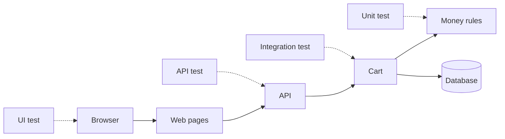

# Test Levels and the Test Pyramid: Which Tests to Write, and How Many

You can test the same rule in very different ways. You can check one small function in a blink, or drive a whole browser through checkout in many seconds. Both are "tests", but they cost very different amounts of time and trouble. This topic shows you the levels of testing, how to choose between them, and how to tell when a team has the mix wrong.

!!! info "In plain words"
    Think about checking a new car. You can test each part on a bench: the brakes, the lights, the engine. That is quick, and when something fails you know exactly which part.
    Then you put some parts together and check they work as one. Last, you take the whole car for a drive. The drive tells you the most, but it takes the longest, and when something feels wrong, it is hard to say which part caused it.
    Software tests work the same way. Most checks belong on the bench. Only a few need the full drive.

!!! example "Your task"
    Your team runs an online shop. The tests take ages, and a few fail at random, so people have started to ignore them. Your lead asks: "Can you work out why our tests are so slow and flaky, and what we should change?"
    This page walks through that task, with a small example shop you can run yourself.

## Jump to what you need

- [The test levels](the-test-levels.md): unit, integration, API, UI and end-to-end, with one rule tested at each
- [The test pyramid](the-test-pyramid.md): how many tests to have at each level, and the "ice cream cone" to avoid
- [The testing trophy](the-testing-trophy.md): a different shape, and when it fits better
- [Non-functional testing](non-functional-testing.md): performance, usability, compatibility and reliability
- [Choosing the right level](choosing-the-right-level.md): a decision chart for every new test idea

## 1. Understand the ask

"The tests are slow and flaky" could mean many things. Ask before you look:

| You ask | Your lead answers |
| --- | --- |
| Which tests are slow? | The full run before each release. It takes most of a morning |
| Which ones fail at random? | Mostly the browser tests for checkout |
| What does "done" mean? | A suggestion for what to change, and one area changed as an example |
| Can I delete tests? | Only if something else covers what they checked |
| Who wrote the tests? | Different people over two years. Nobody owns them |

The last answer matters. Tests that nobody owns tend to grow in the easiest direction, not the best one.

## 2. Picture the system

Draw the shop's parts, and where each kind of test touches them:



Look at the arrows. A UI test goes through every part, so it can break for many reasons. A unit test touches one small part, so when it fails, you know exactly where to look.

## 3. Learn just enough

Read two well-known articles, about 40 minutes in total:

1. [The Practical Test Pyramid](https://martinfowler.com/articles/practical-test-pyramid.html) by Ham Vocke, on Martin Fowler's site: the sections "The Test Pyramid" and "Unit tests" are enough for now.
2. [The Testing Trophy and Testing Classifications](https://kentcdodds.com/blog/the-testing-trophy-and-testing-classifications) by Kent C. Dodds: a different view, from the world of web front ends.

Then read this topic's [test levels](the-test-levels.md) lesson, to see one rule tested at every level.

## 4. Get something running

Before you change anything, look at the shape of the suite. Sort the test files into folders by level (`tests/unit`, `tests/api`, `tests/ui` and so on), add the [conftest.py template](#templates) so each test gets marked with its folder's level, and run the [pyramid report](#templates):

```bash
python pyramid_report.py
```

In this example, the team's suite looks like this:

```text
Tests per level (a healthy suite is widest at the bottom)

e2e                                  0    0%
ui           ###############         8   73%
api          ####                    2   18%
integration                          0    0%
unit         ##                      1    9%

Total: 11 tests

Warning: more UI and end-to-end tests than unit tests.
This is the 'ice cream cone' shape: slow, and often flaky.
Look for UI tests that could become API or unit tests.
```

There it is. Almost everything is tested through the browser: the slowest and most fragile way. The suite is upside down.

## 5. Decide what to change

Go through the UI tests one by one, with the [decision chart](#templates). For each one, ask: "What is this test really checking? What is the lowest level that could catch that bug?"

| UI test today | What it really checks | Better level |
| --- | --- | --- |
| Free shipping at $50 | A money rule | Unit |
| Apply a coupon | A money rule, plus the cart | Unit and integration |
| Declined card at checkout | What the API answers | API |
| Log in | That the login page works for a real user | Keep as UI |
| Checkout with a card | The full journey that earns money | Keep as one end-to-end test |

Most of the "UI tests" were really checking rules. Those belong lower down, where they run in milliseconds and don't break when a button moves.

## 6. Write a one-page plan

A plan to share with your lead:

- **Goal:** a suite that is widest at the bottom, and a full run that takes minutes, not a morning.
- **First area:** checkout. Move the money rules to unit tests, the error cases to API tests, and keep one end-to-end checkout journey.
- **Rule from now on:** every new test idea goes through the decision chart.
- **Done when:** the pyramid report shows more unit tests than UI tests, and the checkout tests have run without a random failure for two weeks.

## 7. Build in small steps

Move one rule at a time. For each one: write the lower-level test, check that it fails when the rule breaks, and only then delete the old UI test. That order matters. If you delete first, you might lose a check without noticing. After checkout, the report for that part of the shop looks like this:

```text
Tests per level (a healthy suite is widest at the bottom)

e2e                                  0    0%
ui           ##                      1    8%
api          #####                   3   23%
integration  ###                     2   15%
unit         ###########             7   54%

Total: 13 tests
```

## 8. Report and get feedback

Show your lead the two reports side by side, the run time before and after, and the list of UI tests you kept, with a reason for each. Also show one real bug the new integration test caught that the unit tests missed (see [The test levels](the-test-levels.md), step 3). A real catch convinces people more than any chart.

## 9. Keep learning on your own

Run the pyramid report every few weeks, and add it to your team's review of the test suite. Next, read [Test design techniques](../test-design-techniques/index.md) to choose good cases within each level, and [UI automation](../../core-automation/ui-automation/index.md) when you are ready to write the few browser tests you keep.

!!! tip "How an experienced SDET thinks about this"
    - "What is this test really checking?" is the most useful question in this whole topic. The answer tells you the level.
    - A test should fail for one reason. A browser test can fail for fifty, so keep only the ones where the browser is the point.
    - Speed is a feature of a test suite. Fast tests get run often. Slow tests get skipped, and then they protect nobody.
    - The pyramid is a guide, not a law. Count your tests, but judge the mix by how fast and how trusted the suite is.

!!! warning "Red flags"
    - The full test run takes so long that people only run it before a release.
    - People rerun failed tests until they pass, instead of asking why they failed.
    - Every new feature gets a new browser test, and nothing else.
    - Nobody can say which level a test belongs to.
    - Unit tests exist, but nobody runs them.

!!! question "Stuck? Try this"
    - **You can't tell which level a test is.** Look at what it needs to run. Needs a browser: UI. Needs the app running and calls a URL: API. Needs a database or several classes: integration. Needs nothing but the code: unit.
    - **The team is afraid to delete old UI tests.** Don't delete. Move the check lower first, prove the new test fails when the rule breaks, then show the team both tests. Delete only when they agree.
    - **There are no unit tests, and the code is hard to test.** Start with API tests. They are fast enough, and they don't need the code to change. Ask developers to add unit tests for new code.
    - **The browser tests fail at random and you don't know why.** Write down each failure for a week: which test, which step, what error. Patterns appear quickly. The [flaky tests](../../advanced-testing/flaky-tests-and-speed/index.md) topic goes deeper.

## Templates

**Every file is below, ready to copy.** The whole folder is also [on GitHub](https://github.com/myopensdet/myopensdet.github.io/tree/main/modules/think_like_a_tester/test_levels_and_the_pyramid/templates).

Copy these into your own project. Each file starts with a comment line that says where it came from.

=== "Decision chart"

    ```markdown
    --8<-- "modules/think_like_a_tester/test_levels_and_the_pyramid/templates/test_level_decision_chart.md"
    ```

=== "conftest.py (mark by folder)"

    ```python
    --8<-- "modules/think_like_a_tester/test_levels_and_the_pyramid/templates/conftest.py"
    ```

=== "pytest.ini (the levels)"

    ```ini
    --8<-- "modules/think_like_a_tester/test_levels_and_the_pyramid/templates/pytest.ini"
    ```

=== "Pyramid report"

    ```python
    --8<-- "modules/think_like_a_tester/test_levels_and_the_pyramid/templates/pyramid_report.py"
    ```

=== "How to use them"

    1. Put `pytest.ini` in your project's main folder, and `conftest.py` in your `tests/` folder.
    2. Sort your test files into `tests/unit`, `tests/integration`, `tests/api`, `tests/ui` and `tests/e2e`. Create only the folders you need.
    3. Run one level with `pytest -m unit`, or skip the slow ones with `pytest -m "not ui"`.
    4. Put `pyramid_report.py` in the main folder and run `python pyramid_report.py` to see the shape.
    5. Print the decision chart, or keep it open, when you plan new tests.

## Official resources

- [Martin Fowler: Test Pyramid](https://martinfowler.com/bliki/TestPyramid.html): a short history of the idea
- [The Practical Test Pyramid](https://martinfowler.com/articles/practical-test-pyramid.html): a long, hands-on guide
- [Kent C. Dodds: The Testing Trophy](https://kentcdodds.com/blog/the-testing-trophy-and-testing-classifications)
- [pytest: Working with custom markers](https://docs.pytest.org/en/stable/example/markers.html)
- [ISTQB Glossary](https://glossary.istqb.org/): test level, component testing, system testing
