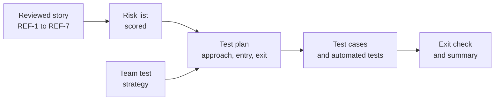

# Test Strategy and Planning: Decide What to Test, How Deeply, and When You're Done

There is never time to test everything. Planning is how you choose, out loud, what gets tested deeply, what gets a quick look, and what gets skipped, so the team agrees before the release and not after a bug. This topic covers the two documents most teams use, a **test strategy** for the whole team and a **test plan** for each feature, and three small tools that turn the hard parts into numbers you can discuss.

!!! info "In plain words"
    A test strategy is like a family's house rules: "shoes off at the door, homework before games". They hold every day.
    A test plan is the plan for one trip: where you're going, what to pack, and when you'll be back. It follows the house rules, and adds what this trip needs.

!!! example "Your task"
    The refund feature from [Test cases](../test-cases/index.md) is going into release 2.4 in two weeks. Your lead says: "Write the test plan for refunds. Tell me what you'll test first, what you won't automate, and how we'll know we're done."
    This page walks through that plan, from risks to sign-off.

## Jump to what you need

- [Test strategy](test-strategy.md): the one page that says how your team tests, every time
- [Test plan](test-plan.md): the plan for one feature or release, with a full refund example
- [Risk-based testing](risk-based-testing.md): score what could go wrong, and test the worst first
- [Entry and exit criteria](entry-and-exit-criteria.md): when testing can start, and when it's done
- [What not to automate](what-not-to-automate.md): a checklist and a payback calculator

## 1. Understand the ask

| You ask | Your lead answers |
| --- | --- |
| Is there a team test strategy? | Yes, one page. Follow it, and say where you differ |
| What's the release date? | Friday in two weeks. Sign-off on Friday morning |
| Who reviews the plan? | Me, the refund developer and the product owner |
| What does "done" mean here? | The strategy's default exit criteria, unless you suggest stricter ones |

## 2. Picture the system

A plan connects things you already have from earlier topics:



The story gives the rules, the risks give the order, the strategy gives the defaults, and the exit check tells you when to stop.

## 3. Learn just enough

Read the [risk-based testing](risk-based-testing.md) lesson first (15 minutes). It is the part that changes how you work. Then skim the [test plan](test-plan.md) example, and keep it open while you write yours.

## 4. Get something running

Run the [risk scorer](#templates) on the refund risks:

```bash
python risk_score.py refund_risks.csv
```

```text
| Score | Depth | Area | Risk |
| --- | --- | --- | --- |
| 6 | deep | Money | The same item is refunded twice (REF-2) |
| 6 | deep | Money | Money goes back to the wrong place (REF-5) |
| 6 | deep | Rules | Day 30 or day 31 is handled wrongly (REF-1) |
| 4 | normal | Email | The approval or refusal email is not sent (REF-3) |
| 4 | normal | Rules | A sale item is refunded when it is not faulty (REF-4) |
| 3 | normal | Money | A refund to an expired card is lost (REF-6) |
| 2 | light | Page | Long Bengali item names break the refund page layout |
| 1 | light | Page | The Cancel order link is missing for undelivered orders (REF-7) |

3 deep, 3 normal, 2 light. Test the deep ones first.
```

Now you have an order to test in, and a table to paste into the plan.

## 5. Decide what to put in

For each risk, decide the level and whether to automate it. Money rules go in fast unit and API tests. Email wording and the Bengali layout stay manual, because they need a human eye. The [automation checklist](what-not-to-automate.md) makes that choice quick and easy to explain.

## 6. Write a one-page plan

Use the [test plan template](#templates). The [test plan](test-plan.md) lesson shows the finished refund plan: scope, the risk table, the approach, entry and exit criteria, who does what, and one open question for the product owner.

## 7. Build in small steps

Test the deep risks first, then normal, then light. If time runs out, it runs out on the light risks, and the plan already says so. Keep the exit numbers in a file, and check them with the [exit checker](#templates) as you go, not only on the last day.

## 8. Report and get feedback

On sign-off day, run the exit check and share the result:

```bash
python exit_check.py refund_exit_criteria.toml refund_results.toml
```

```text
met      failed_tests: 0 (at most 0)
met      open_critical_bugs: 0 (at most 0)
NOT MET  open_major_bugs: 1 (at most 0)
met      requirements_without_tests: 0 (at most 0)
met      deep_risks_not_tested: 0 (at most 0)

1 exit criterion not met. Don't sign off yet, or agree an exception in writing.
```

One major bug is still open. You don't decide alone whether to release. You bring the facts, and the team decides: fix it first, or release with a written reason.

## 9. Keep learning on your own

When you start automating, the [pytest framework](../../core-automation/pytest-framework/index.md) topic shows how to organise the tests your plan asks for. For how teams track quality over many releases, see [quality metrics](../../professional-sdet/quality-metrics/index.md).

!!! tip "How an experienced SDET thinks about this"
    - A plan is for agreeing, not for filing. If nobody reviewed it, it isn't a plan yet.
    - Start from what would hurt most. Test order follows risk, not the order of the story.
    - Decide "done" before you start. Exit criteria set on the last day bend to fit the results.
    - Say what you won't test, and why. Silence about scope is how surprises happen.

!!! warning "Red flags"
    - A 30-page test plan nobody has read.
    - Every risk is "high".
    - No exit criteria, so testing ends when time runs out.
    - "Automate everything" as the whole automation plan.
    - The plan was written once and never updated when the story changed.

!!! question "Stuck? Try this"
    - **You don't know the risks.** Ask the developer "what are you most worried about?" and support "what do customers complain about most?". Those two answers are most of your risk list.
    - **There's no team strategy.** Write the plan anyway, and put the defaults you used in it. A good plan is often how a strategy starts.
    - **There isn't enough time for the plan.** Then the plan matters more. Test the deep risks, write down what you skipped, and share that list before the release.
    - **People argue about the plan.** Good. That's the point of it. Write down what you agreed, and change the plan.

## Templates

**Every file is below, ready to copy.** The whole folder is also [on GitHub](https://github.com/arshaduzzaman-sm/myopensdet/tree/main/modules/think_like_a_tester/test_strategy_and_planning/templates).

Copy these into your own project. Each file starts with a line that says where it came from.

=== "Test plan"

    ```markdown
    --8<-- "modules/think_like_a_tester/test_strategy_and_planning/templates/test_plan.md"
    ```

=== "Test strategy"

    ```markdown
    --8<-- "modules/think_like_a_tester/test_strategy_and_planning/templates/test_strategy.md"
    ```

=== "risk_score.py"

    ```python
    --8<-- "modules/think_like_a_tester/test_strategy_and_planning/templates/risk_score.py"
    ```

=== "exit_check.py"

    ```python
    --8<-- "modules/think_like_a_tester/test_strategy_and_planning/templates/exit_check.py"
    ```

=== "automation_roi.py"

    ```python
    --8<-- "modules/think_like_a_tester/test_strategy_and_planning/templates/automation_roi.py"
    ```

=== "Automation checklist"

    ```markdown
    --8<-- "modules/think_like_a_tester/test_strategy_and_planning/templates/automation_roi_checklist.md"
    ```

=== "How to use them"

    1. Fill `risks.csv` with what could go wrong, then run `python risk_score.py risks.csv` and paste the table into the plan.
    2. Write the plan in `test_plan.md`. Keep `exit_criteria.toml` next to it, and run `python exit_check.py exit_criteria.toml results.toml` before sign-off.
    3. For each check you might automate, go through the checklist, and run `automation_roi.py` with your own numbers.
    4. The scripts need only Python 3.11 or newer. Nothing to install.

## Official resources

- [ISTQB Certified Tester Foundation Level v4.0](https://istqb.org/certifications/certified-tester-foundation-level-ctfl-v4-0/): chapter 5 covers test planning, risk and entry and exit criteria
- [ISTQB Glossary: test strategy, test plan, exit criteria](https://glossary.istqb.org/)
- [Martin Fowler: The Practical Test Pyramid](https://martinfowler.com/articles/practical-test-pyramid.html)
- [Python tomllib](https://docs.python.org/3/library/tomllib.html): how `exit_check.py` reads its files
