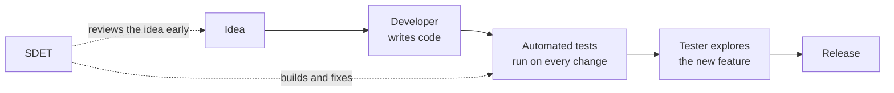

# The SDET Role: What the Job Is, and How to Start It Well

This topic explains what an SDET does, and walks you through the first 90 days in the role. It gives you the checklists, plan and first test that people really use when they start.

!!! info "In plain words"
    Think of a building inspector. A manual tester walks through the house and checks each room by hand.
    An SDET does that too, but also builds machines that check every room, every night, without being asked.
    **SDET** means Software Development Engineer in Test: a tester who writes code to test software.

!!! example "Your task"
    You have tested your company's online shop by hand for two years. Your lead says: "We want you as the team's first SDET. Can you plan your first 90 days?"
    This page walks through that plan. The same steps work if you are starting a new SDET job, joining a new team, or asked to "start automating" for the first time.

## Jump to what you need

- [What an SDET does](what-an-sdet-does.md): the daily work, and a test catching a real bug
- [SDET vs QA vs developer](sdet-vs-qa-vs-developer.md): who does what with the same bug
- [Skills map](skills-map.md): the skills the job needs, and how to find your gaps
- [The seven testing principles](seven-testing-principles.md): the ideas every tester works by
- [The test process and testware](test-process-and-testware.md): the seven activities of testing, and what each one produces

## 1. Understand the ask

"Be our SDET" can mean many things. Use the [day-one questions](../learning-a-new-testing-area/index.md#templates) from the last topic, and ask your lead:

| You ask | Your lead answers |
| --- | --- |
| What should I do more of? | Automate the checks we repeat before every release |
| What should I do less of? | Testing the same pages by hand every sprint |
| What does "done" mean after 90 days? | Smoke tests run after every deploy, and the team trusts them |
| Will I still test by hand? | Yes, for new features and for exploring |
| Who helps me with code? | A developer on the team will review your code |

The answers show the job is not "stop testing, start coding". It is testing, plus code that saves the team time.

## 2. Picture the system

Draw where an SDET fits in the team: how a change travels from an idea to users.



The SDET does not wait at the end. They join at the start (reviewing the idea) and they own the machine in the middle (the automated tests).

## 3. Learn just enough

Don't try to learn every tool at once. In the first week, work through the [new team onboarding checklist](#templates): access, people, the product, the existing tests. Then read two pages on this site:

1. [What an SDET does](what-an-sdet-does.md) (15 minutes).
2. [The seven testing principles](seven-testing-principles.md): the ideas your team will expect you to know (20 minutes).

## 4. Get something running

The first test most SDETs write on a new team is a **smoke test**: the quickest check that the app is up after a deploy. Copy the [smoke test template](#templates), point it at the shop, and run it:

```bash
BASE_URL=http://127.0.0.1:8080 HEALTH_PATH=/api/health SMOKE_PAGES=/,/login pytest test_smoke.py -v
```

You should see:

```text
test_smoke.py::test_health_check_says_ok PASSED                          [ 25%]
test_smoke.py::test_health_check_is_fast PASSED                          [ 50%]
test_smoke.py::test_page_loads[/] PASSED                                 [ 75%]
test_smoke.py::test_page_loads[/login] PASSED                            [100%]
============================== 4 passed in 0.19s ===============================
```

Here `BASE_URL` points at a copy of the shop on a local computer. On your team it is your test environment, for example `https://staging.your-company.example`. If a page is missing, the test names it:

```text
FAILED test_smoke.py::test_page_loads[/basket] - AssertionError: /basket answ...
1 failed, 3 passed in 0.07s
```

Four checks in a fifth of a second, after every deploy, forever. That is the kind of thing an SDET builds.

## 5. Decide what to automate first

List the checks your team repeats by hand before each release. Run each one through the [automation readiness checklist](#templates):

| Check done by hand today | Worth it? | Reliable? | Decision |
| --- | --- | --- | --- |
| The site is up after a deploy | Every deploy, 10 minutes | Yes | Automate now (done in step 4) |
| Log in, add to cart, pay with a test card | Every release, 20 minutes | Yes, with test accounts | Automate now |
| The new homepage banner "looks right" | Changes every month | No, needs a human eye | Keep manual |
| The monthly sales report adds up | Monthly, 2 hours | Yes, with fixed test data | Automate later, after checkout |

Not every check should be automated. The checklist makes the choice clear, and gives you an answer when someone asks "why not automate everything?"

## 6. Write a one-page plan

Turn your choices into a [30-60-90 day plan](#templates), and agree it with your lead:

| When | Goal | Proof it is done |
| --- | --- | --- |
| Days 1 to 30 | Learn the product, the team and the existing tests | Onboarding checklist complete; smoke tests run after every deploy |
| Days 31 to 60 | Automate the checkout check | The checkout test runs in the pipeline on every change, and has run green for two weeks |
| Days 61 to 90 | Own the release checks | Half the release checklist is automated, and the team looks at the results without being asked |

Every goal has proof you can show. "Learn Python" can't be checked. "The checkout test runs in the pipeline" can.

## 7. Build in small steps

Keep testing by hand while you build. Each week, automate one check, starting with the most boring and most repeated one. Run each new test as soon as you write it, and ask a developer to review the code. The [Python for testers](../../start-here/python-for-testers/index.md) and [pytest](../../core-automation/pytest-framework/index.md) topics teach the code.

## 8. Report and get feedback

Every two weeks, show your lead three things: the tests you added, a problem they caught, and what is still checked by hand. At each check-in, update the plan's table. Plans change, and that is fine, as long as the change is written down.

## 9. Keep learning on your own

Pick one new skill per month from the [Skills Matrix](../../start-here/skills-matrix.md), and tie it to a real task on your team. Next, read [Test levels and the pyramid](../test-levels-and-the-pyramid/index.md) to decide which kinds of tests to build first.

!!! tip "How an experienced SDET thinks about this"
    - Code is a tool for testing, not the goal. A test that nobody runs or trusts is worth nothing.
    - Keep your tester's eye. The best SDETs still explore by hand, because automation only checks what someone thought of.
    - Automate what is boring, repeated and stable first. A page that changes every week is a poor first target.
    - Ask developers to review your test code. It is the fastest way to learn, and it makes them trust the tests.

!!! warning "Red flags"
    - You stopped testing by hand completely as soon as you started coding.
    - You count tests instead of problems caught. 500 tests that never fail may test nothing useful.
    - Your plan says "learn Python" with no proof of being done.
    - You try to automate everything at once, and finish nothing.
    - Only you can run or fix the tests. If you are on holiday, nobody can use them.

!!! question "Stuck? Try this"
    - **You don't know where to start.** Write a smoke test. It is small, useful on day one, and teaches you how the team deploys.
    - **The existing tests are a mess.** Don't rewrite them. Run them, list what fails and why, and fix one thing per week.
    - **Nobody has time for your questions.** Collect them in the onboarding checklist, and ask them all in one 30-minute meeting.
    - **You can't get access to an environment.** Tell your lead on day one, in writing. Missing access is one of the most common reasons a new SDET is stuck for weeks.

## Templates

**Every file is below, ready to copy.** The whole folder is also [on GitHub](https://github.com/myopensdet/myopensdet.github.io/tree/main/modules/think_like_a_tester/the_sdet_role/templates).

Copy these into your own project and change the parts in `<angle brackets>`. Each file starts with a comment line that says where it came from.

=== "New team onboarding checklist"

    ```markdown
    --8<-- "modules/think_like_a_tester/the_sdet_role/templates/new_team_onboarding_checklist.md"
    ```

=== "30-60-90 day plan"

    ```markdown
    --8<-- "modules/think_like_a_tester/the_sdet_role/templates/first_90_days_plan.md"
    ```

=== "Automation readiness checklist"

    ```markdown
    --8<-- "modules/think_like_a_tester/the_sdet_role/templates/automation_readiness_checklist.md"
    ```

=== "Smoke test (pytest)"

    ```python
    --8<-- "modules/think_like_a_tester/the_sdet_role/templates/test_smoke.py"
    ```

=== "How to use them"

    1. **Week 1:** copy the onboarding checklist into your notes. Fill in each answer as you get it.
    2. **Week 2:** write your 30-60-90 day plan, and agree it with your lead.
    3. **Before each automation task:** run the check through the readiness checklist. Keep the filled-in copy: it explains your choice later.
    4. **Smoke test:** save `test_smoke.py` in your test folder. Install pytest (`pip install pytest`), set `BASE_URL` to your test environment, and run `pytest test_smoke.py -v`. Without `BASE_URL`, every test is skipped, so it never fails by accident.

## Official resources

- [ISTQB Certified Tester Foundation Level](https://istqb.org/certifications/certified-tester-foundation-level-ctfl-v4-0/): the seven principles and the test process come from this syllabus
- [ISTQB Glossary](https://glossary.istqb.org/): the official meaning of testing words
- [pytest documentation](https://docs.pytest.org/en/stable/): the test tool used across this site
- [Python: urllib.request](https://docs.python.org/3/library/urllib.request.html): what the smoke test uses to call your app
