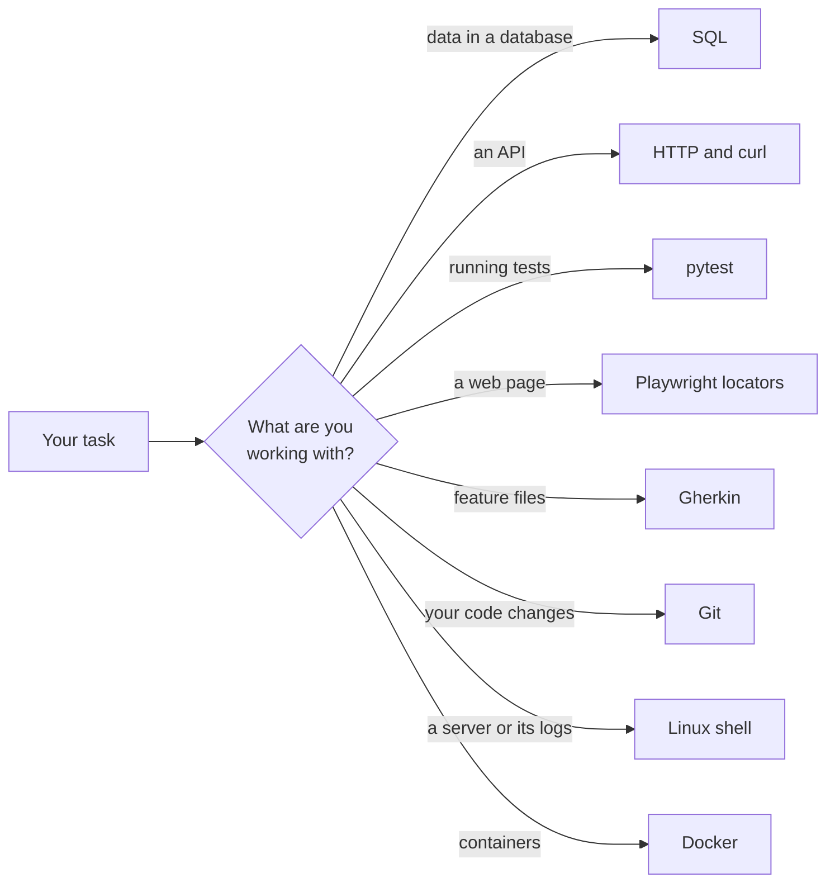

# Cheat Sheets for Testers: SQL, HTTP, pytest, Playwright, Gherkin, Git, Linux and Docker

You know the command exists. You've used it before. Now, in the middle of a task, you can't remember if it's `-k` or `-m`, `LEFT JOIN` or `JOIN`, `get_by_label` or `get_by_placeholder`. A web search gives you an answer for another tool, an old version, or a long article. These sheets give the answer in one line, for the tools on this site.

!!! example "The problem"
    **You, during a release check:** "I need to find orders whose customer was deleted. How did that SQL go again?"

## Step 1: Pick the sheet for the task



| Sheet | Open it when you need to |
| --- | --- |
| [SQL](sql.md) | Read data, count, join, and find bad data: duplicates, orphans, missing values, wrong totals |
| [HTTP and curl](http.md) | Know what a status code means for your test, send a request from the terminal |
| [pytest](pytest.md) | Run one test, a marker, only the last failures |
| [Playwright locators](locators.md) | Find an element the stable way, act on it, check it |
| [Gherkin](gherkin.md) | Write or review a feature file |
| [Git](git.md) | Branch, share, catch up with main, undo a mistake |
| [Linux shell](shell.md) | Read and search logs, check processes and ports |
| [Docker](docker.md) | Start a test database, read container logs, clean up safely |

Each sheet is one page you can print. **Every example on them is tested**: the SQL runs on a practice database, the locators run in a real browser, the Gherkin goes through the official parser, and the status code names are checked against Python's own list.

## Step 2: Get the kit

You need **Python 3.13**. Get the files from [Templates](#templates) below, or take the whole folder [from GitHub](https://github.com/myopensdet/myopensdet.github.io/tree/main/modules/toolbox/cheat_sheets/templates). The SQL practice needs nothing else. The locator test needs `pip install pytest-playwright` and `playwright install chromium`.

## Step 3: Try the SQL sheet on a practice shop

Reading SQL is not the same as knowing it. `try_sql.py` loads a tiny shop database into memory and runs any query from the sheet. Every run starts fresh, so `UPDATE` and `DELETE` are safe to try:

```bash
python try_sql.py "SELECT status, COUNT(*) AS how_many FROM orders GROUP BY status"
```

```text
status     how_many
---------  --------
cancelled  1
paid       4
(2 rows)
```

The shop has **four planted problems**, the kind real databases have. The sheet's weekly checks find each one. Orders whose customer doesn't exist:

```bash
python try_sql.py "SELECT o.id, o.customer_id FROM orders o LEFT JOIN customers c ON c.id = o.customer_id WHERE c.id IS NULL"
```

```text
id   customer_id
---  -----------
105  99
(1 row)
```

An order whose total doesn't match its lines:

```text
id   total  lines_total
---  -----  -----------
104  40     24.5
(1 row)
```

Each row is a bug report: "Order 104 charged 40.00, its items add up to 24.50." On your database, change the table and column names, and run the same checks after your tests.

## Step 4: Try the locators in a browser

`test_locators.py` runs every line of the locators sheet on `locator_practice.html`, a small page with one example of everything:

```bash
python -m pytest test_locators.py -v
```

```text
test_locators.py::test_find[chromium] PASSED                             [ 33%]
test_locators.py::test_narrow[chromium] PASSED                           [ 66%]
test_locators.py::test_act_and_check[chromium] PASSED                    [100%]

========================= 3 passed, 1 warning in 0.53s =========================
```

The warning says `PytestRemovedIn10Warning` about the `base_url` fixture. It comes from the pytest-playwright plugin with pytest 9.2, not from your test, and changes nothing today.

To learn a locator, break it on purpose and read the error. Change `name="Add to cart"` so it matches two buttons, or use a name that isn't on the page, and see the errors in [step 7](#step-7-when-it-goes-wrong).

## Step 5: Make a cheat sheet for your own project

The most useful sheet is the one nobody gives you: **your project's**. Which address is staging? Which test account is the admin? Where are the logs? New testers ask these every week, and the answers live in someone's head. Write them down once:

```markdown
--8<-- "modules/toolbox/cheat_sheets/templates/team_cheat_sheet.md"
```

Keep it in the test repository, next to the README, so a pull request can update it. Two rules:

- **Never** write passwords, tokens or customer data in it. Write **where** to find them: "Password manager: QA accounts".
- Check it when something changes: a new environment, a new tool. A wrong sheet is worse than none.

## Step 6: Print one, or save it as a PDF

Open a sheet, then print from the browser (++ctrl+p++, or ++cmd+p++ on a Mac). Choose **Save as PDF** to keep a copy on your computer or phone. The menu and buttons are left out when you print.

## Step 7: When it goes wrong

| You see | What it means | Fix |
| --- | --- | --- |
| `SQL error: no such table: customer` | The table name is different (here: `customers`) | List the tables in your database tool, and copy the name |
| `SQL error: You can only execute one statement at a time.` | `try_sql.py` got several statements, like `BEGIN; ... ROLLBACK;` | Run one statement at a time. Try transactions in a database tool |
| `WHERE email = NULL` returns `(0 rows)` though some emails are empty | `= NULL` never matches anything | `WHERE email IS NULL` |
| `strict mode violation: get_by_role("button", name="Add to cart") resolved to 2 elements` | The locator matches more than one element | Narrow it: `page.get_by_role("listitem").filter(has_text="Test mug").get_by_role("button", name="Add to cart")`. The error lists a locator for each match |
| `TimeoutError: Locator.click: Timeout 30000ms exceeded.` with `waiting for get_by_role("button", name="Save changes")` | Nothing on the page has that role and name | Check the real text on the button. Run `playwright codegen` and click it to get the right locator |
| `Parser errors: (6:7): inconsistent cell count within the table` | A row in an `Examples:` or data table has more or fewer cells than the header | Count the cells on each row. `(6:7)` means line 6, column 7 |
| `UPDATE` changed every row | No `WHERE` | On a test database: restore it. Always run the `WHERE` as a `SELECT` first |

## Templates

**Every file is below, ready to copy.** The whole folder is also [on GitHub](https://github.com/myopensdet/myopensdet.github.io/tree/main/modules/toolbox/cheat_sheets/templates). The sheets themselves are on their own pages: open one from the table in [step 1](#step-1-pick-the-sheet-for-the-task).

=== "try_sql.py"

    ```python
    --8<-- "modules/toolbox/cheat_sheets/templates/try_sql.py"
    ```

=== "practice_shop.sql"

    ```sql
    --8<-- "modules/toolbox/cheat_sheets/templates/practice_shop.sql"
    ```

=== "test_locators.py"

    ```python
    --8<-- "modules/toolbox/cheat_sheets/templates/test_locators.py"
    ```

=== "locator_practice.html"

    ```html
    --8<-- "modules/toolbox/cheat_sheets/templates/locator_practice.html"
    ```

## References

- [SQLite: SQL as understood by SQLite](https://www.sqlite.org/lang.html)
- [MDN: HTTP response status codes](https://developer.mozilla.org/en-US/docs/Web/HTTP/Reference/Status)
- [curl: the man page](https://curl.se/docs/manpage.html)
- [pytest: how to invoke pytest](https://docs.pytest.org/en/stable/how-to/usage.html)
- [Playwright for Python: locators](https://playwright.dev/python/docs/locators)
- [Cucumber: Gherkin reference](https://cucumber.io/docs/gherkin/reference/)
- [Git: reference](https://git-scm.com/docs)
- [Docker: CLI reference](https://docs.docker.com/reference/cli/docker/)

Written for Python 3.13, pytest 9.2 and Playwright 1.64. Outputs captured November 2026. Links checked: November 2026.
