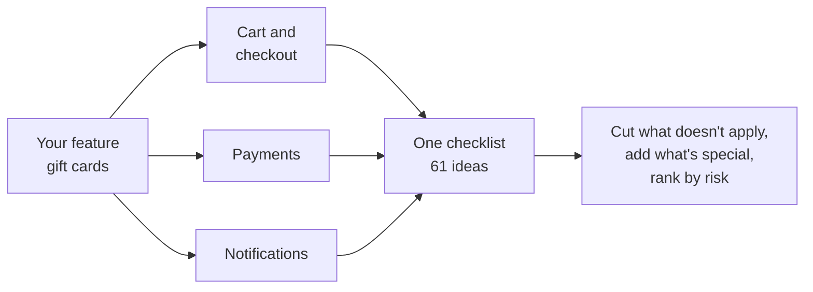

# Test Idea Banks: What to Test for Login, Checkout, Payments and More

A blank page is the hardest start for a test plan. Most features are made of parts every app has: a login, a form, a payment, a list to search. The bugs in those parts are the same from app to app. These banks hold the ideas for nine common parts, so you start from 20 good ideas instead of zero, and spend your time on what makes **your** feature different.

!!! example "The problem"
    **Your lead:** "Gift cards go to QA tomorrow. Customers buy them at checkout and get the code by email. Can you send your test ideas by the end of the day?"

## Step 1: See how the banks fit together

A feature is rarely one part. Gift cards touch the cart, the payment and an email. So you take the ideas from each bank it touches, and add what's special about gift cards:



Every bank has the same five areas. Each one catches a kind of bug that a quick test misses:

| Area | Asks | Why it's there |
| --- | --- | --- |
| **Works as it should** | Does the normal path work, end to end? | The basics. Check the result everywhere it shows: page, email, database |
| **Refuses bad input** | Is wrong input refused, with a clear message? | Users type everything. A 500 error for bad input is a bug |
| **Edges and limits** | What happens at exactly the limit, twice, or at the same moment? | Most bugs live at limits and in timing |
| **Security** | Can a user see or change what isn't theirs? | Easy to forget, and the most expensive to miss |
| **People, devices and failures** | Keyboard, screen reader, phone, a slow or broken service? | Real users and real networks |

The nine banks: **login, sign-up, search, cart and checkout, payments, bank transfer, file sharing, notifications, roles and permissions**. For single fields (text, numbers, dates), use the [error guessing checklist](../../manual-testing/test-design/error-guessing.md) as well.

## Step 2: Get the kit

You need **Python 3.13**. Get the files from [Templates](#templates) below, or take the whole folder [from GitHub](https://github.com/myopensdet/myopensdet.github.io/tree/main/modules/toolbox/test_idea_banks/templates). `idea_checklist.py` uses only Python's standard library. The banks are plain Markdown files in `ideas/`: you can also just open one and read it.

## Step 3: See the banks

```bash
python idea_checklist.py --list
```

```text
bank_transfer           20 ideas  Bank transfer
cart_and_checkout       24 ideas  Cart and checkout
file_sharing            20 ideas  File sharing
login                   26 ideas  Login
notifications           17 ideas  Notifications
payments                20 ideas  Payments
roles_and_permissions   17 ideas  Roles and permissions
search                  23 ideas  Search
sign_up                 24 ideas  Sign-up
```

## Step 4: Make one checklist for your feature

Name the banks your feature touches. The start of a name is enough (`cart` for `cart_and_checkout`):

```bash
python idea_checklist.py cart payments notifications > gift_cards_ideas.md
```

```markdown
# Test ideas: Cart and checkout, Payments, Notifications

61 ideas. Tick what you tested. Strike out what doesn't apply, and say why.

## Cart and checkout

### Works as it should

- [ ] Add one item, two of the same item, and different items: the total is right
- [ ] Change the quantity and remove items: the total updates
- [ ] Tax, shipping and discount are each correct, and in the right order
- [ ] The order confirmation, the email and the database show the same items and total
```

The file goes on: 61 ideas in all. The `- [ ]` boxes become real checkboxes in GitHub, GitLab, Jira and most wikis.

Short on time? Take one area across all the banks. Security is the one most often skipped:

```bash
python idea_checklist.py cart payments --only security
```

```markdown
# Test ideas: Cart and checkout, Payments

7 ideas. Tick what you tested. Strike out what doesn't apply, and say why.

## Cart and checkout

### Security

- [ ] Changing the price or total in the request is ignored: the server works it out again
- [ ] One user can't see or change another user's cart (change the id in the address)
- [ ] Discount codes can't be guessed quickly (rate limiting)

## Payments

### Security

- [ ] Card numbers never reach your server, logs or database (the provider's form handles them)
- [ ] The success page can't be opened directly to mark an order paid
- [ ] Webhooks from anyone except the provider are refused (signature check)
- [ ] Refunds need the right role
```

## Step 5: Make it yours

A bank is a start, not a plan. Spend 20 minutes on the list before you send it:

1. **Strike out** what doesn't apply, with a reason: "~~Two discount codes~~: the shop allows only one, by design." The reason shows you thought about it.
2. **Add what's special** about this feature. The banks don't know gift cards. Ask "what's new here?": a gift card used for part of a payment, a card used twice at the same moment, a card that expires, a refund of an order paid by gift card.
3. **Add your team's past bugs.** If refunds broke last year, add "refund of an order with cents". Past bugs are the best ideas there are.
4. **Rank by risk.** Mark the ideas where a bug would cost the most, and test those first. See [risk-based testing](../../manual-testing/test-planning/risk-based-testing.md).

Then send it. Ideas shared **before** the code is done are the cheapest bugs: a developer who reads "two people use the same gift card at the same moment" may handle it before you ever test it.

## Step 6: Put the ideas in your test tool

Most test management tools (Xray, Zephyr, TestRail, a spreadsheet) can import a CSV file:

```bash
python idea_checklist.py cart payments --csv > ideas.csv
```

```text
Feature,Area,Idea
Cart and checkout,Works as it should,"Add one item, two of the same item, and different items: the total is right"
Cart and checkout,Works as it should,Change the quantity and remove items: the total updates
Cart and checkout,Works as it should,"Tax, shipping and discount are each correct, and in the right order"
```

An idea is not yet a test case. For the ones you keep, write the steps and the expected result as shown in [test cases](../../manual-testing/test-cases/index.md). Ideas you'll run on every release are candidates for automation.

## Step 7: Grow the banks

The banks get better every time you use them. To add to one, open its file in `ideas/` and add a line under the right area, starting with `- `. To add a new kind of feature (say, "booking a time slot"), copy a bank, rename it, and keep the five `## ` area headings: the script finds it by itself.

Keep your team's banks in the test repository, so ideas are shared and reviewed like code.

## Step 8: When it goes wrong

| You see | What it means | Fix |
| --- | --- | --- |
| `No single idea bank called 'logn'. Choose from: bank_transfer, cart_and_checkout, ...` | A typo, or a name that matches no bank | Use a name from `--list`, or the start of one |
| `No area has 'speed' in its name. Try: works, refuses, edges, security, people` | `--only` takes a word from an area name | Use one of the words listed |
| `Choose one or more, like: python idea_checklist.py login payments` | No bank was named | Name at least one bank |
| `No ideas found. Each idea is a line starting with '- ', under a '## ' area heading.` | Your new bank's lines start with something else (like `* `), or there's no area heading above them. `--list` shows it with `0 ideas` | Copy the layout of an existing bank |
| The list has 80 ideas and two days to test | Too many banks, or nothing cut | Strike out, then rank by risk (step 5). Test the top first, and say what you didn't test |
| A bug came back that "was on the list" | The idea was ticked without being really tested, or tested once and never again | Tick only what you tested. Automate the ideas that matter on every release |

## Templates

**Every file is below, ready to copy.** The whole folder is also [on GitHub](https://github.com/myopensdet/myopensdet.github.io/tree/main/modules/toolbox/test_idea_banks/templates).

=== "idea_checklist.py"

    ```python
    --8<-- "modules/toolbox/test_idea_banks/templates/idea_checklist.py"
    ```

=== "login"

    ```markdown
    --8<-- "modules/toolbox/test_idea_banks/templates/ideas/login.md"
    ```

=== "sign_up"

    ```markdown
    --8<-- "modules/toolbox/test_idea_banks/templates/ideas/sign_up.md"
    ```

=== "search"

    ```markdown
    --8<-- "modules/toolbox/test_idea_banks/templates/ideas/search.md"
    ```

=== "cart_and_checkout"

    ```markdown
    --8<-- "modules/toolbox/test_idea_banks/templates/ideas/cart_and_checkout.md"
    ```

=== "payments"

    ```markdown
    --8<-- "modules/toolbox/test_idea_banks/templates/ideas/payments.md"
    ```

=== "bank_transfer"

    ```markdown
    --8<-- "modules/toolbox/test_idea_banks/templates/ideas/bank_transfer.md"
    ```

=== "file_sharing"

    ```markdown
    --8<-- "modules/toolbox/test_idea_banks/templates/ideas/file_sharing.md"
    ```

=== "notifications"

    ```markdown
    --8<-- "modules/toolbox/test_idea_banks/templates/ideas/notifications.md"
    ```

=== "roles_and_permissions"

    ```markdown
    --8<-- "modules/toolbox/test_idea_banks/templates/ideas/roles_and_permissions.md"
    ```

## References

- [OWASP Web Security Testing Guide](https://owasp.org/www-project-web-security-testing-guide/)
- [OWASP: Authentication cheat sheet](https://cheatsheetseries.owasp.org/cheatsheets/Authentication_Cheat_Sheet.html)
- [OWASP: Authorization cheat sheet](https://cheatsheetseries.owasp.org/cheatsheets/Authorization_Cheat_Sheet.html)
- [W3C: WCAG 2.2 at a glance](https://www.w3.org/WAI/standards-guidelines/wcag/glance/)
- [Stripe: testing payments](https://docs.stripe.com/testing)
- [ISTQB glossary: checklist-based testing and error guessing](https://glossary.istqb.org/)

Written for Python 3.13. Outputs captured November 2026. Links checked: November 2026.
