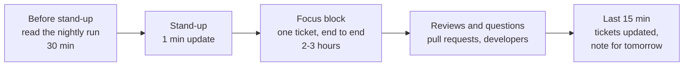

# A Day in the Life of an SDET: Plan Your Working Day, Step by Step

Nobody hands you a timetable. The nightly run is red, two developers want a review, a product owner has a question, and you still have a ticket to test. Without a plan, the day becomes a list of interruptions and the real testing never happens. This guide gives the day a shape that works in most teams, and the tools to do each part quickly.

!!! example "The problem"
    **You, after two weeks in a new job:** "I'm busy all day, but at stand-up I have nothing finished to say. Where does the time go?"

## Step 1: See the shape of a good day



| Part | Why it's in this place |
| --- | --- |
| **Nightly run first** | The team makes decisions at stand-up. If you know what broke overnight, you can say it there, once |
| **Stand-up** | The one meeting where everyone hears your risks. Short and specific |
| **A focus block** | Testing needs long, quiet thinking. Protect 2 to 3 hours: notifications off, one ticket |
| **Reviews after** | Pull requests can wait an hour. Your thinking can't be split ten times |
| **Last 15 minutes** | Tomorrow-you, and your team, know exactly where things are |

Your team's hours will differ. Keep the **order**, and fit the times around it.

## Step 2: Get the kit

You need **Python 3.13** for the triage script. The rest is checklists to copy. Get the files from [Templates](#templates) below, or take the whole folder [from GitHub](https://github.com/myopensdet/myopensdet.github.io/tree/main/modules/professional_sdet/a_day_in_the_life/templates). The script uses only Python's standard library: nothing to install.

## Step 3: Before stand-up, read the nightly run

The nightly run (see [CI/CD for testers](../../devops-for-qa/ci-cd/index.md)) leaves a test report. Twenty failures look scary. Often they are three problems, and two of them are already known. `morning_triage.py` sorts that out in a second.

Download the report (the JUnit XML file) from last night's run. To practise, the kit has a pretend nightly run that fails on purpose:

```bash
python -m pytest nightly_example --junitxml=reports/junit.xml
python morning_triage.py reports/junit.xml
```

```text
Last night: 9 tests, 4 failed

NEW: look at these today
   2 x AssertionError: payment provider did not answer in 3000 ms (took 3012 ms)
       - test_checkout_with[card]
       - test_checkout_with[voucher]
   1 x AssertionError: discount code SAVE10 did not change the total
       - test_discount_code_is_applied
   1 x AssertionError: order history is not newest first
       - test_order_history_is_sorted
```

Four failures, but only **three problems**: the two payment tests fail for the same reason. The script groups errors that differ only in numbers (`took 3012 ms`, `took 3105 ms`).

**Keep a list of known problems.** The payment provider on the test site has been slow for a week, and there's a ticket. Write it once in `known_issues.txt`, one line per problem: a piece of the error text, `|`, the ticket:

```text
--8<-- "modules/professional_sdet/a_day_in_the_life/templates/day_kit/known_issues.txt"
```

```bash
python morning_triage.py reports/junit.xml --known known_issues.txt
```

```text
Last night: 9 tests, 4 failed

KNOWN (SHOP-412)
   2 x AssertionError: payment provider did not answer in 3000 ms (took 3012 ms)

NEW: look at these today
   1 x AssertionError: discount code SAVE10 did not change the total
       - test_discount_code_is_applied
   1 x AssertionError: order history is not newest first
       - test_order_history_is_sorted
```

Now the morning is clear: two new things to look at. For each one, decide in five minutes which kind it is:

| Kind | Sign | Do |
| --- | --- | --- |
| **A real bug** | It fails the same way when you try it by hand | Raise a bug, add it to `known_issues.txt` |
| **A test problem** | The app is right; the test expects the wrong thing | Fix the test today. A wrong test that stays red teaches everyone to ignore red |
| **The environment** | Timeouts, "connection refused", other teams' services down | Tell the environment owner, add it to `known_issues.txt` with their ticket |

The script exits with `1` when something is new, and `0` on a clean night, so it can run in the pipeline too. When a ticket is fixed, delete its line, or real new failures will hide behind it.

## Step 4: Give a stand-up update people can use

A good update is about **results and risks**, not activity. "I worked on testing" tells the team nothing. Copy the template:

```markdown
--8<-- "modules/professional_sdet/a_day_in_the_life/templates/day_kit/standup_update.md"
```

Three habits that make it work:

- **Name the ticket.** People connect it to their own work.
- **Say the risk the first day you see it**, not the day before the release.
- **Long discussions go after stand-up**, with only the people who need them: "Can we talk about the voucher rules after this?"

## Step 5: Take one ticket from start to finish

This is the focus block. The same five moves, every ticket:

| Move | What you do | Guide |
| --- | --- | --- |
| **1. Questions** | Read the ticket. Write down what's unclear, and ask **before** testing | [Learning a new testing area](../learning-a-new-area/index.md) |
| **2. Test ideas** | List the cases: normal, edges, wrong input, permissions | [Test design techniques](../../manual-testing/test-design/index.md) |
| **3. Automate** | The cases worth repeating become tests, pushed with the change | [Automate API tests](../../case-studies/automate-api-tests/index.md) |
| **4. Run and explore** | Run them; then try what the tests don't cover, by hand | |
| **5. Report** | Bugs with steps, expected, actual, evidence. A short comment on the ticket | [Bug reports](../../manual-testing/bug-reports/index.md) |

Finish one ticket before you start the next. Two half-tested tickets are worth less than one finished one, because neither can be released.

## Step 6: Review pull requests

Reviews are where testers stop bugs before they exist. You'll review two kinds: developers' changes, and test code from other testers. Use the checklist:

```markdown
--8<-- "modules/professional_sdet/a_day_in_the_life/templates/day_kit/pr_review_checklist.md"
```

Ask about behaviour, not style: "What happens if the cart is empty?" finds bugs. "I'd name this differently" rarely does.

## Step 7: End the day in 15 minutes

- Update each ticket: its status and one line on where it is.
- Write a note for tomorrow: what's half done, and what you're waiting for and from whom.
- Clean `known_issues.txt`: remove lines for fixed tickets.

If you're ill tomorrow, someone else can pick up your work from those notes. That's the real test of a good handover.

## Step 8: Release day is different

On release day, the order changes: **the release comes first.**

- Read the nightly run as usual, but every NEW failure is now a release question: "does this block the release?"
- Run the release checks (smoke tests on the release candidate, the main user flows).
- Give a clear status, in writing: what was tested, what failed, the known risks, and your recommendation. The [release sign-off](../../devops-for-qa/release-testing/index.md) guide has the template.
- After release: a quick smoke test on production, if your team allows it, and watch the error logs for an hour.
- New tickets wait until tomorrow.

## Step 9: When it goes wrong

| You see | What it means | Fix |
| --- | --- | --- |
| `No report at nightly.xml. Download it from last night's run first.` | Wrong file name, or the report isn't downloaded | Download it from the run's **Artifacts**, and give the right path |
| `FileNotFoundError: [Errno 2] No such file or directory: 'known.txt'` | Wrong name for the known issues file | `--known known_issues.txt` |
| The nightly run is red every day, and nobody looks | People learned red means nothing | Triage every morning, fix wrong tests the same day, and keep known problems in the list, so red means **new** again |
| Interrupted all day | Every message feels urgent | Block focus time in your calendar. Answer messages at set times. Real emergencies will call you |
| Asked to approve a pull request "quickly" with no time to read it | Pressure to rubber-stamp | Say what you checked: "Looked at the tests only, not the payment logic." Never approve what you didn't read |
| Nothing finished to say at stand-up | Too many tickets at once | One ticket to the end, then the next (step 5) |

## Templates

**Every file is below, ready to copy.** The whole folder is also [on GitHub](https://github.com/myopensdet/myopensdet.github.io/tree/main/modules/professional_sdet/a_day_in_the_life/templates).

=== "Daily checklist"

    ```markdown
    --8<-- "modules/professional_sdet/a_day_in_the_life/templates/day_kit/daily_checklist.md"
    ```

=== "morning_triage.py"

    ```python
    --8<-- "modules/professional_sdet/a_day_in_the_life/templates/day_kit/morning_triage.py"
    ```

=== "nightly_example/test_nightly.py"

    ```python
    --8<-- "modules/professional_sdet/a_day_in_the_life/templates/day_kit/nightly_example/test_nightly.py"
    ```

## References

- [Atlassian: the daily stand-up](https://www.atlassian.com/agile/scrum/standups)
- [Google engineering practices: how to do a code review](https://google.github.io/eng-practices/review/reviewer/)
- [pytest: JUnit XML reports](https://docs.pytest.org/en/stable/how-to/output.html#creating-junitxml-format-files)
- [Python: xml.etree.ElementTree](https://docs.python.org/3/library/xml.etree.elementtree.html)

Written for Python 3.13 and pytest 9.2. Outputs captured November 2026. Links checked: November 2026.
