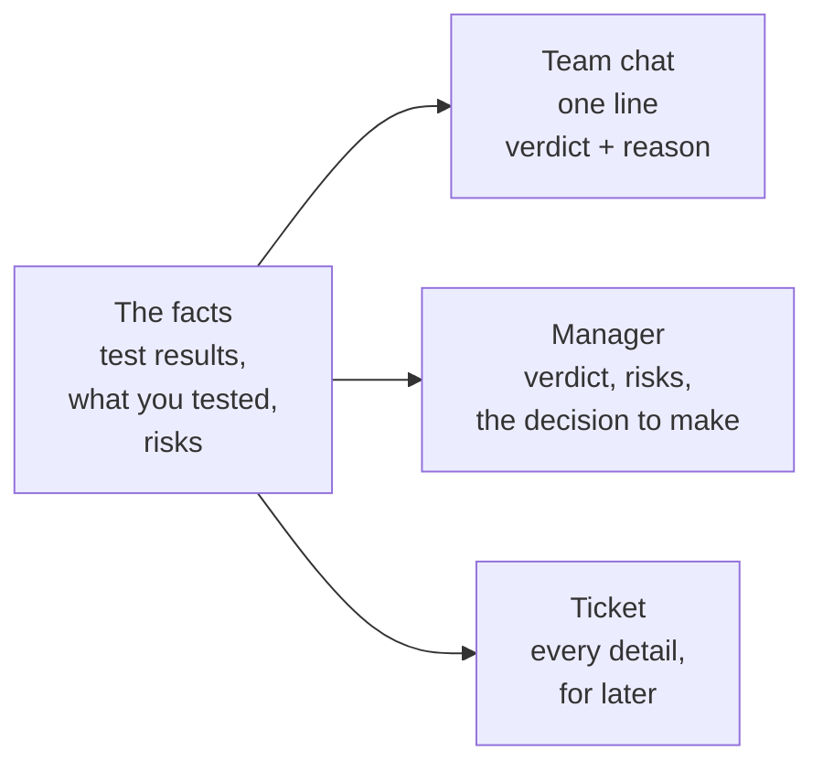

# Communicating Your Work as an SDET: Status, Risk and Estimates, Step by Step

Good testing that nobody understands doesn't change any decision. A manager who reads "4/5 passed, P95 regressed, coverage partial" learns nothing. One who reads "AMBER: ready if you accept one risk, here it is" can decide in a minute. This guide turns your results into messages people can act on, with scripts that do the writing for you.

!!! example "The problem"
    **Your manager, the day before the release:** "So, can we release on Thursday or not? I need a yes or no for the leadership meeting."

## Step 1: Design the message for the reader

The same facts go to different people. Each needs a different amount:



| Reader | Wants | Give them |
| --- | --- | --- |
| **The team** | "Do I need to do anything?" | One line: the verdict and why |
| **A manager** | "Can we release? What's the risk?" | The verdict, the risks in user words, and the decision that's theirs |
| **The ticket** | "What exactly was done?" (read later, often in an argument) | Every test, what wasn't tested, and why |

The verdict uses three colours everyone understands:

| Verdict | Means |
| --- | --- |
| **GREEN** | Ready, from a testing point of view. No known risks |
| **AMBER** | Can release **if** the risks are accepted. Someone must decide |
| **RED** | Not ready: a test fails, or something blocks testing |

## Step 2: Get the kit

You need **Python 3.13**. Get the files from [Templates](#templates) below, or take the whole folder [from GitHub](https://github.com/myopensdet/myopensdet.github.io/tree/main/modules/professional_sdet/communicating_your_work/templates). The scripts use only Python's standard library.

## Step 3: Write your notes

The script can count tests. It can't know what you tested by hand, what you skipped, or what worries you. You write that, in `status_notes.ini`:

```ini
--8<-- "modules/professional_sdet/communicating_your_work/templates/comms_kit/status_notes.ini"
```

The **not tested** section is the most important one. "We tested everything" is never true, and a manager who finds out later stops trusting your GREEN.

## Step 4: Write the status, three ways

Run the tests with a JUnit report (the kit has a pretend release run, with one failing test), then the script:

```bash
python -m pytest example_run --junitxml=reports/junit.xml
python status_update.py reports/junit.xml status_notes.ini
```

```text
== For the team chat (one glance)

RED: Release 2.15 testing: 4/5 tests pass. 1 test failing: test_order_history_is_sorted.

== For a manager (email)

Subject: Release 2.15 testing status: RED

Not ready yet. What's needed is below. Planned: Thursday 21 November.

Must fix first:
- FAILED test_order_history_is_sorted: a test is failing

Risks:
- SHOP-433: the order page fails about 1 in 3 times under heavy load. Fix planned for 2.16

Not tested:
- Refunds in other currencies: no test data for other currencies yet
```

The ticket part follows, with every area tested. A failing test means RED, and the manager sees what must be fixed first.

The order history bug is fixed the next day. Run again (here, by leaving that test out with `-k "not order_history"`):

```text
== For the team chat (one glance)

AMBER: Release 2.15 testing: 4/4 tests pass. Tests pass, 1 known risk to accept.

== For a manager (email)

Subject: Release 2.15 testing status: AMBER

Can release if you accept the risks below. Your decision. Planned: Thursday 21 November.

Risks:
- SHOP-433: the order page fails about 1 in 3 times under heavy load. Fix planned for 2.16

Not tested:
- Refunds in other currencies: no test data for other currencies yet

== For the ticket (details)

Automated tests: 4 passed, 0 failed (of 4).
Tested:
- Discount codes: 14 API tests and exploratory testing
- Checkout: full regression
- Search: smoke tests only (no changes in this release)
Not tested:
- Refunds in other currencies: no test data for other currencies yet
```

That's the answer to the manager's question: **"AMBER. You can release Thursday if you accept that the order page may fail under heavy load until 2.16. Your call."** Notice who decides: you give the facts and a suggestion; the release decision belongs to the manager or the team. With no risks left, the script says GREEN.

## Step 5: Explain risk in plain words

"P95 regressed by 40%" is true and useless to most managers. Say what happens to **users**, how often, and what the options are:

```markdown
--8<-- "modules/professional_sdet/communicating_your_work/templates/comms_kit/explaining_risk.md"
```

Always give **options**, and your suggestion. "Here's a problem" makes you the bearer of bad news. "Here's a problem and two ways forward" makes you the person who helps.

## Step 6: Estimate as a range

"How long will testing take?" One number is almost always wrong, and people remember it. Give a **range**. For each task, guess three numbers: best case, most likely, worst case:

```text
--8<-- "modules/professional_sdet/communicating_your_work/templates/comms_kit/estimate.csv"
```

```bash
python estimate.py estimate.csv
```

```text
Task                                  best likely  worst  expect
Read the story and ask questions         1      2      4     2.2
Write API tests for discount codes       4      6     12     6.7
Write one UI test for checkout           2      4      8     4.3
Exploratory testing                      2      3      5     3.2
Test data and environment set-up         1      2      8     2.8
Bug reports and retesting fixes          2      4     10     4.7

Expected: 24 hours. Likely between 21 and 26 hours.
If every task hits its worst case: 47 hours.
Say: "About 24 hours, probably 21 to 26. I'll update you if the worst cases happen."
```

The **three-point** (PERT) formula weighs the most likely guess four times: `(best + 4 × likely + worst) / 6`. The likely range assumes not everything goes wrong at once. The worst-case line shows what happens if it does.

Two things testers forget to estimate, and then work overtime for: **test data and environment set-up**, and **retesting bug fixes**. Both have wide ranges here on purpose. When a worst case starts to happen (the test environment is down for a day), say so the same day, not at the deadline.

## Step 7: Write the test summary report

At the end of a release or a big feature, a one-page summary is the record of what was done. Fill it from the status output:

```markdown
--8<-- "modules/professional_sdet/communicating_your_work/templates/comms_kit/test_summary_report.md"
```

For daily updates, use the stand-up template in [a day in the life](../a-day-in-the-life/index.md#step-4-give-a-stand-up-update-people-can-use).

## Step 8: Demo your work

Test work is invisible unless you show it. At the sprint review, a 3-minute demo does more than any report:

1. **The problem**, in one sentence: "Checkout bugs reached production twice last month."
2. **What you built**: "Every pull request now runs 40 checkout tests in 4 minutes."
3. **Show it running**: a pipeline turning red on a broken change, or the morning triage output.
4. **The result**, in numbers: "Two bugs caught before merge this sprint."

Show **results** (bugs caught, time saved), not effort (tests written).

## Step 9: When it goes wrong

| You see | What it means | Fix |
| --- | --- | --- |
| `Usage: python status_update.py <junit.xml> <status_notes.ini>` | A file is missing, or the name is wrong | Give both files. Make the report with `--junitxml=reports/junit.xml` |
| `'API tests': needs best <= likely <= worst, got 8, 4, 12` | The three guesses are in the wrong order | Best case first, worst case last |
| Your GREEN turned out wrong in production | Something wasn't tested, and the report didn't say | Always fill "not tested". Add the gap to the postmortem ([incidents](../regression-hotfixes-and-incidents/index.md#step-8-write-a-blameless-postmortem)) |
| The manager asks "yes or no?" and AMBER isn't an answer | They need a decision, not a colour | Give the two options and your suggestion: "Release, and fix SHOP-433 in 2.16. That's my suggestion." |
| Your estimate was way off | One number, and the hidden tasks (data, retests) were missing | Ranges, all tasks, and an update the day a worst case starts |
| Nobody reads your reports | Too long, or too technical | Lead with the verdict in one line. Put details in the ticket |

## Templates

**Every file is below, ready to copy.** The whole folder is also [on GitHub](https://github.com/myopensdet/myopensdet.github.io/tree/main/modules/professional_sdet/communicating_your_work/templates).

=== "status_update.py"

    ```python
    --8<-- "modules/professional_sdet/communicating_your_work/templates/comms_kit/status_update.py"
    ```

=== "estimate.py"

    ```python
    --8<-- "modules/professional_sdet/communicating_your_work/templates/comms_kit/estimate.py"
    ```

## References

- [ISTQB glossary: test summary report and test estimation](https://glossary.istqb.org/)
- [Wikipedia: three-point estimation](https://en.wikipedia.org/wiki/Three-point_estimation)
- [Atlassian: how to write a status report](https://www.atlassian.com/agile/project-management/status-report)
- [The Scrum Guide: sprint review](https://scrumguides.org/scrum-guide.html#sprint-review)
- [pytest: JUnit XML reports](https://docs.pytest.org/en/stable/how-to/output.html#creating-junitxml-format-files)

Written for Python 3.13 and pytest 9.2. Outputs captured November 2026. Links checked: November 2026.
