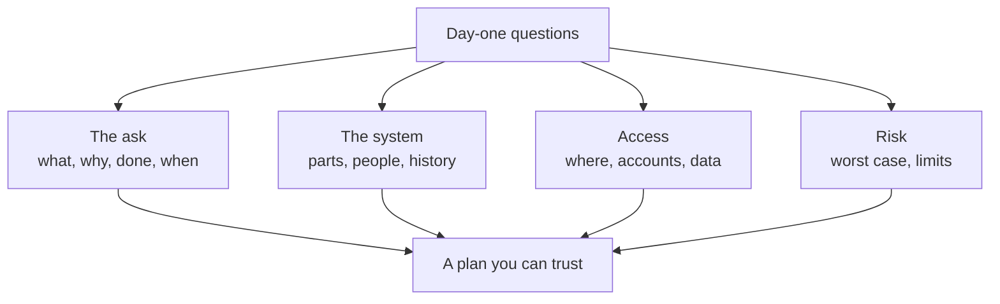

# Asking the Right Questions on Day One of a Testing Task

A question that takes ten minutes on day one can save you a week later. This lesson gives you the questions to ask before you test anything, shows how to ask them without annoying a busy lead, and gives you a checklist you can copy straight into your work.

!!! note "Before you start"
    Read [The 9-step playbook](the-9-step-playbook.md) first. This lesson is step 1, "Understand the ask", up close.
    **Scope** means what is part of the task, and what is not.

## What you will learn

- The four groups of day-one questions: the ask, the system, access, and risk
- How to find most answers yourself before you ask anyone
- How to ask in one message instead of ten
- How the answers turn into your test plan

## Why this matters at work

When testers skip these questions, three things tend to happen. They test the wrong thing. They test in the wrong place. Or they never know when they are finished, so they keep going until someone stops them. Good questions also show your lead something important: that you think about risk, not just about clicking buttons.

## The idea in plain words

!!! info "In plain words"
    Before a taxi driver starts driving, they ask where you want to go. They don't drive around the city hoping to guess.
    Day-one questions are your "where to?" They make sure you drive to the right place.



## Step by step

1. **Copy the checklist** from the [template below](#the-template) into a new file or a ticket comment.

2. **Answer what you can yourself first.** Read the ticket, the docs and the code before you ask. Your lead is busy, and they will notice that you did your homework. For the password reset task, you can find these on your own:

    | Question | Answer | Where to find it |
    | --- | --- | --- |
    | Which parts does it touch? | The API, the database and email | The API docs at `/docs` |
    | Are there tests already? | Yes, in the login test file | The team's code |
    | How do I reset the test data? | One command in the README | The project's README |

3. **Ask the rest in one message, not ten.** Ten separate pings in a day feel like being poked. One clear message feels like working with a professional:

    ```text
    Hi! I'm starting on password reset testing. A few questions before I plan:
    1. Is the web page in scope, or only the API?
    2. What does "done" mean for you: a plan, tests, or both?
    3. Is the end of the sprint a fixed date?
    4. What worries you most about this feature?
    Thanks! I'll share a one-page plan by Thursday.
    ```

    See the last line? It tells your lead when they will hear from you next. That builds trust quickly.

4. **Write the answers down, with who said them and when.** Memory is unreliable, and plans change. If an answer changes later, you can show why you planned the way you did, without an argument.

    | Question | Answer | From | Date |
    | --- | --- | --- | --- |
    | Is the web page in scope? | Yes, the happy path only | Team lead | 2026-11-15 |
    | What does done mean? | Plan, API tests, bug reports | Team lead | 2026-11-15 |
    | What worries you most? | Old codes still working | Team lead | 2026-11-15 |

5. **Let the answers shape your plan.** The lead's worry, "old codes still working", becomes the first high risk in the plan. "Web page: happy path only" means the rest of the web page goes into "out of scope". Your plan now reflects what the team actually cares about.

    !!! success "Check: you should now have"
        A checklist with most answers filled in, one grouped message sent, and answers written down with names and dates.

## When it goes wrong

- **Your lead answers: "Just test everything."** That isn't something you can plan with. Ask a narrower question: "If I only had time for three tests, which three matter most?" People find it much easier to choose than to list.
- **Nobody knows the answer.** That is useful too. Write "unknown" and add it to "Open questions" in your plan. An unknown that is written down can't surprise anyone later.
- **Two people give you different answers.** Don't pick one quietly. Put both answers in one message to both people and ask them to agree. It takes two minutes and saves a fight at release time.

## The template

=== "Day-one questions"

    ```markdown
    --8<-- "modules/think_like_a_tester/learning_a_new_testing_area/templates/day_one_questions.md"
    ```

=== "How to use it"

    1. Copy the file into your notes or the ticket.
    2. Tick each question when it has an answer.
    3. Put each answer in the table at the end, with who said it and the date.

## Common mistakes

!!! warning "Common mistakes"
    - **Asking what the docs already say.** Read first, then ask what is left.
    - **Asking one question at a time, all day.** Group them into one message.
    - **Keeping answers in your head.** Write them in the ticket, where the team can see them.
    - **Never asking about risk.** "What worries you most?" is often the most useful question of all.

!!! failure "If you see this error"
    **"We'll know it when we see it."**
    This means nobody has decided what "done" looks like. Offer a draft: "Here is what I think done means: these five risks tested, and bugs reported. Is that right?" It is far easier to correct a draft than to answer an empty question.

## Try it yourself

Your lead says: "Please test the invoice download in the shop." Using the checklist, write three questions you can answer yourself, and three you must ask.

??? success "Solution"
    You can answer yourself, from the API docs and one try:

    - Which endpoint? `GET /api/orders/{id}/invoice.pdf`.
    - Who should be able to download it? Only the person who placed the order.
    - Which orders have one? Paid orders. An unpaid order gives an error.

    You must ask:

    - Is the PDF layout in scope, or only "the right person gets the right file"?
    - Does an invoice count as personal data under our company's rules?
    - What does done mean: tests, a bug report, or both?

## Quick check

1. What should you do before asking your lead anything?

    ??? question "Answer"
        Answer what you can yourself, from the ticket, the docs and the code.

2. Why write down who answered and when?

    ??? question "Answer"
        If an answer changes later, you can show why you planned the way you did.

3. Which question often turns into your first high risk?

    ??? question "Answer"
        "What worries you most about this feature?"

## References

- [ISTQB Glossary](https://glossary.istqb.org/): test basis, test scope and risk
- [Atlassian: Definition of done](https://www.atlassian.com/agile/project-management/definition-of-done): how teams agree what "done" means

Links checked: November 2026.
