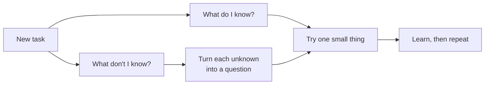

# How to Approach a Testing Task You Have Never Done

You have just been given a task, and you have no idea how to do it. Your stomach drops a little. This lesson is about the next hour: how to get from "I don't know where to start" to "I have tried something, and I know what to do next".

!!! note "Before you start"
    You don't need any testing experience for this page.
    A **testing task** is any job like "test this feature" or "set up tests for this service".

## What you will learn

- Why a new task feels hard, and why that feeling is normal
- How to split a task into what you know and what you don't
- How to turn "I don't know" into small questions with an owner
- How to try one small thing in the first hour

## Why this matters at work

Testers change areas all the time: a new feature, a new tool, a new team. Your lead will often hand you something nobody on the team has tested before. The people who do well are not the ones who already know everything. They are the ones who know how to start, and who start quickly.

## The idea in plain words

!!! info "In plain words"
    Think of a big jigsaw puzzle. You don't try to see the whole picture at once. You find the corners and the edges first, then fill in the middle.
    A new task is the same. Find the parts you already know first. The empty spaces become your questions.



## Step by step

We use the task from the [topic page](index.md): "Test password reset in the shop." Say you have never tested a login feature before.

1. **Write the task in one sentence, in your own words.** Not your lead's words. Yours. If you can't, you don't understand it yet, and that is your first question.

    ```text
    Make sure users can safely get back into their account when they forget their password.
    ```

    Notice the word "safely". Your lead didn't say it. You added it, because it tells you this is partly a security task, and that changes what you will test.

2. **Make two lists: what you know, and what you don't.** Give it five minutes. Don't look anything up yet. You are just emptying your head onto paper.

    | I know | I don't know |
    | --- | --- |
    | The shop has user accounts | How the reset works step by step |
    | Users log in with a password | How the code reaches the user |
    | The shop has an API | What makes a reset "safe" |
    | I have a test copy of the shop | What "done" means for my lead |

    The "I know" list is usually longer than you expect. That helps with the panic.

3. **Turn each unknown into a question, and say who can answer it.** A question without an owner just sits there. A question with an owner gets answered.

    | Question | Who or what can answer |
    | --- | --- |
    | How does the reset work step by step? | The API docs at `/docs` |
    | How does the code reach the user? | Try it once, then look at the test email inbox |
    | What makes a reset safe? | The [OWASP Forgot Password Cheat Sheet](https://cheatsheetseries.owasp.org/cheatsheets/Forgot_Password_Cheat_Sheet.html) |
    | What does "done" mean? | My lead |

4. **Try one small thing.** Pick the easiest unknown you can answer yourself, right now. For example, ask the shop for a reset code:

    ```bash
    curl -X POST http://127.0.0.1:8080/api/auth/forgot-password \
      -H "Content-Type: application/json" \
      -d '{"email": "arshad@example.com"}'
    ```

    You should see:

    ```json
    {"message": "If that email has an account, we sent a code to it."}
    ```

    `curl` is a small program that sends a request to a web address and prints the answer. You will use it a lot.

5. **Write down what you learned.** One unknown is now known: the code goes out by email, and the answer doesn't say whether the email has an account. Move that line to the "I know" list. Then pick the next small thing.

    !!! success "Check: you should now have"
        One sentence that says what the task is, two lists, a few questions with owners, and one thing you have already tried.

## When it goes wrong

The first try often fails. That is fine, and it still teaches you something. Here is how to think about it:

- **Nothing answers at all.** The app isn't running, or you have the wrong address. Check the address with your team before anything else.
- **You get an error you don't understand.** Copy the exact error text into your notes. Search for it in the official docs first, then in your team's chat history. Someone has probably seen it.
- **It works, but you don't know if the answer is right.** That is a great question for your lead: "Is this what should happen?" Not knowing what "right" looks like is a real gap, and it is worth asking about early.

## Common mistakes

!!! warning "Common mistakes"
    - **Reading for days before trying anything.** Try one small thing in the first hour. It shows you what to read.
    - **Pretending to understand.** Writing "I don't know" on a list is not a weakness. It is the start of your plan.
    - **Asking "how do I test this?"** It is too big for anyone to answer. Ask small questions instead, like "where do I see the email?"

!!! failure "If you see this error"
    **`curl: (7) Failed to connect to 127.0.0.1 port 8080`**
    Nothing is listening at that address. The app isn't running, or it runs somewhere else. Ask your team for the right test environment address, or start your local copy, then try again.

## Try it yourself

Your lead says: "Can you test product reviews in the shop?" Make the two lists and three questions with owners. Then decide what your one small first try would be.

??? success "Solution"
    One possible answer:

    | I know | I don't know |
    | --- | --- |
    | Products have star ratings | Who is allowed to write a review |
    | The shop has an API | Can one person review a product twice? |
    | | Where are reviews stored? |

    Questions with owners: "Who can review?" (the API docs), "Can I review twice?" (try it), "Where are reviews stored?" (a developer on the team).

    A small first try: ask the API for one product's reviews. In the shop that is `GET /api/products/6/reviews`, and it answers with a list of reviews in JSON. Now you know what a review looks like, which helps with every other question.

## Quick check

1. What is the first thing to write down for a new task?

    ??? question "Answer"
        The task in one sentence, in your own words. If you can't write it, you don't understand it yet.

2. Why try one small thing in the first hour?

    ??? question "Answer"
        Trying something real shows you what you still need to learn, so your reading has a purpose.

3. "How do I test this?" is a weak question. Why?

    ??? question "Answer"
        It is too big for anyone to answer quickly. Small questions with a clear owner get fast answers.

## References

- [OWASP Forgot Password Cheat Sheet](https://cheatsheetseries.owasp.org/cheatsheets/Forgot_Password_Cheat_Sheet.html): what a safe password reset does
- [curl documentation](https://curl.se/docs/manpage.html): every option of the curl command
- [ISTQB Glossary](https://glossary.istqb.org/): the official meaning of testing words

Links checked: November 2026.
