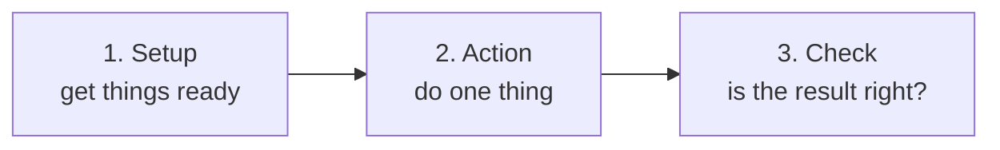

# Learning from Code and Examples: Read the Tests That Already Exist

Here is something many new testers don't realise: the best documentation on your team is often the test folder. This lesson shows you how to read existing tests, even if you have never read code before, and how to use them to find what nobody is checking yet.

!!! note "Before you start"
    Read [Reading official docs fast](reading-official-docs-fast.md) first. You don't need to write Python for this lesson. You only read it.
    A **test file** is a file of small programs. Each one checks one thing the app should do.

## What you will learn

- Where to find the tests that already exist
- How to read one test like a short story: setup, action, check
- How to make a list of what is already tested
- How to spot what is **not** tested yet

## Why this matters at work

Docs say what *should* happen. Tests prove what *does* happen, every time they run. That makes them the most honest description of the app your team has. Reading them also shows you how your team likes to write tests, so your own work fits in. And the gaps between the tests? That is often exactly where bugs live.

## The idea in plain words

!!! info "In plain words"
    When you join a new football team, you watch a few practice games before you play. You learn the moves they already use.
    Reading the existing tests is watching practice. You learn the team's moves, and you notice the moves nobody practises.

Most tests follow the same three parts. Once you see them, any test gets easier to read:



## Step by step

1. **Find the tests.** They usually sit in a folder called `tests`, in files whose names start with `test_`. If you can't find them, ask: "Where do the tests for login live?" It is a perfectly normal question on a new team. In our example, the login tests are in a file called `test_auth.py`.

2. **Read the test names first.** Good test names read like sentences. Scroll through `test_auth.py` and you find:

    ```text
    test_a_code_expires_after_10_minutes
    test_a_new_code_replaces_the_old_one
    test_forgot_password_gives_the_same_answer_for_unknown_emails
    test_reset_password_with_the_code
    ```

    Without reading a single line of code, you already know four things the team cares about. Names are cheap to read and full of information.

3. **Read one test like a story.** Here is the start of the team's reset test:

    ```python
    def test_reset_password_with_the_code(client, outbox):
        client.post("/api/auth/forgot-password", json={"email": "arshad@example.com"})
        code = code_in(outbox.last_to("arshad@example.com"))
        body = {"email": "arshad@example.com", "code": code, "new_password": "NewPass99"}
        assert client.post("/api/auth/reset-password", json=body).status_code == 200
        assert error_code(client.post("/api/auth/reset-password", json=body)) == "INVALID_CODE"
    ```

    Don't try to understand every symbol. Tell it as a story instead:

    - **Setup:** ask for a reset code for the test user Arshad, and read the code from the email.
    - **Action:** send the code with a new password.
    - **Check:** the first try works (200). The second try with the same code fails (`INVALID_CODE`). So a code works only once.

    `assert` means "this must be true, or the test fails". That is the most important word in any test.

4. **Make a "tested" list.** Write one line per test, in plain words:

    | What is tested | Test |
    | --- | --- |
    | A sign-up code stops working after 10 minutes | `test_a_code_expires_after_10_minutes` |
    | A reset code works only once | `test_reset_password_with_the_code` |
    | Known and unknown emails get the same answer | `test_forgot_password_gives_the_same_answer_for_unknown_emails` |

5. **Look for the gaps.** Now put your risk list next to the "tested" list. The first high risk in the plan was "a reset code older than 10 minutes must not work". Look again. There is a test for the **sign-up** code expiring. There is no test for the **reset** code expiring. That gap goes straight to the top of your list: it is the first thing to test by hand.

6. **Search the whole folder before you call it a gap.** Tests aren't always where you expect them. Search every test file for a word from your risk, like `expire` or `invoice`. In VS Code, that is **Search in files** (Ctrl+Shift+F, or Cmd+Shift+F on a Mac).

    !!! success "Check: you should now have"
        A list of what is tested, in plain words, and at least one risk that no test covers yet.

## When it goes wrong

- **The test names mean nothing**, like `test_1`, `test_case_7`. Then read the check lines (`assert ...`) only. They tell you what is being proved, even when the name doesn't.
- **The code is too hard to follow.** Ask a developer for 15 minutes to walk you through one test. Bring the test name and your story version of it. They will usually be happy to help someone who has clearly tried first.
- **There are no tests at all.** Then you have found the biggest gap there is. Note it in your plan, and start with a smoke test.

## Common mistakes

!!! warning "Common mistakes"
    - **Trying to understand every line.** Read the names first, then one test as setup, action, check. That is enough to start.
    - **Thinking "there are tests, so it works".** Tests only prove what they check. A gap is a place nobody is looking.
    - **Copying a test without knowing what it checks.** Say what it checks in one sentence before you reuse it.

!!! failure "If you see this error"
    **`zsh: command not found: pytest`** (or `'pytest' is not recognized` on Windows)
    pytest is installed inside the project's virtual environment, not for the whole computer. Turn the environment on first (`source .venv/bin/activate`, or `.venv\Scripts\activate` on Windows), or run `python -m pytest` from the project folder.

## Try it yourself

Here are three test names from the team's order tests. Which risks are tested? Which important one seems to be missing?

```text
test_my_orders_newest_first_and_only_mine
test_cancel_a_paid_order
test_a_delivered_order_cannot_be_cancelled
```

??? success "Solution"
    Tested: you only see your own orders; a paid order can be cancelled; a delivered order can't.

    Seems missing: can someone download **another person's invoice**? It looks like a gap. But before you say so, search the whole test folder for `invoice`. In this team's tests, another file has `test_no_invoice_for_someone_elses_order`. A gap in one file isn't always a gap. Search before you decide, and you will save yourself an awkward conversation.

## References

- [pytest: Anatomy of a test](https://docs.pytest.org/en/stable/explanation/anatomy.html): arrange, act, assert
- [pytest: Get started](https://docs.pytest.org/en/stable/getting-started.html)
- [VS Code: Search across files](https://code.visualstudio.com/docs/editor/codebasics#_search-across-files)

Written for pytest 9. Links checked: November 2026.
