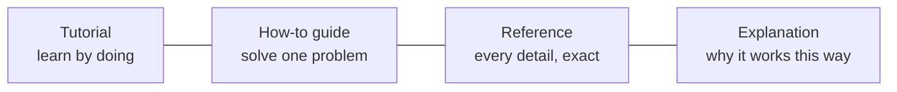

# Reading Official Docs Fast: Find the Part You Need in Minutes

Nobody reads documentation from start to finish. Good testers don't either. They know how to jump straight to the one page that answers their question, read it carefully, and stop. This lesson shows you how.

!!! note "Before you start"
    Read [Asking the right questions](asking-the-right-questions.md) first: your questions tell you what to look for.
    **Official docs** are the pages written by the people who made the tool or the app. They are the most trustworthy source you have.

## What you will learn

- Why official docs come before blog posts and videos
- The four kinds of pages most docs have, and which one to open first
- How to read an API page: the fields, the rules and the answers
- How to make sure you are reading the right version

## Why this matters at work

Every new area comes with new docs: a tool, a library, an API. Reading all of it would take days. Reading none of it means guessing. The skill is to find the one page that answers your question. It is a skill you will use every single week, and it gets faster with practice.

## The idea in plain words

!!! info "In plain words"
    A cookbook has hundreds of recipes, but you are only cooking one tonight. You use the index, go to that page, and read it carefully.
    Docs are the same. You don't read the whole book. You find tonight's recipe.

Most documentation has four kinds of pages. This idea comes from a well-known guide called [Diátaxis](https://diataxis.fr/), and once you see it, you will notice it on almost every docs site:



| You want to... | Open this kind of page |
| --- | --- |
| Try something for the first time | Tutorial or "Getting started" |
| Do one specific thing | How-to guide |
| Know an exact field, option or error | Reference (like API docs) |
| Understand a design decision | Explanation |

Testers spend a lot of time in reference pages, because that is where the limits are written down. And limits are where bugs live.

## Step by step

Say you need to know exactly what the reset endpoint expects. That is a reference question.

1. **Start at the official source.** For an API, that is its own docs page, often at `/docs`. For a tool, it is the tool's own website. A blog post can be helpful later, but it might be old, or about a different version.

2. **Find the one page you need.** Use the docs' search box, or your browser's find (Ctrl+F, or Cmd+F on a Mac). Search for "reset" and you find `POST /api/auth/reset-password`.

3. **Read the example first, then the rules.** The example shows you the normal case quickly. The rules show you the limits. Many APIs also publish their rules as a file called `openapi.json`. Here is the part for this endpoint:

    ```json
    {
      "properties": {
        "email": {"type": "string", "examples": ["arshad@example.com"]},
        "code": {"type": "string", "pattern": "^\\d{6}$", "examples": ["123456"]},
        "new_password": {"type": "string", "minLength": 8, "maxLength": 128}
      },
      "required": ["email", "code", "new_password"]
    }
    ```

    Don't worry if that looks strange. Read it line by line: the code is exactly 6 digits, the new password is 8 to 128 characters, and all three fields are required.

4. **Turn each rule into test ideas.** This is the tester's trick. Every rule has a limit, and every limit is a place to test:

    | Rule in the docs | Test ideas |
    | --- | --- |
    | `code` is exactly 6 digits (`^\d{6}$`) | 5 digits, 7 digits, letters |
    | `new_password` is 8 to 128 characters | 7, 8, 128 and 129 characters |
    | All three fields are required | Leave each one out |

5. **Check one rule for real.** Send a password that is too short:

    ```bash
    curl -X POST http://127.0.0.1:8080/api/auth/reset-password \
      -H "Content-Type: application/json" \
      -d '{"email": "arshad@example.com", "code": "000000", "new_password": "short"}'
    ```

    You should see the rule from the docs, enforced:

    ```json
    {"error": {"code": "VALIDATION_ERROR", "message": "Some fields are missing or not valid.",
      "request_id": "743c78f2...",
      "details": [{"field": "new_password", "message": "String should have at least 8 characters"}]}}
    ```

    The docs and the app agree. That is worth knowing, and it took one minute.

6. **Check the version.** Docs change between versions, and reading the wrong version is a classic way to lose an afternoon. Most API docs show the version at the top of the page (this shop's says 1.0.0). For tools, find the version picker on the docs site and match it to what you installed.

    !!! success "Check: you should now have"
        One reference page found, its rules listed, a test idea for each rule, and one rule checked for real.

## When it goes wrong

- **The docs say one thing, the app does another.** Congratulations, you found something. Either the app or the docs is wrong. Write down both, with the exact request, and report it. Don't quietly assume the docs are right.
- **There are no docs.** It happens more than you would hope. Then the existing tests and the code are your docs (see [Learning from code and examples](learning-from-code-and-examples.md)), and a developer is your best friend for 15 minutes.
- **The docs are huge and you can't find anything.** Search for the exact error message or field name you are dealing with, in quotes. It is far more precise than searching for a topic.

## Common mistakes

!!! warning "Common mistakes"
    - **Starting with a random blog post.** It may be old, wrong, or about another version. Start with the official docs.
    - **Reading a tutorial when you need a reference.** Tutorials skip the limits, and limits are what testers need.
    - **Trusting the docs blindly.** Docs can be wrong. When the app and the docs disagree, that is a finding: report it.

!!! failure "If you see this error"
    **`{"error": {"code": "NOT_FOUND", "message": "Not Found", ...}}` when you try an endpoint from a blog post**
    The post is about another version, or another app. Go back to the official docs for your version.

## Try it yourself

The shop's docs say this about `POST /api/cart/items`: "`product_id` must be a product that exists. `quantity` is a whole number from 1 to 10." Write three test ideas from these rules.

??? success "Solution"
    1. Quantity 0 and 11 (just outside the limits) should be refused with `VALIDATION_ERROR`.
    2. Quantity 1 and 10 (right on the limits) should work.
    3. A product id that doesn't exist, like 9999, should be refused. In this shop the error code is `PRODUCT_NOT_FOUND`.

    Notice how each idea came straight from a number or a word in the rule. That is the habit to build.

## References

- [Diátaxis](https://diataxis.fr/): the four kinds of documentation pages
- [OpenAPI Specification](https://spec.openapis.org/oas/latest.html): the format behind `openapi.json` files
- [ISTQB Glossary](https://glossary.istqb.org/)

Links checked: November 2026.
