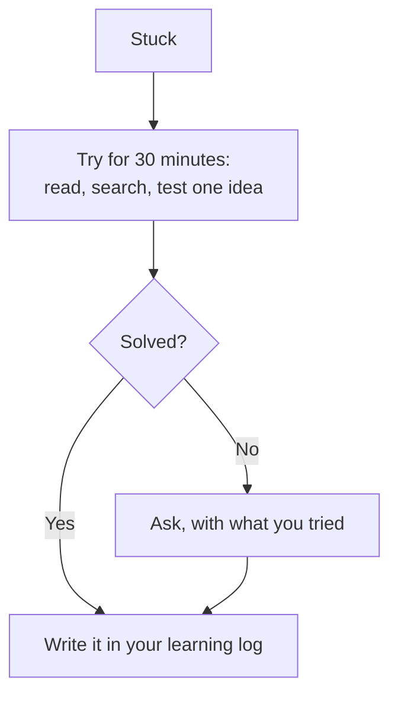

# When to Ask for Help: the 30-Minute Rule and How to Ask Well

Everyone gets stuck. The difference between people is how long they stay stuck. This lesson gives you a simple rule for when to ask, a message format that gets fast answers, and a small daily habit that turns being stuck into learning.

!!! note "Before you start"
    Read [Learning from code and examples](learning-from-code-and-examples.md) first.
    Being stuck is a normal part of learning. This page is about being stuck for less time.

## What you will learn

- The 30-minute rule: try first, then ask
- What to put in a help message, so people can answer it quickly
- Where to ask: a person, the team chat, or the tool's own community
- How a learning log helps you, and quietly shows your progress

## Why this matters at work

New people often wait far too long to ask, because they don't want to look slow. Others ask too early, before they have tried anything at all. Both cost time: yours, or your teammates'. A clear rule and a good message make asking easy for you, and quick for the person who helps.

## The idea in plain words

!!! info "In plain words"
    When you are lost in a shopping centre, you first look at the map. If you are still lost after a few minutes, you ask someone, and you tell them where you are and where you want to go.
    You don't wander for two hours. And you don't ask before you have even looked at the map.



## Step by step

A common example: you are setting up your computer to run the team's tests. The team starts its local test environment with Docker (a tool that runs apps in boxes called containers), using the command `docker compose up -d`. It fails.

1. **Try on your own for about 30 minutes.** Read the error message slowly, word by word. Many errors tell you exactly what is wrong if you read them carefully. Search the official docs for it. Try one idea at a time, and see what changes.

    Thirty minutes is a guide, not a law. Ask sooner if something blocks the whole team, or if you might break shared data. Nobody wants you to experiment on the shared test database.

2. **Write down what you tried, as you go.** You will need it for your message. And quite often, writing it down shows you the answer.

3. **Still stuck? Write a help message with four parts:**

    | Part | Example |
    | --- | --- |
    | What I am trying to do | Start the local test environment for the reset tests |
    | What I expected | All the services to start |
    | What happened (the exact error) | `Bind for 127.0.0.1:8080 failed: port is already allocated` |
    | What I tried | Restarted Docker; read the README's setup section; same error |

    Put together, it looks like this:

    ```text
    Hi! I'm trying to start the local test environment for the password reset tests.
    I expected all services to start, but docker compose says:
      Bind for 127.0.0.1:8080 failed: port is already allocated
    I restarted Docker Desktop and followed the README's setup section. Same error.
    Could something else be using port 8080? Thanks!
    ```

    Look at how easy that is to answer. Someone who has seen it before can reply in one line.

4. **Ask in the right place.** A question about your team's app goes to your team. A question about a tool, like pytest or Docker, can go to the tool's official forum or issue tracker. Search there first: someone may have asked the same thing last year.

5. **Close the loop.** When it is solved, reply with what fixed it: "Another copy of the app was already running. I stopped it and it works." The next person with the same problem will find your answer in the chat history, and they will be grateful.

6. **Write it in your learning log.** One entry, five minutes, at the end of the day:

    ```markdown
    ## 2026-11-15

    - **Goal today:** start the local test environment and try the reset flow
    - **What I read or watched:** the project README, "Setup" section
    - **What I tried:** docker compose up -d; got "port is already allocated"
    - **What I learned:** two programs can't use the same port; stop one first
    - **Still confused about:** how to see which program uses a port
    - **Next step:** ask for a reset code and read it in the test inbox
    ```

    !!! success "Check: you should now be able to"
        Say when you would ask for help, write a four-part help message, and keep one learning log entry.

## When it goes wrong

- **Nobody answers your message.** Wait a reasonable time (an hour in a busy team), then ask one person directly, and link to your original message. Don't post the same question in five channels.
- **The answer doesn't make sense to you.** Say so, kindly: "Thanks! I'm not sure what you mean by X. Could you show me where?" A follow-up question is much better than nodding and staying stuck.
- **You feel like you are asking too often.** Look at your learning log. If the questions are all different, you are learning, and that is fine. If you keep asking the same one, write the answer somewhere you will find it.

## The template

=== "Learning log"

    ```markdown
    --8<-- "modules/think_like_a_tester/learning_a_new_testing_area/templates/learning_log.md"
    ```

=== "How to use it"

    1. Copy the file once for each new area you learn.
    2. Add one entry at the end of each day, newest at the bottom.
    3. Bring it to your one-to-one meetings with your lead. It shows your progress without any extra work.

## Common mistakes

!!! warning "Common mistakes"
    - **"It doesn't work."** Always paste the exact error text. "It doesn't work" can't be answered.
    - **A screenshot of text.** Paste errors as text, so people can copy and search them.
    - **Sharing secrets in a help message.** Never paste passwords, tokens or customer data. Replace them with `***`.
    - **Never closing the loop.** Say what fixed it, so the next person can find the answer.

!!! failure "If you see this error"
    **`Bind for 127.0.0.1:8080 failed: port is already allocated`**
    Another program already uses port 8080, often a second copy of the same app. Stop it (`docker compose down` in the folder where it runs, or `Ctrl+C` in its terminal), then start again. To see what uses the port, run `lsof -i :8080` on macOS or Linux, or `netstat -ano | findstr :8080` on Windows.

## Try it yourself

You are testing password reset, and the app answers: `{"error": {"code": "CODE_EXPIRED", "message": "That code has expired. Ask for a new one."}}`. Before asking anyone, what do you try? If it still fails, write the help message.

??? success "Solution"
    Try first: read the message. It says the code expired. Codes last 10 minutes, so ask for a new code and use it straight away. That usually fixes it, and no message is needed.

    If a brand-new code, used within a minute, also says `CODE_EXPIRED`, something else is going on. Write:

    ```text
    Hi! I'm testing password reset on the test environment. I asked for a new code and used
    it within a minute, but the API answers {"error": {"code": "CODE_EXPIRED", ...}}.
    I tried twice with new codes. Could the test server's clock be wrong or moved forward?
    ```

    Why ask about the clock? Some test environments let people move the server's time forward, to test expiry without waiting. If someone moved it and forgot, every new code looks old. Good help messages include your best guess.

## Quick check

1. What are the four parts of a good help message?

    ??? question "Answer"
        What you are trying to do, what you expected, what happened (the exact error), and what you tried.

2. When should you ask sooner than 30 minutes?

    ??? question "Answer"
        When the problem blocks the whole team, or when you might break shared data.

3. What must never go into a help message?

    ??? question "Answer"
        Passwords, tokens, keys or real customer data.

## References

- [Stack Overflow: How do I ask a good question?](https://stackoverflow.com/help/how-to-ask)
- [pytest: Contact channels](https://docs.pytest.org/en/stable/contact.html): an example of where a tool's own community lives
- [Docker docs: docker compose up](https://docs.docker.com/reference/cli/docker/compose/up/)

Links checked: November 2026.
