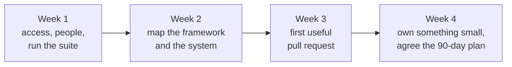
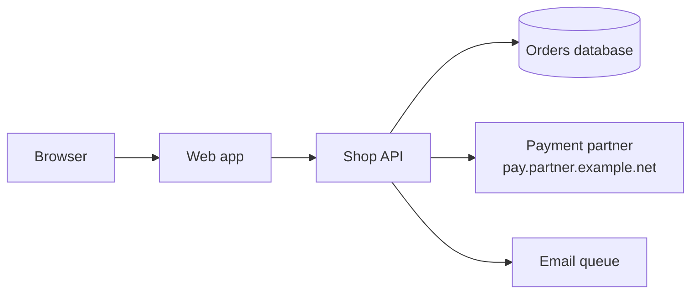

# Your First Weeks in a New SDET Job: Learn the Framework and Earn Trust, Step by Step

You join a team with a test suite someone else wrote: hundreds of tests, odd helper names, and a README that says "run the tests". Everyone is busy. In a month, people will expect you to fix and extend it. This guide turns that first month into a plan, with a script that maps an unknown test suite in seconds.

!!! example "The problem"
    **Your new lead, on day one:** "Here's the repo. Get comfortable with it, and let me know if you need anything."

## Step 1: See the shape of the first month



| Week | Goal | Proof you can show |
| --- | --- | --- |
| **1** | Everything works for you, and you know who's who | One test passes on your computer; the onboarding checklist is filled in |
| **2** | You understand how the tests are built and what they test | A one-page map of the framework and the system |
| **3** | You've made it a little better | A small pull request, reviewed and merged |
| **4** | Something is yours | You own a piece (the nightly triage, a flaky test, one area), and a 90-day plan is agreed |

The order matters: **understand, then change.** Rewriting things in week 1 is the most common mistake of new SDETs. The code may look odd for reasons nobody has told you yet.

## Step 2: Week 1: access, people and questions

You need **Python 3.13** for the scripts. Get the files from [Templates](#templates) below, or take the whole folder [from GitHub](https://github.com/myopensdet/myopensdet.github.io/tree/main/modules/professional_sdet/your_first_weeks/templates). The scripts use only Python's standard library.

Day 1 to 5 is about **access and people**. Missing access blocks you for days, so start the requests on day one. The onboarding checklist from [the SDET role](../../manual-testing/fundamentals/index.md) covers it:

??? note "Onboarding checklist (open to copy)"
    ```markdown
    --8<-- "modules/think_like_a_tester/the_sdet_role/templates/new_team_onboarding_checklist.md"
    ```

Then **ask questions**, to the right people, and write the answers down. A new person's questions are welcome for about a month; use that time. The kit's list:

```markdown
--8<-- "modules/professional_sdet/your_first_weeks/templates/first_weeks_kit/questions_to_ask.md"
```

## Step 3: Run it before you read it

Reading code you can't run is slow and you'll guess wrong. Make it run first. In the team's test repository, in a fresh virtual environment:

```bash
python -m pip install -r requirements.txt
python -m pytest --collect-only -q
```

`--collect-only` lists every test **without running any**. It's safe on day one: nothing is sent to any server. If something is missing, it fails here, early:

```text
conftest.py:7: in <module>
    from helpers.api import ApiClient
helpers/api.py:4: in <module>
    import requests
E   ModuleNotFoundError: No module named 'requests'
```

That's a missing package: the install step was skipped, or `requirements.txt` is incomplete. If it's incomplete, that's your first finding. When it works:

```text
tests/api/test_users.py::test_delete_user
tests/ui/test_checkout.py::test_checkout_with_card

11 tests collected in 0.00s
```

Then run **one** test, not all of them. Ask which test environment is safe to use, and which settings it needs (step 4 shows how to find them).

## Step 4: Map the framework

Now read it, with a map. `map_test_suite.py` reads the code (it doesn't run anything) and lists what you'd otherwise find over days. The kit has a small `sample_framework` folder, "written by someone else", to practise on:

```bash
python map_test_suite.py sample_framework
```

```text
== sample_framework: 7 Python files, 9 test functions

== Set-up files found
  pytest.ini, conftest.py, requirements.txt

== Tests per file
    5  tests/api/test_orders.py
    3  tests/api/test_users.py
    1  tests/ui/test_checkout.py

== Fixtures (name, scope, file)
  base_url               session   conftest.py
  api                    session   conftest.py
  admin_api              function  conftest.py

== Markers used
  smoke x2, skip x2, xfail x1, parametrize x1, slow x1

== Skipped or expected to fail
  skip    test_cancel_order (tests/api/test_orders.py): SHOP-301 flaky on staging
  xfail   test_refund (tests/api/test_orders.py): SHOP-288 refunds not built yet
  skip    test_delete_user (tests/api/test_users.py): NO REASON GIVEN

== Settings it reads (environment variables)
  ADMIN_TOKEN            in conftest.py
  API_TOKEN              in conftest.py
  BASE_URL               in conftest.py

== Fixed waits (often the cause of slow or flaky tests)
  helpers/api.py:15  time.sleep(5)
  tests/api/test_orders.py:18  time.sleep(3)
  tests/ui/test_checkout.py:11  page.wait_for_timeout(4000)

== Addresses in the code
  staging.shop.example.com x1
  pay.partner.example.net x1
```

How to read it:

| Part | What it tells you | What to do with it |
| --- | --- | --- |
| **Test functions** | 9 functions became 11 tests in step 3: `parametrize` runs one function several times | Where the effort went: here, mostly the API |
| **Fixtures** | `api` is made once per run (`session`), `admin_api` for every test | Open `conftest.py` first. Fixtures are the framework's foundation |
| **Markers** | `smoke` and `slow` sort tests into groups | Ask when each group runs. Check `pytest.ini` for what they mean |
| **Skipped** | Two skips with a ticket, one with **no reason** | Check the tickets are still open. The one with no reason is a question for the team |
| **Settings** | It needs `API_TOKEN`, `ADMIN_TOKEN`, `BASE_URL` | Ask where the test values are kept (a vault, the CI settings), never in chat |
| **Fixed waits** | 12 seconds of `sleep` in three places | Likely slow or flaky tests. A good first pull request (step 7) |
| **Addresses** | A partner's payment site is called directly | The system has a part you don't own. Ask about it (step 6) |

Run it on your team's suite: `python map_test_suite.py path/to/tests`. Then fill in the reading checklist:

```markdown
--8<-- "modules/professional_sdet/your_first_weeks/templates/first_weeks_kit/framework_reading_checklist.md"
```

## Step 5: Follow one test end to end

A map shows the parts. Following one test shows how they **work together**. Pick an important test, like `test_list_orders`, and follow it:

1. The test asks for the `api` fixture → `conftest.py` makes an `ApiClient` with `BASE_URL` and `API_TOKEN`.
2. `api.get("/api/orders")` → `helpers/api.py` sends the request, and if the answer is `503`, waits 5 seconds and tries once more.
3. The test checks the status is `200`.

Now you know three things nobody told you: where the address comes from, how login works, and that the client **hides a retry**. That retry could hide a real server problem: note it.

Then run that one test in the debugger with a breakpoint ([everyday tools, step 8](../../devops-for-qa/everyday-tools/index.md#step-8-debug-the-test-in-vs-code)), and make it fail once on purpose to see its message.

## Step 6: Map the system

Tests make sense when you know what they test. Draw the system on one page, with a developer, in 30 minutes. The addresses in the code (step 4) are clues: the sample suite calls a partner's payment site.



For each box, ask: who owns it, is there a test copy of it, and what happens to our tests when it's down? The payment partner is the classic answer to "why are the checkout tests red?": a part your team doesn't control.

## Step 7: Make your first useful pull request

Week 3. Pick something **small, safe and visible** from what you found. Good first changes:

| Change | Why it's a good first one |
| --- | --- |
| Write the "how to run" section of the README, from your notes in step 3 | Nobody else can see what was missing. You just lived it |
| Add a reason and a ticket to the skip with "NO REASON GIVEN" | Asks the team a useful question in a reviewable form |
| Replace one fixed wait with waiting for the real thing | Faster and less flaky tests. Measure the time before and after |
| Add the missing package to `requirements.txt` | Saves the next person the same error |

For the fixed wait in `test_new_order_shows_up`, waiting for what the test really needs looks like this:

```python
# Before: always 3 seconds, and still fails when the server needs 4
time.sleep(3)
assert api.get("/api/orders?sort=new").status_code == 200

# After: asks every half second, for up to 10 seconds, and moves on as soon as it's ready
deadline = time.monotonic() + 10
while (answer := api.get("/api/orders?sort=new")).status_code != 200:
    assert time.monotonic() < deadline, f"still {answer.status_code} after 10 s"
    time.sleep(0.5)
```

Keep the pull request **small** (one change), explain **why** in the description, and say how you checked it. A small, clean pull request in week 3 earns more trust than a big rewrite in week 8.

## Step 8: Earn trust and agree the 90-day plan

Trust comes from small promises kept:

- **Say what you'll do, then do it**, at stand-up. "I'll have the order tests reviewed by Thursday."
- **Report what you find with evidence**, not opinions: "these three waits add 12 seconds to every run", not "the framework is bad".
- **Own one thing** by week 4. The nightly triage ([a day in the life, step 3](../a-day-in-the-life/index.md#step-3-before-stand-up-read-the-nightly-run)) is a good one: everyone sees the value every morning.
- **Ask before you change shared things.** Fixtures and helpers are used by every test.

At the end of the month, write the 30-60-90 plan and agree it with your lead. Every goal has proof:

??? note "30-60-90 day plan (open to copy)"
    ```markdown
    --8<-- "modules/think_like_a_tester/the_sdet_role/templates/first_90_days_plan.md"
    ```

## Step 9: When it goes wrong

| You see | What it means | Fix |
| --- | --- | --- |
| `E   ModuleNotFoundError: No module named 'requests'` | A package isn't installed | `python -m pip install -r requirements.txt` in your virtual environment. If it's not in the file, add it: your first pull request |
| `Usage: python map_test_suite.py <folder with the tests>` | No folder given, or the folder doesn't exist | `python map_test_suite.py path/to/tests` |
| `Could not read tests/test_x.py: line 1 (not valid Python)` | That file doesn't parse; the map skips it | Check it's Python 3 code. Ask if the file is still used |
| Access requests take a week | Normal in big companies | Start them all on day 1. Pair with a colleague who has access meanwhile |
| Nobody has time for your questions | Everyone is busy | Collect questions and ask in one 30-minute slot. Ask in the team channel, so the answer helps the next person too |
| You want to rewrite the framework | It looks old or odd | Write your ideas down, and wait until week 6. Then propose **one** change with numbers (time saved, flaky tests fixed) |
| The tests are red and everyone ignores it | Old failures nobody owns | Don't fix all of them. Sort them first ([morning triage](../a-day-in-the-life/index.md#step-3-before-stand-up-read-the-nightly-run)), then offer to own the list |

## Templates

**Every file is below, ready to copy.** The whole folder is also [on GitHub](https://github.com/myopensdet/myopensdet.github.io/tree/main/modules/professional_sdet/your_first_weeks/templates).

=== "map_test_suite.py"

    ```python
    --8<-- "modules/professional_sdet/your_first_weeks/templates/first_weeks_kit/map_test_suite.py"
    ```

=== "sample_framework/conftest.py"

    ```python
    --8<-- "modules/professional_sdet/your_first_weeks/templates/first_weeks_kit/sample_framework/conftest.py"
    ```

=== "sample_framework/helpers/api.py"

    ```python
    --8<-- "modules/professional_sdet/your_first_weeks/templates/first_weeks_kit/sample_framework/helpers/api.py"
    ```

## References

- [pytest: how to invoke pytest (`--collect-only`, `--durations`)](https://docs.pytest.org/en/stable/how-to/usage.html)
- [pytest: fixtures](https://docs.pytest.org/en/stable/how-to/fixtures.html)
- [pytest: skip and xfail](https://docs.pytest.org/en/stable/how-to/skipping.html)
- [Python: ast module](https://docs.python.org/3/library/ast.html)
- [The C4 model: diagrams of a software system](https://c4model.com/)

Written for Python 3.13 and pytest 9.2. Outputs captured November 2026. Links checked: November 2026.
