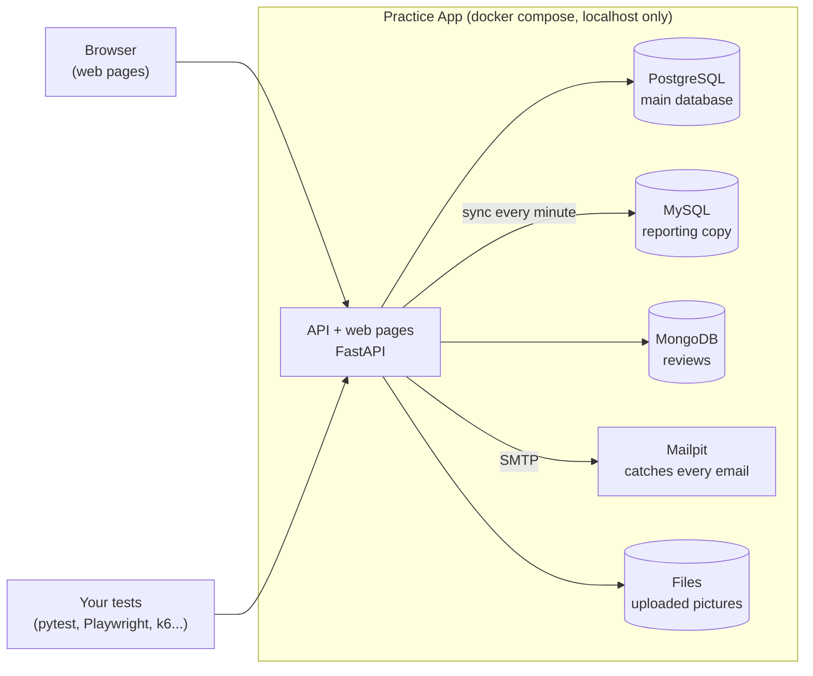
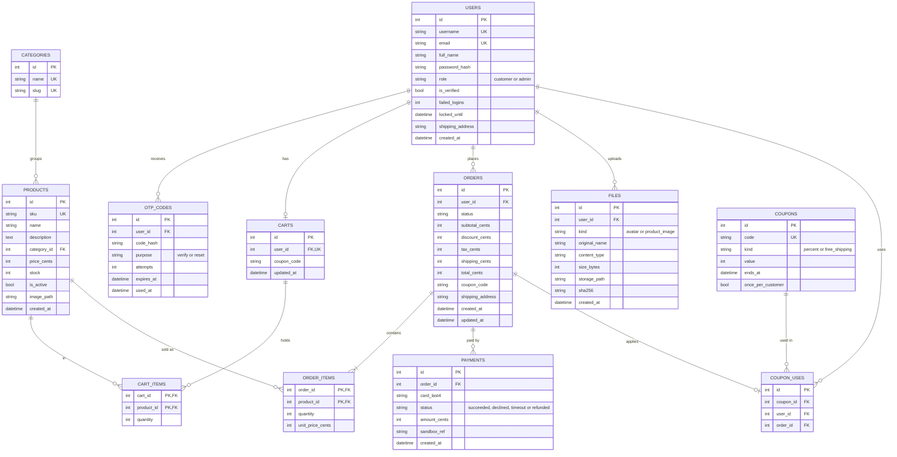

# Practice App: design

The Practice App is **Bookshelf**, a small online shop that sells books and a few
study gadgets. Every lesson on myOpenSDET tests this same app, so the lessons
connect: the API lesson creates an order, the database lesson checks it was saved,
the BDD lesson describes checkout in Gherkin, the performance lesson puts it under
load.

This page is the plan for building it (Phase 1.5). It is written for contributors.
Readers meet the app on the website, in **Start Here → Practice App tour**.

> [!IMPORTANT]
> The app is for practice on your own computer only. It has bugs **on purpose**.
> Every service listens on `localhost` only. Never deploy it to the internet.

## 1. Who uses it

| Role | Example user | Can do |
| --- | --- | --- |
| Visitor | (not logged in) | Browse and search products, read reviews, sign up |
| Customer | `arshad` (Arshad), plus Faker customers such as Maria and Kenji | Everything a visitor can, plus cart, checkout, own orders, own profile, reviews, files |
| Admin | `admin` | Manage products and stock, see all orders, change order status, run the reporting sync, reset data |

Seeded logins (clearly fake, local only, also listed in `.env.example`):

| Username | Email | Password | Role |
| --- | --- | --- | --- |
| `arshad` | `arshad@example.com` | `Test@1234` | customer |
| `maria` | `maria@example.com` | `Test@1234` | customer |
| `admin` | `admin@example.com` | `local_only_password` | admin |

## 2. Features (v1.0)

Written as user stories with acceptance criteria, because later lessons use them
as real requirements to design tests from.

### Accounts

- **Sign up.** As a visitor I can create an account with email, username, full
  name and password.
  - Email must be unique and valid; username 3 to 20 letters, digits or `_`.
  - Password at least 8 characters with a letter and a digit.
  - A 6-digit **OTP** is emailed (Mailpit). The account is unverified until the
    code is entered. A code lasts 10 minutes and works once. Five wrong tries
    burn it. A new code (`resend-code`) replaces the old one.
- **Log in.** I get a **bearer token** (JWT, 30 minutes) for the API, or a
  session cookie on the web page. Five wrong passwords in a row lock the account
  for 15 minutes.
- **Forgot password.** An OTP by email lets me set a new password.
- **Profile.** I can see and change my name and shipping address, and upload
  a profile picture (JPEG or PNG, up to 2 MB).

### Catalog

- **Products.** Each has a SKU, name, description, category, price, stock and
  an active flag. Inactive products are hidden from customers.
- **Search and filter.** Search by text in name and description; filter by
  category and price range; sort by price, name or newest; paginate
  (`page`, `size`, at most 50 per page).
- **Reviews.** A customer who bought a product can rate it 1 to 5 and write up
  to 500 characters. One review per product per customer.

### Shopping

- **Cart.** Add, change quantity, remove. Quantity 1 to 10 per line. You
  cannot add more than the stock. The cart total is shown with tax (10%) and
  shipping (free when the total after discount is 50.00 or more, otherwise 4.99).
  Percentages round half up to the nearest cent.
- **Coupons.** `WELCOME10` gives 10% off once per customer; `FREESHIP` removes
  the shipping cost. `SPRING25` has already ended (for expiry tests). Coupons
  have an end date. One coupon per cart.
- **Checkout.** Needs a shipping address and a payment. Payment is a **fake
  sandbox**: card `4242 4242 4242 4242` succeeds, `4000 0000 0000 0002` is
  declined, `4000 0000 0000 9995` times out. Stock goes down only when payment
  succeeds. A confirmation email is sent. A declined or timed-out payment leaves
  the order `pending` and the cart and stock unchanged.
- **Orders.** I see my own orders, newest first, with status `pending`, `paid`,
  `shipped`, `delivered` or `cancelled`. I can cancel while `paid` and not yet
  shipped. I can download an **invoice PDF**.

### Admin

- Create, edit and deactivate products; change stock; upload a product image.
- See every order; move an order to `shipped` or `delivered`.
- **Reporting sync:** copy orders into the MySQL reporting database (also runs
  by itself every minute).
- **Reset:** put every database back to the original seed data (admin page,
  `POST /api/admin/reset`, or the command `python -m bookshelf reset`).

### For testers (built in on purpose)

- **API docs** at `/docs` (Swagger UI) and `/openapi.json`.
- **Health page** at `/status` (and `/api/health` as JSON): the API, the main,
  reporting and reviews databases, and Mailpit each show up or down.
- **Version** at `/api/version` and in the page footer. Each lesson names the
  app version it was written for.
- **Stable test hooks:** every button, field and message on the web page has a
  `data-testid`, so UI tests do not depend on layout.
- **Clock control** (admin, local only): set a fake "now", for lessons on time
  zones, OTP expiry and coupon end dates.
- **Request IDs** in every response header (`X-Request-ID`) and in the logs.

## 3. Architecture



| Part | Choice | Why |
| --- | --- | --- |
| API and web pages | Python 3.13, FastAPI, Pydantic, SQLAlchemy, Jinja2 templates | One language for the whole site; automatic API docs; plain HTML pages that are easy to automate |
| Main database | PostgreSQL 17 | The most common choice in job ads |
| Reporting copy | MySQL 8.4 | Multi-database lessons: compare the same order in two databases |
| Reviews | MongoDB 8 | Multi-database lessons: a document database next to SQL ones |
| No-Docker mode | SQLite | Beginners can start the API with one Python command before they learn Docker |
| Email | Mailpit | Catches every email; has its own API, so tests can read the OTP |
| Start | `docker compose up -d` | One command on macOS, Windows and Linux. The app image runs as a normal user, never root |
| Online | GitHub Codespaces (`.devcontainer/`) | Each learner gets a private copy; nothing to install. Never shared public hosting |

Host ports avoid the usual defaults, so the app never clashes with a database
you already run: API `8080`, Mailpit `58025`, PostgreSQL `55432`, MySQL `53306`,
MongoDB `57017`, and SMTP `51025` (the app sends email to Mailpit there).
Everything binds to `127.0.0.1`. Images are pinned to an exact version and
digest: PostgreSQL 17.12, MySQL 8.4.13, MongoDB 8.0.38, Mailpit 1.33.1.

### Email

With `SMTP_HOST` set (Docker mode), every email goes to Mailpit. Nothing reaches
a real inbox. Read the emails at <http://127.0.0.1:58025>, or let a test read
them with Mailpit's API (`GET /api/v1/messages`, `GET /api/v1/search?query=to:...`).
Mailpit keeps the emails in memory only. Without `SMTP_HOST`, every email is
printed in the terminal and saved as a text file in `data/outbox/`. A failed
send is logged and never breaks the request: the user can ask for a new code.

### Files

- **Uploads** (profile pictures and product images): JPEG or PNG only, up to
  2 MB and 25 million pixels. The app opens each file with Pillow and refuses
  anything that is not a real picture, whatever its name or content type says.
  It saves a clean copy (turned upright, with no hidden metadata such as GPS
  location) under a random name in `data/files/`. The uploaded name is stored
  only as text. A new picture replaces the old one; reset deletes them all.
- **Who sees what:** product images are public (hidden products: admins only).
  A profile picture is visible to its owner and admins only.
- **Invoices** are made on request from the order (fpdf2), never stored. Only
  orders that were paid have one; a `pending` order answers 409
  `INVOICE_NOT_AVAILABLE`.

## 4. Data model

### PostgreSQL (main) and SQLite (no-Docker mode)



In SQLite mode (no Docker) the reviews live in a `reviews` table instead of MongoDB.

**Seed data:** fixed rows that lessons rely on (3 users, 3 categories, 13
products, 3 coupons, 2 delivered orders), plus 40 Faker customers with about 65
orders and 20 reviews. Faker and the random choices use a fixed seed, so the data
is the same on every computer. Seeded orders are history: they do not change stock.

Money is stored as whole **cents** (`price_cents = 1299` means 12.99), so sums
never have rounding errors. Times are stored in **UTC** and shown in the
browser's time zone.

### MySQL (reporting copy)

| Table | Columns | Filled by |
| --- | --- | --- |
| `order_facts` | `order_id`, `customer_email`, `status`, `item_count`, `total_cents`, `created_at`, `synced_at` | Reporting sync (every minute, or on demand) |
| `daily_sales` | `sales_date`, `orders_count`, `revenue_cents` (paid, shipped and delivered orders only) | Reporting sync |

Each sync rebuilds both tables in one transaction, so a reader never sees half a
sync. Between syncs the copy is behind the main database: tests must sync or wait.
Without Docker, the reporting copy is a second SQLite file.

### MongoDB (reviews)

```json
{
  "_id": "ObjectId",
  "product_id": 12,
  "user_id": 1,
  "username": "arshad",
  "rating": 5,
  "text": "Clear examples, easy to follow.",
  "created_at": "2026-11-15T10:00:00Z"
}
```

## 5. API (v1.0)

All under `/api`. JSON in and out. Errors always look like
`{"error": {"code": "OUT_OF_STOCK", "message": "...", "request_id": "..."}}`.

| Area | Endpoints |
| --- | --- |
| Auth | `POST /auth/signup`, `POST /auth/verify`, `POST /auth/resend-code`, `POST /auth/login`, `POST /auth/forgot-password`, `POST /auth/reset-password`, `GET /auth/me` |
| Users | `GET /users/me`, `PATCH /users/me`, `POST /users/me/avatar`, `DELETE /users/me/avatar`, `GET /users/{id}/avatar` (owner or admin), `GET /users` (admin) |
| Products | `GET /products` (search, filter, sort, page), `GET /products/{id}`, `POST /products`, `PATCH /products/{id}`, `DELETE /products/{id}` (admin, soft delete), `POST /products/{id}/image` (admin), `GET /products/{id}/image` |
| Categories | `GET /categories` |
| Reviews | `GET /products/{id}/reviews`, `POST /products/{id}/reviews` |
| Cart | `GET /cart`, `POST /cart/items`, `PATCH /cart/items/{product_id}`, `DELETE /cart/items/{product_id}`, `POST /cart/coupon`, `DELETE /cart/coupon` |
| Checkout and orders | `POST /checkout`, `GET /orders`, `GET /orders/{id}`, `POST /orders/{id}/cancel`, `GET /orders/{id}/invoice.pdf` |
| Admin | `GET /admin/orders`, `PATCH /admin/orders/{id}`, `POST /admin/reporting/sync`, `POST /admin/reset`, `GET /admin/clock`, `POST /admin/clock` |
| Tester tools | `GET /health`, `GET /version` |

## 6. Web pages (v1.0)

| Page | Address | What it shows |
| --- | --- | --- |
| Home and product list | `/` | Search box, filters, product cards, pagination |
| Product | `/products/{id}` | Details, stock, add to cart, reviews |
| Sign up, verify, log in | `/signup`, `/verify`, `/login` | Forms with clear error messages |
| Cart | `/cart` | Lines, quantities, coupon, totals |
| Checkout | `/checkout` | Address, card, place order |
| My orders | `/orders`, `/orders/{id}` | Status, cancel, invoice download |
| Profile | `/profile` | Name, address, profile picture |
| Admin | `/admin` | Products, stock, orders, reset |
| Status | `/status` | Every service up or down, app version |

### How the web pages work

- Server-made HTML pages with plain forms, built on the same functions as the
  API, so both always follow the same rules. Prices are shown in dollars (`$12.99`).
- Logging in on the web sets a cookie (`bookshelf_session`): HttpOnly,
  SameSite=Lax, Secure on https. It lasts as long as an API token (30 minutes).
- Every form carries a CSRF token, so another site cannot post forms as you.
- Strict security headers: Content-Security-Policy (only the app's own files),
  no framing, no outside scripts or fonts (works offline).
- Errors show next to the field they belong to; card numbers and passwords are
  never shown back.
- **Test IDs:** every link, button, field, form and message has a `data-testid`
  in kebab-case: `<thing>-input`, `<thing>-button`, `<thing>-error`, `product-card`,
  `cart-line`, `flash-message`, `page-title`. Lists also carry the record id
  (`data-product-id`, `data-order-id`). A test fails if any element misses one.

## 7. Planted bugs

About 30 bugs are planted on purpose across the API, database, web page,
security and performance: a starter set in step 1.5.7, the rest added with the
topics that use them (lessons come first, see the brief section 6). They are **not** listed here or anywhere
in the app's code comments, so Bug Hunts stay fair: the code only marks each
one with its answer code (`bugs.on("BH-01")`). The answers live in one place,
`practice-app/BUG_HUNT_ANSWERS.md`, and on the Practice App tour page, folded by
default. A switch, `PRACTICE_APP_BUGS=off`, turns every planted bug off, so
lessons can show what correct behavior looks like. The app's own tests run with
the bugs off; `tests/test_planted_bugs.py` checks each bug both ways.

## 8. Safety rules

- Fake data only: Faker names, `@example.com` emails, sandbox cards.
- Passwords and secrets come from `.env` (never committed); `.env.example` has
  clearly fake values like `local_only_password`.
- Every service binds to `127.0.0.1`; nothing is reachable from other computers.
- The app refuses to start on any other address while it still uses the fake
  values from `.env.example`. In Docker it listens on `0.0.0.0` inside its
  container, but its port is published on `127.0.0.1` only
  (`CONTAINER_PORT_IS_LOCAL_ONLY=yes` says so).
- The app's container runs as a normal user, never root. `.env` and `data/` never
  go into the image (`.dockerignore`).
- Codespaces ports are private by default; learners are told never to make them public.
- Security lessons attack only this app on your own computer.
- Images are pinned to exact versions; Python packages are pinned with hashes.

## 9. Versions: what each later lesson adds

Lessons name the app version they use, so adding features never breaks an older
lesson. Version 1.0 is built in Phase 1.5; later versions are added in the
phase that first needs them.

| Version | Adds | Needed by |
| --- | --- | --- |
| 1.0 | Everything above | Phases 2 to 5 |
| 1.1 | Structured JSON logs, `/metrics`, slow and flaky endpoints you can switch on | Observability, flaky tests, performance |
| 1.2 | GraphQL endpoint (`/graphql`) for products and orders | GraphQL testing |
| 1.3 | WebSocket for live order status; a small gRPC stock service | gRPC and WebSocket testing |
| 1.4 | Order events on a message queue; a separate notification service | Message queues, testing microservices, contract testing |
| 1.5 | AI helpers for Pillar 6 (with a fake model by default) | AI-Powered QA |

## 10. Folder layout

```text
practice-app/
├── README.md              # how to start, reset and stop it
├── DESIGN.md              # this page
├── docker-compose.yml     # the app, three databases and Mailpit
├── Dockerfile             # the app's image (pinned base, packages checked by hash)
├── .env.example
├── requirements.in/.txt   # the app's Python packages (pinned with hashes)
├── bookshelf/             # the FastAPI app: api/ (one file per area), web/, templates/, static/,
│                          # models, seed (Faker), guard, `python -m bookshelf [reset]`
└── tests/                 # the app's own tests (separate from lesson templates)
```
